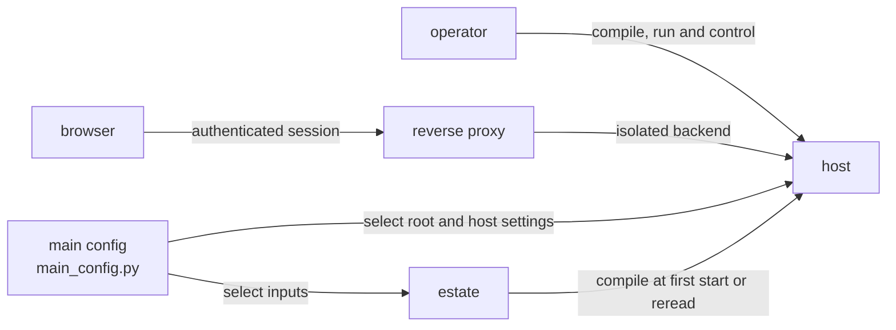
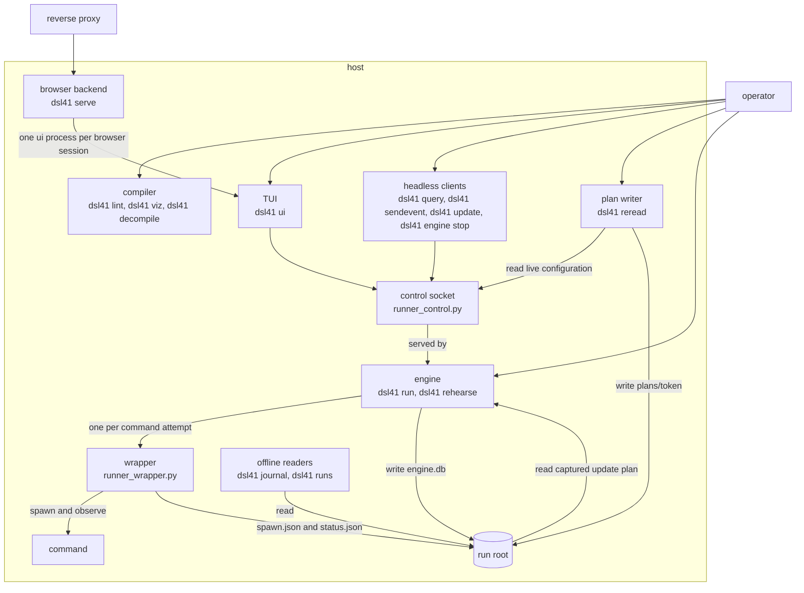
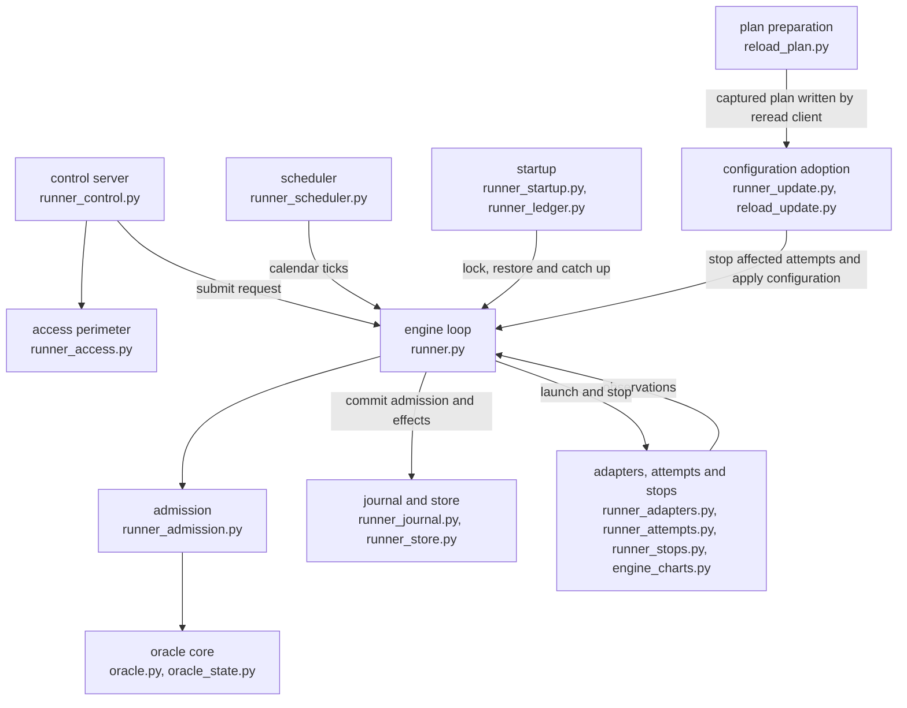
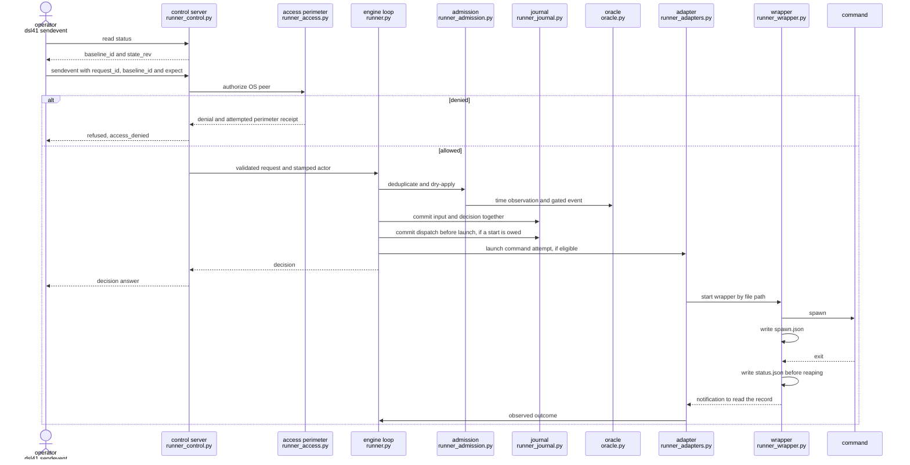

# Architecture overview

For the architect tracing the built v2 engine from an estate to a durable
decision and a job attempt. Continue through the [architect track](../README.md#documents)
and the [glossary](glossary.md). Rules belong to the linked contracts.
Deployment commands and service configuration belong to [deploy](deploy.md).

## 1. Built and specified only

The engine executes one estate on one host. The oracle owns AutoSys semantics.
The compiler also produces findings, graphs and Python DSL source without
running the estate. [DL-424](decision-log.md) sets the product boundary.

| Part | Built surface | Authority |
| --- | --- | --- |
| Compiler | `dsl41 lint`, `dsl41 viz`, `dsl41 equiv`, `dsl41 decompile`, `dsl41 build` | [IR pipeline](ir-design.md#1-pipeline--representations) |
| Main config | `/etc/dsl41/dsl41.toml`, `dsl41 run --config PATH` | [Control §2](control-protocol.md#2-transport-and-framing-frozen); DL-437 |
| Engine | `dsl41 run`, `dsl41 rehearse` | [Runner duties](runner-design.md#1-mission-and-scope) |
| Store and restart | SQLite `engine.db`, snapshots and automatic resume | [Runner recovery](runner-design.md#7-journal-and-recovery-e1-prod-grade); DL-428, DL-433 |
| Command execution | Engine-owned wrapper per attempt | [Wrapper contract](wrapper-protocol.md) |
| Control and access | Unix socket, queries, mutations and subscriptions | [Control](control-protocol.md); [access](access-model.md) |
| Terminal and browser UI | `dsl41 ui`, `dsl41 run --ui`, `dsl41 serve` | [Runner UI](runner-design.md#11-ui--one-textual-app-terminal-and-web-e3) |
| Configuration adoption | `dsl41 reread`, `dsl41 update` | [Control commands](control-protocol.md#2-transport-and-framing-frozen) |

The decompiler pattern combinators (`--patterns`) have no CLI option;
see [the compiler boundary](../README.md#what-is-not-built).
Supervisor, detached mode, remote relay, shared multihost store, follower
mode, `standby check` and the multi-executor rig resolve to
[DL-424](decision-log.md); the follower proposal is indexed by DL-230.
The HTTP/WebSocket proposal resolves through [gateway](gateway.md) and DL-273.
The web proxy supplies authentication; dsl41 supplies none.

## 2. Context

`dsl41 run` and `dsl41 reread` default to the main config at
`/etc/dsl41/dsl41.toml`; an absolute `--config` selects another file.
It selects the run root, host settings, JIL or Python DSL inputs through
include globs, properties, interpretation settings and lint policy.
[Control §2](control-protocol.md#2-transport-and-framing-frozen) and
[DL-437](decision-log.md) define this input selection.
The compiler loads a `CatalogIR`; the runner executes that catalog locally.
IR-G is derived for analysis and visualization, not persisted engine state.

This shows the host's users and inputs; it leaves out the processes inside the host.

The [IR pipeline](ir-design.md#1-pipeline--representations) defines the
representations. [Runner §2](runner-design.md#2-position-in-the-pipeline)
defines what execution consumes. Service wiring belongs to [deploy](deploy.md).

## 3. Containers

One engine process holds `leader.lock` for one run root. It owns the store,
the oracle and `control.sock`. The engine starts each command wrapper by
file path. The wrapper starts and observes the command.

This shows process ownership and durable writers; it leaves out scheduler and oracle internals.

`dsl41 run --ui` attaches the TUI through the socket and makes its terminal
own the run. Quitting a separately attached `dsl41 ui` detaches the viewer.
`dsl41 serve --socket PATH` starts a UI process per browser session.
Its default host is `127.0.0.1`; loopback alone is not an access boundary
on a shared host. [Access §9](access-model.md#9-the-web-tier) requires
backend isolation and describes tier service accounts and log grants.

`engine.db` holds the journal, configuration history, snapshots and store
identity. Command spools use `runs/<job>.<run_number>/<ordinal>/`.
`spawn.json` and `status.json` are wrapper evidence, not another engine
journal. See [wrapper spool](wrapper-protocol.md#3-spool-format-frozen)
and [DL-428](decision-log.md).
The run root also holds `engine.toml`, `plans/`, logs and, with access
control, `perimeter.jsonl`. [Deploy](deploy.md) owns the service and filesystem layout.
`dsl41 reread` writes `plans/<token>/`; `dsl41 update` asks the engine to
read and apply that captured plan.
Period, segment-file, seal and lineage identities resolve to [DL-424](decision-log.md).

## 4. Engine components

The oracle is the semantics core. The shell adds clocks, effects, durability
and the control surface. One asyncio loop owns oracle mutation.

This shows module responsibilities around the single writer; it leaves out individual chart transitions.

| Owner | Responsibility | Contract |
| --- | --- | --- |
| Admission | Deduplicate, stamp time, check revisions and decide inputs | [Control §3](control-protocol.md#3-mutating-verb-sendevent) |
| Scheduler | Turn calendar occurrences into inputs; skip and report downtime ticks | [Runner §5](runner-design.md#5-scheduler--the-calendar-the-oracle-deliberately-lacks) |
| Journal and store | Commit input and decision together; commit dispatch before launch | [DL-428](decision-log.md); [runner recovery](runner-design.md#7-journal-and-recovery-e1-prod-grade) |
| Attempts and adapters | Observe CMD outcomes, apply interruption plans and poll FW evidence | [DL-433](decision-log.md); [wrapper](wrapper-protocol.md) |
| Startup | Refuse incompatible roots, restore state, catch up through the loop | [DL-433](decision-log.md) |
| Update | Apply a reread token against the configuration revision it names | [Control §2](control-protocol.md#2-transport-and-framing-frozen) |
| Access perimeter | Authenticate socket peers, enforce tiers and record access receipts | [Access §5](access-model.md#5-the-enforcement-point) |

[The machine registry](../src/dsl41/machines.py) names JOB, QUEUE_SCAN,
RUNTIME_ASSEMBLY, ADMISSION, SUBSCRIPTION, ENGINE_LIFECYCLE, ATTEMPT and UPDATE.
Their transitions belong to the generated [machine reference](state-machines.md)
and [lifecycle views](chart-lifecycles.md).

A main-config restart resumes the last applied revision from the store and
does not re-read sources. Host settings come from the main config at restart
([DL-437](decision-log.md)). An existing `engine.db` selects automatic
resume; `--resume` is accepted and ignored. Restart restores the snapshot
and tail, then the live loop observes open attempts and executes owed plans before releasing deferred starts.
Before catch-up, restart scans the root's cookies once and TERMs what it
finds of interrupted attempts; the loop runs their grace and KILL cleanup
(DL-433, DL-436). It does not wait for a previous wrapper.
Interrupted idempotent work gets a new attempt of the same run and invocation. Named non-idempotent jobs are
held with failure evidence. Application failure is not retried.
[DL-424 and DL-433](decision-log.md) rule these distinctions.

Where runner §7's record list differs, DL-428 and DL-433 govern the store
and restart rules.

With an access map, the perimeter stamps the OS principal and enforces
read, ops and adm. `engine_stop` and `update` require adm; socket authority
does not grant filesystem authority. [Access §§1–2](access-model.md#1-the-model)
owns the tiers. SIGHUP reloads the map contents; an answering socket proves
handlers are armed ([access §7](access-model.md#7-reload-and-revocation); DL-275).
Leadership fences, epochs and seal fail-stop resolve to [DL-424](decision-log.md);
DL-274 is the seal fail-stop reference.

## 5. One control input, end to end

For example, `dsl41 sendevent FORCE_STARTJOB --job DEMO_C --socket /srv/dsl41/run/control.sock`
requests a start of an existing command job. With access control armed,
the socket first authenticates and authorizes the peer.

This shows a start request and an access-denial branch; it leaves out retry, precondition and interruption branches.

The CLI reads the baseline and revision unless the caller pins them.
An exact retained retry returns its decision without another admission.
A lost answer requires the original request id and envelope, within the
store's retention window. An unchanged baseline proves no retry lifetime.
[Control §3](control-protocol.md#3-mutating-verb-sendevent) owns those rules
and the distinction between refused, rejected, applied and unknown.
Every `ok: false` answer carries a stable code (DL-272).
The answer is the engine's decision; it does not certify that a command
started or completed. The wrapper record supplies the observed outcome.

## 6. The runnable example: `examples/fulfilment`

The synthetic warehouse example uses the real engine, PostgreSQL and a
local HTTP carrier service. Its [README](../examples/fulfilment/README.md)
owns the commands, prerequisites and assertions.

| Part | Example mapping |
| --- | --- |
| Estate | `estate.jil` and properties produced by `demo.py` |
| Engine | `demo.py` starts `dsl41 run` with a run root and UTC timezone |
| Wrapper and command | One wrapper per command attempt runs `worker.py` |
| Control socket | The demo starts the box, polls status and requests the recovery job |
| Run root | `<run>/engine`, containing `engine.db`, spools and logs |
| Offline reader | `dsl41 runs --format json` supplies rows checked against worker evidence |

The example demonstrates application recovery, not detached process survival.
Supervisor ownership resolves to [DL-424](decision-log.md).

## 7. Where to read next

- Vocabulary: [glossary](glossary.md).
- Component cards: [block index](blocks/README.md); rules remain in the contracts.
- Runner design: [runner-design](runner-design.md).
- Contracts: [wrapper](wrapper-protocol.md), [control](control-protocol.md),
  [protocol evolution](protocol-evolution.md), [access](access-model.md),
  [statechart engine](statechart-engine.md).
- Operations: [deploy](deploy.md) and [incident triage](incident-triage.md).
- Evidence scope: [CLI/TUI qualification](cli-tui-qualification.md) and
  [simulation coverage](simulation-coverage.md); [risk-map](risk-map.md) routes existing references.
- Decisions: [decision index](decision-index.md).

`supervisor-protocol.md`, `concurrency-model.md` and `period-model.md`
resolve to [DL-424](decision-log.md); `deployment-runbook.md` resolves to [deploy](deploy.md).
