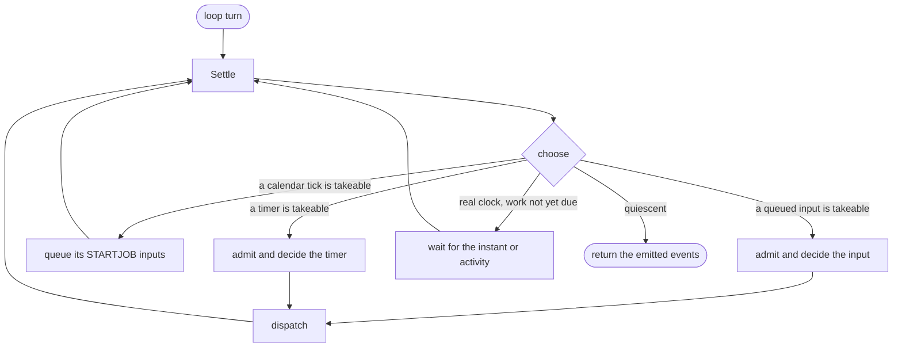

# Engine loop: the work choice

## Purpose

One asyncio task owns the oracle and runs the engine loop.
Each turn of the loop makes one choice: take a queued input, take a calendar tick, fire a timer, wait, or return.
`Engine._next_work` makes the choice and `Engine.run_until_quiescent` carries it out.
The choice decides order only; what an input does is the [admission](admission.md) block's work.

## Fate

The code and the contract carry over unchanged if the storage changes.
Storage capabilities needed: none.
Reason: `_next_work` reads the in-memory input queue, `oracle.next_timer_due()`, `scheduler.next_occurrence()` and the clock, and returns a `_Work` value; it writes nothing.
Every durable write happens after the choice, in admission or dispatch.

## Interface

- `Engine._next_work(horizon, now) -> _Work`. `_Work.do` is one of the five `_Do` names: `EVENT`, `TICK`, `TIMER`, `QUIESCE`, `WAIT`. `_Work.at` is the tick, the timer's stamp or the wake target.
- `Engine.run_until_quiescent(horizon) -> list[Event]` runs the loop and returns the events the oracle emitted.
- The queue is a heap of `_Pending` inputs ordered by `(at, arrival number)`. These fill it: `Engine.inject`, `Engine.submit`, scheduler ticks, adapter completions and reconciliation injections at resume (`_inject_completion`).
- `Engine._push` puts one input on the queue and wakes the loop.
- `EVENT` and `TIMER` go through `Engine._admit_and_apply`, which ends in `Engine._dispatch`: each start writes its `dispatch` record and launches, and each kill cancels the live run.
- `TICK` waits for the tick and queues its `STARTJOB` inputs.
- `WAIT` blocks until the target instant or queue activity, then the loop chooses again.
- Two clock domains: a virtual clock jumps; a real clock sleeps and wakes early on activity.

## States

The work choice is a policy, not a declared machine; [the policies](policies.md#work-choice) say why.
The flowchart shows one turn of the loop:

## Invariants

- One task owns the oracle, and nothing else writes it ([runner-design §4](../runner-design.md#4-engine-loop--single-writer)).
- A timer firing and a calendar tick are inputs. Each takes the one admission order (concurrency-model §4 (`concurrency-model.md`, retired in 2.0.0); ticks: [DL-45](../decision-log.md) item 2, narrowed by [DL-284](../decision-log.md)).
- The choice is one decision with a fixed priority: input, then tick, then timer. The truth table lives in the `_next_work` docstring; [DL-145](../decision-log.md) keeps its branch count as the domain's.
- A tick pops before any later-due event and any same-or-later-due timer. A queued input stamped at the tick's instant goes first ([DL-45](../decision-log.md) item 2, narrowed by [DL-284](../decision-log.md); `test_dl137_a_tick_and_an_input_stamped_alike_feed_the_input_first`).
- On a real clock the loop commits to work only once its instant is due. An earlier instant is waited out, and an input that arrives during the wait makes the loop choose again ([DL-45](../decision-log.md) item 1).
- On a real clock a timer due strictly before a due queued input fires first, as its own input ([DL-232](../decision-log.md); concurrency-model §0 (`concurrency-model.md`, retired in 2.0.0)).
- Every admitted input ends in a dispatch pass ([DL-234](../decision-log.md)).
- Work at one clock instant has a budget. The floor is `INSTANT_BUDGET_FLOOR` ([DL-211](../decision-log.md)).

## Failure and recovery

- An adapter task that died with an exception is re-raised by `Engine._settle`, and the engine stops. Resume rebuilds the estate from the log (period-model §11 (`period-model.md`, retired in 2.0.0)).
- A condition cycle that makes no progress at one instant raises `ZeroDelayCycleError` with the instant and the jobs it started ([DL-184](../decision-log.md)).
- A crash anywhere in the loop loses no choice: the choice is not durable. Resume replays the log and the new loop chooses afresh (period-model §11 (`period-model.md`, retired in 2.0.0) steps 6 to 8).
- A real-clock adapter completion lands inside the horizon while the only known timer lies past it: the loop waits out the horizon instead of returning ([DL-45](../decision-log.md) item 12).

## Owning modules

- `src/dsl41/runner.py`: `Engine._next_work`, `Engine.run_until_quiescent`, `Engine._push`, `_Do`, `_Work`.
- Inputs to the choice come from `src/dsl41/runner_clock.py` (the clock) and `src/dsl41/runner_scheduler.py` (the ticks).

## Tests

- `test_dl137_row_e_a_queued_input_alone_is_the_event_row`
- `test_dl137_row_et_a_queued_input_wins_over_a_timer_due_inside_the_horizon`
- `test_dl137_row_s_a_calendar_tick_alone_is_the_tick_row`
- `test_dl137_row_st_a_calendar_tick_wins_over_a_timer_due_later`
- `test_dl137_a_tick_and_an_input_stamped_alike_feed_the_input_first`
- `test_dl137_row_none_the_real_domain_waits_for_an_input_not_yet_due`
- `test_dl137_row_none_the_real_domain_returns_when_all_work_is_beyond_the_horizon`
- `test_dl137_row_none_hold_open_waits_past_the_horizon_with_no_instant_known`
- `test_fast_real_completion_processed_before_a_far_later_term_run_time_timer`
- `test_a_deadline_due_before_a_late_decision_still_invalidates_a_stale_command`
- `test_a_timer_due_before_the_last_admitted_instant_is_stamped_at_that_instant`
- `test_horizon_discipline_time_only_moves_forward_across_calls`
- `test_zero_delay_cycle_raises_engine_error_instead_of_livelocking`

## Open findings

The [risk map](../risk-map.md) row "Engine work choice" lists no open finding.

## Gaps found

None.
