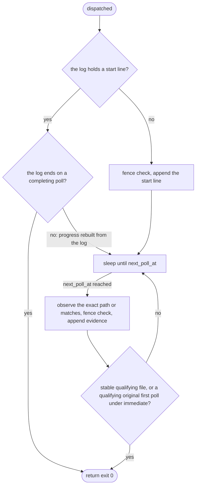

# FW observation

## Purpose

The FW adapter watches an exact path or final-component `*` or `?` pattern for one run.
It completes with exit 0 when any one matching file meets the minimum size and stability rule.
Exact paths use size-only stability unless the run has sampled evidence (DL-467).
Wildcards and sampled runs use unchanged device, inode, size, mtime_ns and ctime_ns
per pathname and file identity (DL-461, DL-467).
Bourne hidden-file rules apply; `.` and `..` never match. Directory wildcards and recursion
are unsupported. A non-UTF-8 match is ignored with one warning per name per watch run.
The warning is given again after an engine restart resumes the watch.
Its progress is evidence in an append-only log that restart and offline readers share.
An FW run is a watch inside the engine, not a process.
Its contract is [runner-design §6](../runner-design.md#6-adapters), with the PR-34 evidence rules retained by [DL-129](../decision-log.md) and [DL-424](../decision-log.md), and the completion rule in DL-258.

## Fate

The watch log is a run-directory file, separate from the store.
`FileWatcherAdapter.run` re-proves the run root's lock before every `watch.jsonl` append; the check and append are separate steps.
The engine commits a `dispatch` binding the watch's `run_id` before launching it ([DL-425](../decision-log.md)).
The completion reaches the store through the engine's outcome and admission paths ([runner-design §7](../runner-design.md#7-journal-and-recovery-e1-prod-grade)).

## Interface

- `FileWatcherAdapter(default_interval_s=..., existence=...)` and its `run(job_ir, run_number, ctx)`, which returns 0.
- Job inputs: `watch_file`, `watch_interval` and `watch_file_min_size`. Estate inputs: the [runtime profile](../glossary.md#runtime-profile)'s `fw_default_interval_us` and the `fw-existence` switch (DL-258). `wire_from_profile` in `src/dsl41/runner_startup.py` builds the adapter from both.
- Context: `ctx.clock`, `ctx.run_root`, `ctx.run_id`, `ctx.spool` and `ctx.fence`, filled by `Engine._run_adapter` in `src/dsl41/runner.py`.
- Spool: `runs/<job>.<run_number>/watch.jsonl`, one `start` line, then scalar `poll` or wildcard `sample` lines with plain paths and five metadata fields (DL-129, DL-461).
  A run with samples keeps sampling for the rest of that run, including exact targets (DL-467).
- Readers: `read_watch_log`, the sole evidence reader, which folds scalar and sampled progress into a `WatchLog`; and `_resume_watch` in `runner_startup.py`.
- Without a run root, as in the virtual-domain harness, the watch keeps no spool.

## States

No machine is declared for the watch.
Its progress is a fold of `watch.jsonl`.
The flowchart shows one watch:

This shows log recovery and polling; it leaves out engine outcome settlement.

## Invariants

- Progress is evidence, not memory. The first line is `start`; then one fsynced line per poll, including polls that changed nothing ([runner-design §6](../runner-design.md#6-adapters); DL-129).
- Write-ahead per poll: observe, re-check the lock, append and fsync, and only then complete (DL-129).
- `next_poll_at` is `start.at` after the start line and `poll.at + interval` after a poll line ([runner-design §6](../runner-design.md#6-adapters)).
- A torn final line truncates on open. A complete line that cannot be read refuses loudly (PR-08d; `read_watch_log`; DL-129).
- A resumed watch appends no second `start`. Every line of a bound watch names its dispatch's `run_id`, and a log naming another run is refused (DL-118, DL-129). A caller with no journal may leave `run_id` null.
- Seal rules PR-28b, PR-28d and [DL-274](../decision-log.md) resolve to [DL-424](../decision-log.md).
- Completion: `stable`, the default, needs two qualifying observations with equal size for exact paths without sampled history or equal five-field samples for wildcards and sampled runs. Sampled streaks reset on replacement or disappearance. `immediate` completes on the original first poll only, and only with no positive minimum size (DL-258, DL-461, DL-467).
- The interval is the job's `watch_interval`, else the profile's `fw_default_interval_us` ([runner-design §6](../runner-design.md#6-adapters)). Adapters never retry an application failure or impose a timeout (the module docstring of `runner_adapters.py`).
- `engine.fw_default_interval_s` is a positive integer, default 60 [?], captured as microseconds in the profile. A default-only update stops no watch; a live watch keeps its interval until completion or restart ([runner-design §6](../runner-design.md#6-adapters), DL-469).
- The wiring rounds the microsecond profile interval to whole seconds, at least one. No shipped surface sets a value that is not whole seconds; resume refuses a hand-pinned one as profile drift. `profile_field:fw_default_interval_us#rounding` in [simulation-coverage](../simulation-coverage.md#profile_field) keeps it provisional.

## Failure and recovery

- An incomplete legacy wildcard log keeps its scalar prefix, deadline and original poll count, then starts fresh pathname streaks with `sample` lines (DL-461).
- The engine dies after the `start` line. Resume relaunches an incomplete watch while its oracle run remains live; it rebuilds progress from the log and appends no second `start` line (PR-34a; DL-129, DL-425).
- The engine dies after a completing poll and before the STATUS input is durable. `_resume_watch` injects the completion from scalar or sampled evidence without observing the file again (PR-34a, DL-461).
- A run directory exists with no `start` line. Resume dispatches the watch again under the bound `run_id`.
- The run root's lock proof fails. The check raises before the append, so no line lands (PR-03, narrowed by DL-424).
- A log that cannot be read, or that names another run, stops the engine with an error. It is never read as "not dispatched".
- A resume whose catalog has an FW run and no FW adapter wired refuses.

## Owning modules

- `src/dsl41/runner_adapters.py`: `FileWatcherAdapter`, `WatchLog`, `read_watch_log`, `append_watch_line` and `AdapterContext`.
- `src/dsl41/runner.py`: the dispatch, adapter context and watch spool path.
- `src/dsl41/runner_startup.py`: adapter wiring from the profile, profile derivation from the wired adapter, and `_resume_watch`.

## Tests

- The log: `test_pr34_the_start_line_is_the_first_durable_act_and_carries_the_effects_run_id`, `test_pr34_a_line_lands_for_every_poll_including_the_ones_that_changed_nothing`, `test_pr34_next_poll_at_is_start_at_then_poll_at_plus_interval`, `test_pr34_a_torn_final_line_truncates_on_open`, `test_pr34_a_complete_line_this_binary_cannot_read_is_refused_not_truncated`, `test_pr34_an_unversioned_line_is_unsupported_evidence`.
- Identity: `test_pr34_a_poll_naming_another_run_never_completes_the_watch`, `test_pr34_a_recorded_count_the_observations_cannot_derive_refuses`, `test_pr34_the_adapter_refuses_to_adopt_a_strangers_watch`.
- Resume: `test_pr34_a_start_line_resumes_the_watch_without_a_second_one`, `test_pr34_a_restart_between_the_two_qualifying_polls_completes_the_same_watch`, `test_pr34a_a_completing_poll_then_a_crash_injects_the_completion_from_the_log`, `test_dl258_an_immediate_qualifying_poll_then_a_crash_injects_from_the_log`, `test_pr34_a_run_directory_with_no_log_is_re_dispatched_under_the_bound_id`, `test_m4_resume_refuses_incomplete_fw_without_adapter`.
- Completion rule: `test_fw_two_immediately_stable_polls_succeed`, `test_fw_existence_with_the_file_already_present`, `test_fw_existence_with_the_file_appearing_later`, `test_fw_existence_does_not_change_a_job_with_a_minimum_size`, `test_fw_existence_is_derived_from_the_wired_adapter_not_the_pin`.

- Wildcards: `test_fw_glob_streaks_are_per_path_and_identity`, `test_fw_glob_question_mark_and_hidden_names`, `test_fw_glob_ignores_non_utf8_match`, `test_fw_glob_waiting_restart_preserves_progress`, `test_fw_legacy_glob_waiting_restart_uses_samples`, `test_cli_fw_star_restart_after_sample`, `test_cli_fw_question_late_arrival_immediate`.

## Open findings

See the row "FW observation" in [the risk map](../risk-map.md).
The row lists no open finding; [DL-299](../risk-map.md#closed-by-dl-289dl-306) records its coverage closure.

## Gaps found

None.
