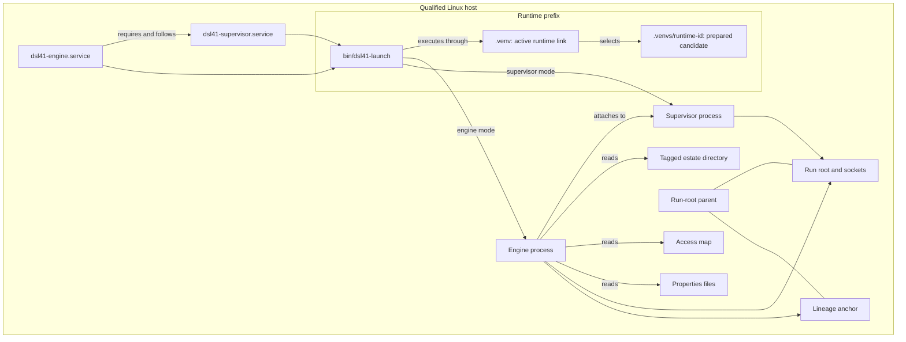

# Build and install the site package

This page is for the packager who installs dsl41 and the site's services on a qualified host.
It covers the site package, first start, and the infrastructure contract that the application's JIL releases run within.
The rest of your track is under **Packager** in the
[README's Documents section](../README.md#documents).

## 1. What a dsl41 release gives you

The [release workflow](../.github/workflows/release.yml) publishes these GitHub release assets.
The [README's Release section](../README.md#release) describes their source and publication gates.

| Asset | What the packager uses it for |
| --- | --- |
| Source distribution, typically `dsl41-X.Y.Z.tar.gz` | The release's source archive. |
| Wheel, typically `dsl41-X.Y.Z-py3-none-any.whl` | The exact dsl41 build installed in a candidate runtime. |
| `requirements-base.txt` | The locked dependencies for the base profile. |
| `requirements-ui.txt` | The locked dependencies for the UI profile. |
| `release-inputs.json` | Bind the wheel and requirements to the release's `pyproject.toml` and `uv.lock`. |
| `dsl41-offline-ubuntu-x86_64.tar.gz` | The offline delivery from the Ubuntu release rehearsal. |
| `dsl41-offline-el8-x86_64.tar.gz` | The offline delivery from the Rocky Linux release rehearsal. |
| `dsl41-offline-*.rpm` | The reference EL8 package described in [§2](#2-choose-how-dsl41-lands-on-the-host). |
| `SHA256SUMS` | Verify the published assets. |

Each bundle installs only on a host whose Python patch version, implementation, platform,
machine, libc, and os-release `ID` and `VERSION_ID` equal its recorded target;
for a different host, [rebuild and qualify the bundle on a matching connected target](offline-installation.md#build-and-qualify-on-a-connected-target).

The release tag must be annotated and equal `v<pyproject version>`.
Its message is the release note.
Use the asset names from that release; the archive and wheel names above are patterns.
The [offline examples](offline-installation.md#prepare-release-inputs-upstream) use a sample version.
Use the version of the release you package.

The input manifest detects mismatched files; it does not authenticate the release.
Use the release checksums or the CI artifact as the trusted input source.
Follow [release-input verification](offline-installation.md#prepare-release-inputs-upstream).

## 2. Choose how dsl41 lands on the host

Choose the reference RPM or the offline recipe without RPM.
Both prepare a candidate at its final path under the chosen prefix.
The default prefix is `/opt/dsl41`.
An operator activates a candidate through the `.venv` link.
Before activation, run any check against a retained runtime with `python -B`, because a `.pyc` written into it makes activation refuse it ([rule](offline-installation.md#prepare-on-the-offline-host)).
[DL-389](decision-log.md) defines the preparation and ownership rules.

### 2.1. Use or rebuild the reference RPM

The RPM installs only on a host whose Python patch version, implementation, platform,
machine, libc, and os-release `ID` and `VERSION_ID` equal its recorded target;
for a different host, [rebuild and qualify the bundle on a matching connected target](offline-installation.md#build-and-qualify-on-a-connected-target) before building the RPM.

The published RPM has this build configuration:

| Setting | Published value |
| --- | --- |
| Target | The exact target recorded in the bundled manifest. |
| Profile | `base` |
| Prefix | The default prefix above |
| RPM release | `1` |

For another prefix, the `ui` profile, or another RPM release, rebuild the dsl41-offline RPM.
Use `ui` only for a host that serves the terminal UI or browser service.
Use a delivery bundle that matches the build and installation hosts under the target rule above.
Follow [Reference RPM](offline-installation.md#reference-rpm) to build its source bundle and RPM.
That section gives the complete build commands.

The [reference spec](../scripts/offline/dsl41-offline.spec) accepts these macros:

| Macro | Default or requirement |
| --- | --- |
| `dsl41_version` | Required; use the release version. |
| `dsl41_release` | `1` |
| `dsl41_prefix` | `/opt/dsl41`; must be an absolute path. |
| `dsl41_profile` | `base`; accepts `base` or `ui`. |
| `dsl41_python` | `/usr/bin/python3.12` |

The RPM requires `bash`, `python3.12` and `python3.12-pip`.
The target package manager must supply them.
Confirm those packages on the actual target distribution.
The Python installation needs working `venv` and `ensurepip`.
Neither pip nor the RPM may fetch Python or OS dependencies in `%post`.

RPM owns only `<prefix>/delivery/<version>-<release>/`.
It does not own the generated runtimes, active link, preparation lock or active templates.
It does not install the service account or the site files in [§3](#3-build-the-site-package).
Upgrade, reinstall, downgrade and erase leave generated runtimes and the active link in place.
The spec has no erase scriptlets.
Follow [candidate retirement](offline-installation.md#retire-one-inactive-candidate) separately.

The `%post` scriptlet runs the offline preparation tool for the selected profile.
It never activates `.venv`, replaces an active template or restarts a service.
It stages deployment templates inside the candidate's `.dsl41/assets/` directory.
A failed scriptlet retains the candidate and may leave the RPM payload installed.
It does not roll back its effects.
Use the [receipt check and activation procedure](deployment-runbook.md#1-install) before first start.

### 2.2. Use the offline recipe without RPM

Follow these sections of the offline installation page in order:

- [Prepare release inputs upstream](offline-installation.md#prepare-release-inputs-upstream).
- [Build and qualify on a connected target](offline-installation.md#build-and-qualify-on-a-connected-target).
- [Prepare on the offline host](offline-installation.md#prepare-on-the-offline-host).

The delivery contains both profiles listed in [§2.1](#21-use-or-rebuild-the-reference-rpm).
Apply the [exact-target rule in §1](#1-what-a-dsl41-release-gives-you) to this route too.
The recipe claims no cross-platform download or broad manylinux compatibility.
The offline page uses `PYTHON=/usr/bin/python3.12`.
The runbook's [installation commands](deployment-runbook.md#1-install) use `PYTHON=python3.12`.
The preparation script accepts either form.

## 3. Build the site package

The site package supplies the service account and active deployment files.
The example uses the account and group `dsl41`.
The site chooses its account, paths, estate inputs and runtime profile.
Review the [deployment example](../examples/nightbank/deploy/) for the matching release.
Every name and path in that example is synthetic.

Use this contents list for the site's RPM spec:

- Declare `Requires: dsl41-offline`. The launcher runs whatever runtime the active link
  selects, so the site package records the dsl41 release it was qualified with in its
  own release note, not as a version pin that would block a later delivery.
  Use the matching profile and prefix from [§2.1](#21-use-or-rebuild-the-reference-rpm).
- Create the service account in `%pre`, using the account definition in the
  [service-install recipe](deployment-runbook.md#recipe-install-and-start-as-a-service).
- Own the launcher, engine unit, supervisor unit, access-map directory and map,
  properties files, the release verbs' sudoers file, the releases directory and
  `ACTIVE`'s directory listed in the table below.
  The application delivers its JIL as releases through `dsl41 release` ([§5](#5-ship-jil-releases-on-the-applications-train)).
  Set each owned path's mode in the spec according to the table.
- Never own run roots, `leader.lock`, anchors, the runtime prefix directory,
  generated runtimes or `.venv`.
  Under the prefix, own only the launcher listed below.
- Do not reload units, restart services or activate a runtime in any site-package scriptlet.
- Preserve reviewed active files during upgrades until the site explicitly installs replacements.
  The [package-replaces-configuration rule](deployment-qualification.md#operator-error-matrix) says:
  “Review and install each active file explicitly, then reload units.”
  Perform that reload as the separate site step in [§4](#4-install-the-package-and-start-the-engine).
- The estate's file list, layers and timezone are the release manifest's (`estate.toml`), so
  a JIL release never edits the launcher (DL-407). A change to a
  properties file is a catalog change: the post-placeholder JIL and its hash move, so it
  goes through the rollout window like a JIL release
  ([operator scenarios](deployment-runbook.md#8-operator-scenarios)).
  [§5](#5-ship-jil-releases-on-the-applications-train) states what a JIL release may change.

| File or directory | Runner requirement or site choice | Where its rule lives |
| --- | --- | --- |
| `<prefix>/bin/dsl41-launch`, mode `0755` | The site chooses configuration paths, `ESTATE_RELEASES`, `ACTIVE`, `ENVIRONMENT`, the site's `-p` and machine settings; the estate's files, layers and timezone come from the active release's manifest through `dsl41 estate args`. Keep `--detached`, `--supervisor attach` with its compatibility probe, the `estate args` probe that refuses a dsl41 without the verb, explicit `--as-machine`, `--machine-policy strict`, `--access-map` and the opener logic. | [Launcher](../examples/nightbank/deploy/dsl41-launch); [starting the engine](deployment-runbook.md#3-starting-the-engine); DL-218 for command construction, DL-396 for attachment, DL-402 for the probe, DL-407 for the manifest in the [decision log](decision-log.md). |
| `/etc/systemd/system/dsl41-engine.service`, mode `0644` | Keep `Wants=` and `After=` for the supervisor, never `Requires=`: a supervisor stop then leaves the engine holding spawns through the drain (DL-416). Keep `Restart=on-failure`, `RestartPreventExitStatus=2 3 6 7`, `StartLimitIntervalSec=300` and `StartLimitBurst=5`. The site chooses its account and paths. | [Engine unit](../examples/nightbank/deploy/dsl41-engine.service); [unit and exit policy](deployment-runbook.md#3-starting-the-engine); [DL-218](decision-log.md). |
| `/etc/systemd/system/dsl41-supervisor.service`, mode `0644` | Keep a dedicated service cgroup, `SuccessExitStatus=8`, `RestartPreventExitStatus=2 7 8`, `Restart=always`, `StartLimitIntervalSec=0` and `KillMode=control-group`. Keep `ExecStop=` on the launcher's `supervisor-stop` mode. Choose the drain's bound, `Environment=DSL41_DRAIN_S`, and size `TimeoutStopSec` for it and for the estate's maintenance bound. | [Supervisor unit](../examples/nightbank/deploy/dsl41-supervisor.service); [unit policy](deployment-runbook.md#3-starting-the-engine); DL-390 and DL-399 for containment and exit policy, DL-398 for guarded stop, DL-401 for the timeout, DL-416 for the drain in the [decision log](decision-log.md). |
| `/etc/dsl41/` | The example installs this directory owned by root with mode `0755`. | [Service-install recipe](deployment-runbook.md#recipe-install-and-start-as-a-service); [role-map contract](access-model.md#4-the-role-map). |
| `/etc/dsl41/nightbank-access.toml` | The example map has mode `0600` and belongs to the engine's account. The runner requires a valid map when the launcher passes it. The site chooses principals, tiers and any socket group. | [Example map](../examples/nightbank/deploy/nightbank-access.toml); [role-map contract](access-model.md#4-the-role-map); [socket-group modes](access-model.md#8-filesystem-modes). |
| Properties files named by `-p` | The site selects ownership and modes that let the service account read the files. The launcher must preserve every properties argument. | [Launcher configuration](../examples/nightbank/deploy/dsl41-launch); [estate configuration recipe](deployment-runbook.md#recipe-configure-an-estate). |
| `/etc/sudoers.d/dsl41-release`, owned by root, mode `0440` | Grants the deployment identity two commands: `<prefix>/.venv/bin/dsl41 release service *` as the service account, and `systemctl start dsl41-engine.service` as root. Check it with `visudo -cf`. | [Sudoers file](../examples/nightbank/deploy/dsl41-release.sudoers); [§5](#5-ship-jil-releases-on-the-applications-train). |
| `ESTATE_RELEASES` directory | Owned by the service account, mode `0755`. `dsl41 release prepare` has the service account copy each release into it as its own: directories `0555`, files `0444`, `.release` `0755`. The deployment identity only reads it, so nobody else can change a release (DL-412). | [Job recipe](deployment-runbook.md#recipe-add-change-or-remove-a-job); [§5](#5-ship-jil-releases-on-the-applications-train). |
| `ACTIVE`'s directory, and `ACTIVE` | The directory is owned by root, with the deployment group and mode `1775`. `dsl41 release apply` replaces `ACTIVE` by a rename there and keeps its apply record and lock in `.release` beside it; the sticky bit keeps entries owned by other users out of its reach. `ACTIVE` is a plain file owned by the deployment identity. | [Job recipe](deployment-runbook.md#recipe-add-change-or-remove-a-job); [launcher header](../examples/nightbank/deploy/dsl41-launch). |
| Run-root parent, outside the package payload | The site provisions this path on local durable storage. The example uses service-account ownership and mode `0700`. The service account writes run roots and anchors there. | [Service-install recipe](deployment-runbook.md#recipe-install-and-start-as-a-service); [host prerequisites](deployment-qualification.md#rehearsal-prerequisites); [spool contract](supervisor-protocol.md#3-spool-format-frozen). |

The install recipe prescribes no owner or mode for properties files.
Choose those values in the site spec before building it.
Manual starts count against the engine's start limit.
The runbook's [worked example](deployment-runbook.md#a-worked-example-examplesnightbankdeploy)
gives `systemctl reset-failed dsl41-engine.service` to clear that limit.

The engine and supervisor units must use the same account and run root.
Use a separate supervisor unit for each run root.
Set each unit's `RequiresMountsFor=` to the launcher's `RUN_ROOT`.
The site must edit the launcher and both unit copies when it changes that path.
The runbook calls the launcher the place that names the root; the units repeat it for mounts.

The example hard-codes the default prefix in these assignments:

- `DSL41=/opt/dsl41/.venv/bin/dsl41` in the launcher.
- `ExecStart=/opt/dsl41/bin/dsl41-launch engine` in the engine unit.
- `ExecStart=/opt/dsl41/bin/dsl41-launch supervisor` in the supervisor unit.
- `ExecStartPost=/opt/dsl41/bin/dsl41-launch supervisor-ready` in the supervisor unit.
- `ExecStop=/opt/dsl41/bin/dsl41-launch supervisor-stop` in the supervisor unit.

Edit those assignments for another prefix.
The RPM's prefix macro moves the runtime; it does not rewrite these templates.
The launcher uses `ESTATE_RELEASES=/srv/dsl41/nightbank/releases` and `ACTIVE=/srv/dsl41/nightbank/active`.
The runbook's examples use the same `ESTATE_RELEASES`.
Its install recipe has the deployment identity prepare the first release with `dsl41 release prepare` and name it in `ACTIVE`.
The launcher's separate `PROPERTIES` path is `/srv/dsl41/nightbank/night/night.properties`.

The example map requires the root-owned directory in the table.
The runbook permits that directory to belong to root or the service account.
Both require that no other account can write the map or its directory.

The wheel excludes the deployment templates.
The offline bundle carries them and preparation stages them as described in [§2.1](#21-use-or-rebuild-the-reference-rpm).
The runbook's copy commands use the matching release checkout's examples.
The offline page directs the site to the staged templates.
Neither page gives a copy procedure from the staged assets to active paths.

Do not change the launcher logic outside its CONFIGURATION block.
Inside that block, preserve the attachment option and the two probes in the keep-list above.
The one-shot `<RUN_ROOT>.open-from` trigger selects `--open-from ESTATE_ANCHOR` before the launcher checks `journal.jsonl`.
Without the trigger, the journal selects `--resume`; otherwise the launcher checks whether genesis is allowed.
The launcher removes the trigger just before executing the engine.
The release manifest names every estate file in order, and the launcher takes the list from it, never from a glob.
The runner hashes that order, and a reorder refuses resume.
The supervisor unit's `ExecStop` is the launcher's `supervisor-stop` mode and nothing else (DL-416).
It sends a stop's SIGTERM to the supervisor alone, because `KillMode=control-group` would send it to every command and defeat the drain.
`KillMode=mixed` is no substitute: after a supervisor crash systemd would SIGKILL the wrappers before they record.
Do not tie its lifetime to the engine with `PartOf=` or `BindsTo=`.
Never start its supervisor by hand.
Never replace `leader.lock` in a running root.
The [service contract and guarded maintenance rules](deployment-runbook.md#3-starting-the-engine) govern these restrictions.



The diagram shows the units, processes and site paths on the host; it leaves out job processes and UI clients.

## 4. Install the package and start the engine

Use [§2](#2-choose-how-dsl41-lands-on-the-host) for the runtime installation route.
Run these steps after the site package installs the contents declared in [§3](#3-build-the-site-package).
In the linked service recipe, skip account creation and every install command for a package-owned path.
Keep its runtime-directory provisioning commands; those paths are outside the package payload.

1. Follow [runbook §1](deployment-runbook.md#1-install) to check the candidate receipt and explicitly activate the runtime.

2. Verify the installed units with the [worked example's static check](deployment-runbook.md#a-worked-example-examplesnightbankdeploy), which starts nothing.

   ```sh
   systemd-analyze verify --man=no \
       /etc/systemd/system/dsl41-engine.service \
       /etc/systemd/system/dsl41-supervisor.service
   ```

3. Use the directory-provisioning part of the [service-install recipe, step 2](deployment-runbook.md#recipe-install-and-start-as-a-service) to create the run-root parent, new root and empty lock before either unit starts.

4. Check job data directories and output targets against the service-account ownership in the [service recipe, step 3](deployment-runbook.md#recipe-install-and-start-as-a-service).

5. Follow the manager and launcher checks in the [service recipe, steps 2 and 4](deployment-runbook.md#recipe-install-and-start-as-a-service) to reload units, enable permitted boot starts and inspect the installed command.
   Step 4 also prepares the first release and writes its name to `ACTIVE`; the launcher refuses to start without it.

6. Follow the tested start and readiness commands in the [service recipe, step 5](deployment-runbook.md#recipe-install-and-start-as-a-service) to start the engine and wait for its answer.

7. Read the [preflight warnings](deployment-runbook.md#recipe-install-and-start-as-a-service) in the engine journal.

   ```sh
   journalctl -u dsl41-engine.service
   ```

Use the [reboot hold](deployment-runbook.md#2b-quiescent-backup-and-restore) when a maintenance window must survive a reboot.
Never install into the active link or move a backing virtual environment.

## 5. Ship JIL releases on the application's train

A JIL release is the application's, and it travels on the application's train (DL-407, DL-408).
The application's on-call prepares a release, applies it in one window, verifies it and rolls it back by the same path, with `dsl41 release` (DL-412).
The runbook's [job recipe](deployment-runbook.md#recipe-add-change-or-remove-a-job) gives the steps and the exit codes.
The site package is the infrastructure: it installs the grant and keeps fixed the paths, units and limits a release runs within.
A JIL release needs no change to `dsl41-offline`, its runtime or the site package.

| Part | Owner | Rule |
| --- | --- | --- |
| The launcher, with its `PREFIX`, `ENVIRONMENT`, `PROPERTIES` and run options | Site package | A release never edits the launcher; the launcher reads the active release's manifest through `dsl41 estate args`. |
| The launcher's `RUN_ROOT` and `ESTATE_ANCHOR` | Site package | Only an infrastructure act changes them. The run roots and anchors themselves stay outside the payload ([§3](#3-build-the-site-package)). |
| The engine and supervisor units | Site package | A release starts the engine unit and changes no unit. |
| The access map | Site package | It binds the deployment identity, as the next paragraph says. |
| The `ESTATE_RELEASES` directory | Site package creates it, owned by the service account, mode `0755` | The service account installs each release there as its own and writes its receipts; the deployment identity only reads it (DL-412). |
| `ACTIVE`'s directory | Site package creates it, owned by root, with the deployment group and mode `1775` | `dsl41 release apply` replaces `ACTIVE` there and keeps its apply record and lock in `.release`; the sticky bit keeps entries owned by other users out of its reach. |
| `/etc/sudoers.d/dsl41-release` | Site package | The deployment identity's two sudo lines, and nothing more. |
| `SERVICE_ACCOUNT` and `ENGINE_UNIT` in the launcher | Site package | The account `dsl41 release` seals as, the units' `User=`, and the engine unit it starts. `dsl41-launch vars` prints both (DL-412). |
| `MAX_JOBS` and `MAX_GRACE_S` in the launcher | Site package | The ceiling below. |
| A release directory's contents: its JIL, calendars and properties layers | Application | `prepare` installs them whole, read-only, and nothing changes them after. |
| The release manifest, `estate.toml` | Application | The files in order, the layers, the timezone, the semantics and `requires_dsl41` ([authoring §6.1](authoring.md#61-declare-the-estate-in-estatetoml)). |
| The release's tag | Application | One tag for every environment; the launcher's `ENVIRONMENT` picks the layers. |

The deployment identity runs `dsl41 release`; the example names it `nbdeploy`, in the group `nightbank-deploy`.
It owns `ACTIVE`, and it may replace `ACTIVE` in its directory, where it keeps its apply record and lock; it only reads `ESTATE_RELEASES`.
`dsl41 release` sends `query` and `sendevent` as that identity, so the access map binds it to `ops`, and it is a member of the map's `socket_group` ([access-model §4](access-model.md#4-the-role-map)).
The service account is a member of that group too, as the [configure recipe](deployment-runbook.md#recipe-configure-an-estate) requires.
Through `sudo`, the identity may run `<prefix>/.venv/bin/dsl41 release service` as the service account, and `systemctl start dsl41-engine.service` as root.
The verbs run that command by the launcher's `DSL41` path, so the grant matches whatever path the operator typed.
They read the launcher at `<prefix>/bin/dsl41-launch`, beside the runtime they run on.
They refuse it when anyone but root, or the account that runs the verb, can write it or a directory above it; a world-writable directory passes only with root as owner and the sticky bit set.
They refuse to run on any runtime but the one the launcher's `DSL41` selects.
The [sudoers file](../examples/nightbank/deploy/dsl41-release.sudoers) holds those two lines.
The site package installs the sudoers file, and creates the identity, its group, the releases directory and `ACTIVE`'s directory.

The ceiling is the workload the units' limits were sized for.
The launcher declares `MAX_JOBS` and `MAX_GRACE_S`, and `dsl41 release prepare` refuses a release with more jobs than `MAX_JOBS`, or a runtime whose command grace is above `MAX_GRACE_S`.
Size them against the supervisor unit's `TimeoutStopSec`, in seconds (DL-401):

```text
TimeoutStopSec >= 15 + 5 + MAX_GRACE_S + 2 + 8 x MAX_JOBS + 10
```

The example's values:

| Setting | Value |
| --- | --- |
| `TimeoutStopSec` | 900 |
| `MAX_JOBS` | 107 |
| `MAX_GRACE_S` | 10 |

The infrastructure acts are a fresh run root, a physical roll and a new estate ([runbook §6](deployment-runbook.md#6-jil-rollout--updating-the-estate), [§7](deployment-runbook.md#7-upgrading-dsl41-itself)).
Under the example units, each changes `RUN_ROOT` and both units' `RequiresMountsFor=`.
A fresh run root and a new estate also change `ESTATE_ANCHOR`; a physical roll keeps it.
The site package owns those launcher and unit files.
An act also needs a provisioned root and empty lock, and a unit reload.
The example launcher refuses genesis when the configured anchor contains `anchor.json`.
No document gives a fresh-root procedure under the units.
A change to the launcher's run options is a profile change: make it at a boundary, with the matching `--next-*` options ([runbook §6a](deployment-runbook.md#6a-the-boundary--sealing-a-period-and-opening-the-next)).

A dsl41 upgrade also needs a verified candidate, rehearsal with the new executable and explicit activation.
Read the [release note described in §1](#1-what-a-dsl41-release-gives-you) and compare state-machine versions in both runtimes.
Follow [runbook §7](deployment-runbook.md#7-upgrading-dsl41-itself) to choose the required root and supervisor treatment.
Keep old runtimes while the periods they wrote remain retained.
After a runtime switch, `dsl41 release apply` refuses a release prepared under another dsl41 version until `dsl41 release prepare --requalify NAME` passes.
A site that rolls the runtime back below dsl41 1.13.0 reinstalls the site package qualified with that release.
The launcher reads the manifest through `dsl41 estate args`, and it refuses to start a runtime without that verb.

## 6. Qualify the host

[Deployment qualification](deployment-qualification.md) covers offline manufacture and safe operation of the installed release.
A green source-tree suite does not qualify a deployment.
Keep the exact wheel, manifest, RPM, commands, exit codes and logs with the rehearsal evidence.
Use its [host prerequisites](deployment-qualification.md#rehearsal-prerequisites) for the target requirements.

[Offline rehearsal](offline-rehearsal.md) builds a delivery in a connected container.
It manufactures the runtime and exercises services in a separate container without networking.
It checks preparation faults, service maintenance, definition boundaries and recovery on synthetic Nightbank estates.
Its [release-workflow invocation](../.github/workflows/release.yml) uses the candidate wheel and exports before publication.

The [RPM lifecycle harness](../scripts/offline/rpm-lifecycle.sh) checks fresh install, upgrade, reinstall, downgrade, failed `%post` and erase.
It exercises both profiles and default and alternate prefixes.
It checks that the active link, operator launcher and retained candidate survive those operations.
Follow [Reference RPM](offline-installation.md#reference-rpm) for its invocation and dependency-check limits.
Repeating installs of a build proves package mechanics, not compatibility between releases.

Container cgroup evidence qualifies only the observed container configuration.
No packager document qualifies a cgroup version, including cgroup v1.
The [local-storage requirement in §3](#3-build-the-site-package) applies to run roots.
The spool contract cites ambiguous rename crash semantics over NFS.
The packager documents give no NFS position for the estate checkout.
The rehearsal's partial-candidate fixture does not prove interruption of a preparation process.
Its reboot step stages ordering in a container; it does not reboot the host.
Container results do not qualify host boot, mounts, kernel upgrades, SELinux policy, live AutoSys instances or an untested release pair.
The installation, runbook and qualification pages give no SELinux policy or context guidance.
Use the [real-host evidence requirements](deployment-qualification.md#evidence-lanes) for host properties.
ARM64 runs and emulation do not qualify native x86_64 acceptance.
The [service-drill report](deployment-runbook.md#a-worked-example-examplesnightbankdeploy) records Ubuntu 24.04 runs on x86_64 and ARM64.
It says that no other distribution or systemd version has been observed.
The [offline rehearsal](offline-rehearsal.md) also runs services in Rocky Linux 8 containers.
These coverage statements conflict; neither establishes qualification of another host.

## 7. Follow the other tracks for engine work

This page leaves daily operation to the [operator track](deployment-runbook.md#0-the-operator-path), estate authoring to [authoring.md](authoring.md), and the runner's design to the [architect track](../README.md#documents).
