# State machines

This file is generated from `dsl41.machines`; regenerate it with `uv run python scripts/render_state_machines.py`.

## job

Clock: logical.

```mermaid
stateDiagram-v2
    state "job" as s20
    state s20 {
        [*] --> s21
        state "lifecycle" as s21
        state s21 {
            [*] --> s3
            state "IDLE" as s3
            state s3 {
                [*] --> s4
                state "INACTIVE" as s4
                state "TERMINAL" as s10
                state s10 {
                    [*] --> s9
                    state "SUCCESS" as s9
                    state "FAILED" as s1
                    state s1 {
                        [*] --> s2
                        state "FAILURE" as s2
                        state "TERMINATED" as s11
                    }
                }
            }
            state "QUE_WAIT" as s6
            state "LIVE" as s5
            state s5 {
                [*] --> s8
                state "STARTING" as s8
                state "RUNNING" as s7
            }
            state "ADMITTED" as s0
        }
        --
        [*] --> s14
        state "flags" as s14
        state s14 {
            [*] --> s18
            state "ice_off" as s18
            state "ice_on" as s19
            --
            [*] --> s16
            state "hold_off" as s16
            state "hold_on" as s17
            --
            [*] --> s22
            state "noexec_off" as s22
            state "noexec_on" as s23
            --
            [*] --> s12
            state "arm_off" as s12
            state "arm_on" as s13
        }
        --
        [*] --> s24
        state "none" as s24
        state "reserved" as s25
        state "held" as s15
    }
    state c0 <<choice>>
    state c1 <<choice>>
    s3 --> s9 : job.101 start [start_bypasses] / extent_bypass
    s3 --> s0 : job.102 start [start_admits_job] / extent_admit
    s3 --> s6 : job.103 start [start_queues] / extent_queue
    s1 --> s0 : job.104 start [start_on_held] / extent_on_held
    s8 --> s7 : job.105 started [started_job] / moved
    s10 --> s4 : job.106 start [start_skips] / moved
    s10 --> s4 : job.107 start [start_skips_member] / moved
    s6 --> s0 : job.108 readmit [readmit_admits] / admit
    s6 --> s4 : job.109 readmit [readmit_cancels] / cancelled
    s6 --> s4 : job.110 flag moved [left_waiter] / left_queue
    s6 --> s11 : job.111 flag moved [killed_waiter] / moved
    s6 --> s4 : job.112 flag moved [iced_waiter] / moved
    s6 --> s4 : job.113 flag moved [noexec_settles_job] / injected
    s5 --> s11 : job.114 KILLJOB / terminated
    s7 --> s11 : job.115 TIMER term_run_time [current_run] / terminated
    s5 --> s11 : job.116 box ends FAILURE or TERMINATED [is_terminator] / terminated
    s21 --> s9 : job.117 STATUS [exit_success] / moved
    s21 --> s2 : job.118 STATUS [exit_failure] / moved
    s21 --> c0 : job.119 STATUS [injects]
    s21 --> s4 : job.120 STATUS [injects_inactive_job] / injected
    s1 --> s4 : job.121 flag moved [noexec_settles_job] / injected
    s10 --> s4 : job.122 box start / batched
    s6 --> s4 : job.123 box set INACTIVE / batched
    s3 --> s0 : job.124 start [start_admits_box] / extent_admit
    s8 --> s7 : job.125 started [started_box] / runs_box
    s7 --> s9 : job.126 member moves [verdict_success] / completed
    s7 --> s2 : job.127 member moves [verdict_failure] / completed
    s7 --> s9 : job.128 completion moment [verdict_success] / completed
    s7 --> s2 : job.129 completion moment [verdict_failure] / completed
    s7 --> s11 : job.130 member ends FAILURE or TERMINATED [terminator_fires] / terminated
    s4 --> s9 : job.131 box recompute [overrides_success] / moved
    s4 --> s2 : job.132 box recompute [overrides_failure] / moved
    s4 --> s9 : job.133 box recompute [derives_success] / moved
    s4 --> s2 : job.134 box recompute [derives_failure] / moved
    s21 --> s4 : job.135 STATUS [injects_inactive_box] / cascades
    s3 --> s4 : job.136 flag moved [noexec_settles_box] / cascades
    s5 --> s4 : job.159 box set INACTIVE / batched
    s10 --> s4 : job.160 box set INACTIVE / batched
    s6 --> s9 : job.161 box recompute [overrides_success] / moved
    s2 --> s9 : job.162 box recompute [overrides_success] / moved
    s6 --> s2 : job.163 box recompute [overrides_failure] / moved
    s9 --> s2 : job.164 box recompute [overrides_failure] / moved
    s6 --> s9 : job.165 box recompute [derives_success] / moved
    s2 --> s9 : job.166 box recompute [derives_success] / moved
    s6 --> s2 : job.167 box recompute [derives_failure] / moved
    s9 --> s2 : job.168 box recompute [derives_failure] / moved
    s6 --> s4 : job.169 flag moved [noexec_settles_box] / cascades
    s8 --> s4 : job.170 flag moved [noexec_settles_box] / cascades
    s18 --> s19 : job.201 ON_ICE [not_live] / iced
    s19 --> s18 : job.202 OFF_ICE
    s19 --> s18 : job.203 FORCE_STARTJOB [force_clears]
    s16 --> s17 : job.204 ON_HOLD [not_live] / held
    s17 --> s16 : job.205 OFF_HOLD / released_hold
    s17 --> s16 : job.206 FORCE_STARTJOB [force_clears]
    s17 --> s16 : job.207 ON_NOEXEC [noexec_applies]
    s16 --> s17 : job.208 box running [has_auto_hold]
    s22 --> s23 : job.209 ON_NOEXEC [noexec_applies] / noexec
    s23 --> s22 : job.210 OFF_NOEXEC / cleared_noexec
    s23 --> s22 : job.211 OFF_NOEXEC on its box
    s12 --> s13 : job.212 start [start_arms]
    s13 --> s12 : job.213 actual start
    s13 --> s12 : job.214 DISARM
    s13 --> s12 : job.215 box run ends
    s13 --> s12 : job.216 readmit [readmit_leaves] / waiter_left
    s13 --> s12 : job.217 KILLJOB [queued] / report_flag_move
    s19 --> s19 : job.218 ON_ICE [not_live] / iced_again
    s18 --> s18 : job.219 OFF_ICE
    s17 --> s17 : job.220 ON_HOLD [not_live] / held
    s16 --> s16 : job.221 OFF_HOLD / released_hold
    s23 --> s23 : job.222 ON_NOEXEC [noexec_applies] / noexec
    s22 --> s22 : job.223 OFF_NOEXEC / cleared_noexec
    s12 --> s12 : job.224 actual start
    s12 --> s12 : job.225 DISARM
    s12 --> s12 : job.226 KILLJOB [queued] / report_flag_move
    s22 --> s23 : job.231 ON_NOEXEC on its box
    s17 --> s16 : job.232 ON_NOEXEC on its box
    s23 --> s23 : job.233 ON_NOEXEC on its box
    s24 --> s25 : job.301 admitted start [has_demand]
    s15 --> c1 : job.302 admitted start [takes_over]
    s15 --> s25 : job.303 admitted start [on_held_units]
    s25 --> s24 : job.304 leave STARTING or RUNNING [frees_all]
    s25 --> s15 : job.305 leave STARTING or RUNNING [keeps_held]
    s25 --> s24 : job.306 leave STARTING or RUNNING [spends]
    s15 --> s24 : job.307 RELEASE_RESOURCE / released_held
    s15 --> s24 : job.308 first input of a period [left_catalog]
    s15 --> s25 : job.319 STATUS [injects_live]
    s0 --> s8 : job.403 starting / moved
    c0 --> s4 : job.171 [injected_inactive] / moved
    c0 --> s8 : job.172 [injected_starting] / moved
    c0 --> s7 : job.173 [injected_running] / moved
    c0 --> s9 : job.174 [injected_success] / moved
    c0 --> s2 : job.175 [injected_failure] / moved
    c0 --> s11 : job.176 [else] / moved
    c1 --> s25 : job.309 [has_demand]
    c1 --> s24 : job.310 [else]
```

| Id | Source | Event | Guard | Action | Target | Kind | Cite |
| --- | --- | --- | --- | --- | --- | --- | --- |
| job.100 | IDLE | start | start_bounded | L010: a re-trigger loop inside one instant. A start that descends from MAX_NESTED_STARTS admitted starts of the same job, its `start admitted` items in the attempt's ancestry, is refused with a START_REFUSED line. |  | internal | DL-304 |
| job.101 | IDLE | start | start_bypasses | extent_bypass | SUCCESS | external | SEM-22, DL-54 |
| job.102 | IDLE | start | start_admits_job | extent_admit | ADMITTED | external | SEM-10, DL-120 |
| job.103 | IDLE | start | start_queues | extent_queue | QUE_WAIT | external | DL-50, DL-247, DL-255 |
| job.104 | FAILED | start | start_on_held | extent_on_held | ADMITTED | external | DL-256 |
| job.105 | STARTING | started | started_job | moved | RUNNING | external | SEM-10 |
| job.106 | TERMINAL | start | start_skips | moved | INACTIVE | external | SEM-33, DL-246 |
| job.107 | TERMINAL | start | start_skips_member | moved | INACTIVE | external | SEM-33, DL-154 |
| job.108 | QUE_WAIT | readmit | readmit_admits | admit | ADMITTED | external | DL-50, DL-257 |
| job.109 | QUE_WAIT | readmit | readmit_cancels | cancelled | INACTIVE | external | DL-50, DL-247 |
| job.110 | QUE_WAIT | flag moved | left_waiter | left_queue | INACTIVE | external | DL-257 |
| job.111 | QUE_WAIT | flag moved | killed_waiter | moved | TERMINATED | external | DL-50, DL-54 |
| job.112 | QUE_WAIT | flag moved | iced_waiter | moved | INACTIVE | external | DL-50, DL-285 |
| job.113 | QUE_WAIT | flag moved | noexec_settles_job | injected | INACTIVE | external | DL-254 |
| job.114 | LIVE | KILLJOB |  | terminated | TERMINATED | external | SEM-14 |
| job.115 | RUNNING | TIMER term_run_time | current_run | terminated | TERMINATED | external | autosys-semantics ss5 |
| job.116 | LIVE | box ends FAILURE or TERMINATED | is_terminator | terminated | TERMINATED | external | SEM-14 |
| job.117 | lifecycle | STATUS | exit_success | moved | SUCCESS | external | SEM-09 |
| job.118 | lifecycle | STATUS | exit_failure | moved | FAILURE | external | SEM-09 |
| job.119 | lifecycle | STATUS | injects |  | injected status | external | DL-13, DL-264 |
| job.120 | lifecycle | STATUS | injects_inactive_job | injected | INACTIVE | external | DL-242, DL-235 |
| job.121 | FAILED | flag moved | noexec_settles_job | injected | INACTIVE | external | SEM-22, DL-243 |
| job.122 | TERMINAL | box start |  | batched | INACTIVE | external | SEM-10, DL-242 |
| job.123 | QUE_WAIT | box set INACTIVE |  | batched | INACTIVE | external | SEM-18, DL-242 |
| job.124 | IDLE | start | start_admits_box | extent_admit | ADMITTED | external | SEM-10, DL-242 |
| job.125 | STARTING | started | started_box | runs_box | RUNNING | external | SEM-10, SEM-33, DL-246 |
| job.126 | RUNNING | member moves | verdict_success | completed | SUCCESS | external | SEM-12 |
| job.127 | RUNNING | member moves | verdict_failure | completed | FAILURE | external | SEM-12, SEM-14 |
| job.128 | RUNNING | completion moment | verdict_success | completed | SUCCESS | external | SEM-11 |
| job.129 | RUNNING | completion moment | verdict_failure | completed | FAILURE | external | SEM-11, SEM-14 |
| job.130 | RUNNING | member ends FAILURE or TERMINATED | terminator_fires | terminated | TERMINATED | external | SEM-14 |
| job.131 | INACTIVE | box recompute | overrides_success | moved | SUCCESS | external | SEM-15 |
| job.132 | INACTIVE | box recompute | overrides_failure | moved | FAILURE | external | SEM-15 |
| job.133 | INACTIVE | box recompute | derives_success | moved | SUCCESS | external | SEM-15 |
| job.134 | INACTIVE | box recompute | derives_failure | moved | FAILURE | external | SEM-15 |
| job.135 | lifecycle | STATUS | injects_inactive_box | cascades | INACTIVE | external | SEM-18 |
| job.136 | IDLE | flag moved | noexec_settles_box | cascades | INACTIVE | external | DL-254 |
| job.137 | INACTIVE | KILLJOB |  | EVENT_IGNORED |  | internal | DL-64, DL-81 |
| job.138 | SUCCESS | KILLJOB |  | EVENT_IGNORED |  | internal | DL-64, DL-81 |
| job.139 | FAILURE | KILLJOB |  | EVENT_IGNORED |  | internal | DL-64, DL-81 |
| job.140 | TERMINATED | KILLJOB |  | EVENT_IGNORED |  | internal | DL-64, DL-81 |
| job.141 | INACTIVE | start | start_refused |  |  | internal | DL-81, DL-246 |
| job.142 | QUE_WAIT | start | start_refused |  |  | internal | DL-81, DL-246 |
| job.143 | STARTING | start | start_refused |  |  | internal | DL-81, DL-246 |
| job.144 | RUNNING | start | start_refused |  |  | internal | DL-81, DL-246 |
| job.145 | SUCCESS | start | start_refused |  |  | internal | DL-81, DL-246 |
| job.146 | FAILURE | start | start_refused |  |  | internal | DL-81, DL-246 |
| job.147 | TERMINATED | start | start_refused |  |  | internal | DL-81, DL-246 |
| job.148 | STARTING | ON_ICE |  | EVENT_IGNORED |  | internal | DL-254 |
| job.149 | RUNNING | ON_ICE |  | EVENT_IGNORED |  | internal | DL-254 |
| job.150 | STARTING | ON_HOLD |  | EVENT_IGNORED |  | internal | DL-254 |
| job.151 | RUNNING | ON_HOLD |  | EVENT_IGNORED |  | internal | DL-254 |
| job.152 | INACTIVE | ON_NOEXEC | noexec_ignored |  |  | internal | DL-254 |
| job.153 | STARTING | ON_NOEXEC | noexec_ignored |  |  | internal | DL-254 |
| job.154 | RUNNING | ON_NOEXEC | noexec_ignored |  |  | internal | DL-254 |
| job.155 | SUCCESS | ON_NOEXEC | noexec_ignored |  |  | internal | DL-254 |
| job.156 | FAILURE | ON_NOEXEC | noexec_ignored |  |  | internal | DL-254 |
| job.157 | TERMINATED | ON_NOEXEC | noexec_ignored |  |  | internal | DL-254 |
| job.158 | QUE_WAIT | ON_NOEXEC | noexec_ignored |  |  | internal | DL-254 |
| job.159 | LIVE | box set INACTIVE |  | batched | INACTIVE | external | SEM-18, DL-242 |
| job.160 | TERMINAL | box set INACTIVE |  | batched | INACTIVE | external | SEM-18 |
| job.161 | QUE_WAIT | box recompute | overrides_success | moved | SUCCESS | external | SEM-15 |
| job.162 | FAILURE | box recompute | overrides_success | moved | SUCCESS | external | SEM-15 |
| job.163 | QUE_WAIT | box recompute | overrides_failure | moved | FAILURE | external | SEM-15 |
| job.164 | SUCCESS | box recompute | overrides_failure | moved | FAILURE | external | SEM-15 |
| job.165 | QUE_WAIT | box recompute | derives_success | moved | SUCCESS | external | SEM-15 |
| job.166 | FAILURE | box recompute | derives_success | moved | SUCCESS | external | SEM-15 |
| job.167 | QUE_WAIT | box recompute | derives_failure | moved | FAILURE | external | SEM-15 |
| job.168 | SUCCESS | box recompute | derives_failure | moved | FAILURE | external | SEM-15 |
| job.169 | QUE_WAIT | flag moved | noexec_settles_box | cascades | INACTIVE | external | DL-254 |
| job.170 | STARTING | flag moved | noexec_settles_box | cascades | INACTIVE | external | DL-254 |
| job.177 | lifecycle | STARTJOB |  | relay_start |  | internal | SEM-10 |
| job.178 | lifecycle | FORCE_STARTJOB |  | relay_start |  | internal | SEM-23 |
| job.179 | lifecycle | TIMER run_window |  | relay_start |  | internal | SEM-33 |
| job.180 | lifecycle | start | start_moves_nothing | A gate holds the attempt silently, a tick arms, or a postponed start waits. |  | ignored | SEM-20, SEM-21, SEM-32, SEM-33 |
| job.181 | QUE_WAIT | readmit | readmit_keeps | The waiter stays queued. |  | ignored | DL-50, DL-247 |
| job.182 | lifecycle | readmit | not_queued | A queue scan addresses a waiter. |  | ignored (unreachable) |  |
| job.183 | lifecycle | started |  | The admitted run is no longer STARTING: a wake of its STARTING ended it, or started the job again (`Started.current`). |  | ignored | SEM-10, DL-350 |
| job.184 | lifecycle | TIMER term_run_time |  | The deadline is an earlier run's, or the run is no longer RUNNING. |  | ignored | SEM-14 |
| job.185 | RUNNING | member moves | decides_nothing | No override holds, the default fold may follow. |  | ignored | SEM-11, SEM-12 |
| job.186 | lifecycle | member moves |  | Only a RUNNING box's completion door reads its overrides. |  | ignored (unreachable) |  |
| job.187 | RUNNING | completion moment | decides_nothing | A member is not done, or an unmet override suppresses the default. |  | ignored | SEM-11, SEM-12 |
| job.188 | lifecycle | completion moment |  | Only a RUNNING box folds. |  | ignored (unreachable) |  |
| job.189 | lifecycle | member ends FAILURE or TERMINATED | is_box | A terminator ends only a RUNNING box, the door or the recompute follows. |  | ignored | SEM-13, SEM-14 |
| job.190 | lifecycle | member ends FAILURE or TERMINATED | is_job | Only a box has members. |  | ignored (unreachable) |  |
| job.191 | lifecycle | box recompute | is_box | No verdict, or the box already has it. |  | ignored | SEM-15 |
| job.192 | lifecycle | box recompute | is_job | Only a box has members. |  | ignored (unreachable) |  |
| job.193 | LIVE | box recompute |  | A live box is not idle, its own end decides it. |  | ignored (unreachable) |  |
| job.194 | TERMINATED | box recompute |  | TERMINATED is sticky until the next box start (SEM-13). |  | ignored (unreachable) |  |
| job.195 | lifecycle | box start |  | INACTIVE loses its exit code by a plain write, a live or queued job keeps its run. |  | ignored | SEM-10, DL-242 |
| job.196 | INACTIVE | box set INACTIVE |  | Already INACTIVE: the cascade leaves it out. |  | ignored | SEM-18 |
| job.197 | lifecycle | box ends FAILURE or TERMINATED |  | Not live, or no job_terminator: nothing to terminate. |  | ignored | SEM-14 |
| job.198 | lifecycle | flag moved | flag_moves_nothing | Not queued, or no status move: the member's completion moment and the wakes follow. |  | ignored | SEM-20, DL-254 |
| job.199 | lifecycle | flag moved | flag_move_unposted | Only a waiter's kill or failed recheck reports it, an ignored ON_NOEXEC moves no flag. |  | ignored (unreachable) |  |
| job.201 | ice_off | ON_ICE | not_live | iced | ice_on | external | SEM-20, DL-254, DL-285 |
| job.202 | ice_on | OFF_ICE |  | no re-evaluation | ice_off | external | SEM-20 |
| job.203 | ice_on | FORCE_STARTJOB | force_clears |  | ice_off | external | SEM-23, DL-243 |
| job.204 | hold_off | ON_HOLD | not_live | held | hold_on | external | SEM-21, DL-254, DL-247 |
| job.205 | hold_on | OFF_HOLD |  | released_hold | hold_off | external | SEM-21, DL-50 |
| job.206 | hold_on | FORCE_STARTJOB | force_clears |  | hold_off | external | SEM-23, DL-243 |
| job.207 | hold_on | ON_NOEXEC | noexec_applies |  | hold_off | external | DL-254 |
| job.208 | hold_off | box running | has_auto_hold |  | hold_on | external | autosys-semantics ss5 |
| job.209 | noexec_off | ON_NOEXEC | noexec_applies | noexec | noexec_on | external | SEM-22, DL-254 |
| job.210 | noexec_on | OFF_NOEXEC |  | cleared_noexec | noexec_off | external | DL-243 |
| job.211 | noexec_on | OFF_NOEXEC on its box |  |  | noexec_off | external | DL-254 |
| job.212 | arm_off | start | start_arms |  | arm_on | external | SEM-32, DL-54 |
| job.213 | arm_on | actual start |  |  | arm_off | external | DL-54 |
| job.214 | arm_on | DISARM |  |  | arm_off | external | DL-158 |
| job.215 | arm_on | box run ends |  | SCHED_DISARM | arm_off | external | DL-54 |
| job.216 | arm_on | readmit | readmit_leaves | waiter_left | arm_off | external | DL-257 |
| job.217 | arm_on | KILLJOB | queued | report_flag_move | arm_off | external | DL-54 |
| job.218 | ice_on | ON_ICE | not_live | iced_again | ice_on | external | SEM-20 |
| job.219 | ice_off | OFF_ICE |  | as job.202 | ice_off | external | SEM-20 |
| job.220 | hold_on | ON_HOLD | not_live | held | hold_on | external | SEM-21 |
| job.221 | hold_off | OFF_HOLD |  | released_hold | hold_off | external | SEM-21 |
| job.222 | noexec_on | ON_NOEXEC | noexec_applies | noexec | noexec_on | external | SEM-22, DL-254 |
| job.223 | noexec_off | OFF_NOEXEC |  | cleared_noexec | noexec_off | external | DL-243 |
| job.224 | arm_off | actual start |  | as job.213 | arm_off | external | DL-54 |
| job.225 | arm_off | DISARM |  | as job.214 | arm_off | external | DL-158 |
| job.226 | arm_off | KILLJOB | queued | report_flag_move | arm_off | external | DL-54 |
| job.227 | flags | box running |  | Not auto_hold, or already held. |  | ignored |  |
| job.228 | arm_off | box run ends |  | Only an armed member disarms. |  | ignored |  |
| job.229 | noexec_off | OFF_NOEXEC on its box |  | Only a flagged job clears. |  | ignored |  |
| job.230 | arm_off | readmit | readmit_leaves | waiter_left |  | internal | DL-257 |
| job.231 | noexec_off | ON_NOEXEC on its box |  | as job.209 | noexec_on | external | SEM-22, DL-254, DL-347 |
| job.232 | hold_on | ON_NOEXEC on its box |  | As job.207: ON_NOEXEC supersedes ON_HOLD, and the job retries its start. | hold_off | external | SEM-22, DL-254, DL-347 |
| job.233 | noexec_on | ON_NOEXEC on its box |  | as job.231 | noexec_on | external | SEM-22, DL-254, DL-347 |
| job.301 | none | admitted start | has_demand |  | reserved | external | DL-120 |
| job.302 | held | admitted start | takes_over |  | taken over | external | DL-256 |
| job.303 | held | admitted start | on_held_units |  | reserved | external | DL-256 |
| job.304 | reserved | leave STARTING or RUNNING | frees_all |  | none | external | DL-120 |
| job.305 | reserved | leave STARTING or RUNNING | keeps_held |  | held | external | DL-256 |
| job.306 | reserved | leave STARTING or RUNNING | spends |  | none | external | SEM-16, DL-120 |
| job.307 | held | RELEASE_RESOURCE |  | released_held | none | external | DL-256 |
| job.308 | held | first input of a period | left_catalog |  | none | external | DL-256 |
| job.311 | none | admitted start | no_demand | No units. |  | ignored |  |
| job.312 | reserved | admitted start | takes_over | settle_ended_run |  | internal (unreachable) | DL-256 |
| job.313 | none | leave STARTING or RUNNING |  | The run held nothing. |  | ignored |  |
| job.314 | held | leave STARTING or RUNNING |  | An earlier run's units stay held. Unreachable: a live status never stands on held units (an admission takes them over first, job.302 and job.303, and an injected live status makes them the run's, job.319), and a run's settlement is sent once. |  | ignored (unreachable) |  |
| job.315 | none | RELEASE_RESOURCE |  | Nothing held. |  | ignored | DL-256 |
| job.316 | reserved | RELEASE_RESOURCE |  | The run's units go back when it ends. |  | ignored | DL-256 |
| job.317 | none | first input of a period |  | The opening addresses only a removed job that holds units. |  | ignored (unreachable) |  |
| job.318 | reserved | first input of a period |  | The boundary refuses a live removed job (period-model ss10.1). |  | ignored (unreachable) |  |
| job.319 | held | STATUS | injects_live | Units on a live row are the run's: they settle when it ends. | reserved | external | DL-120, DL-256 |
| job.320 | reserved | admitted start | on_held_units | A forced start on held units starts from FAILED, never mid-cascade. |  | ignored (unreachable) |  |
| job.321 | held | first input of a period | in_catalog | The opening addresses only a job the catalog no longer defines. |  | ignored (unreachable) |  |
| job.401 | IDLE | start | start_settles_first | settles_first |  | internal | DL-340, DL-349 |
| job.402 | lifecycle | start admitted |  | start_extent |  | internal | DL-304, DL-349 |
| job.403 | ADMITTED | starting |  | moved | STARTING | external | SEM-10, DL-242, DL-350 |
| job.404 | INACTIVE | start | start_skips_inactive_member | skips_in_box |  | internal | SEM-33, DL-154 |
| job.405 | lifecycle | box rules |  | moment |  | internal |  |
| job.406 | lifecycle | settle |  | moment |  | internal |  |
| job.407 | lifecycle | wake |  | moment |  | internal |  |
| job.408 | lifecycle | walk up |  | moment |  | internal |  |
| job.409 | lifecycle | holders may leave |  | moment |  | internal |  |
| job.410 | lifecycle | scan |  | moment |  | internal |  |
| job.411 | lifecycle | load taken |  | moment |  | internal |  |
| job.412 | lifecycle | box ends step |  | moment |  | internal |  |
| job.413 | lifecycle | notify step |  | moment |  | internal |  |
| job.414 | lifecycle | window pass |  | moment |  | internal |  |
| job.415 | lifecycle | after inject |  | moment |  | internal |  |
| job.416 | lifecycle | after leave |  | moment |  | internal |  |
| job.417 | lifecycle | retry step |  | moment |  | internal |  |
| job.418 | LIVE | settle |  | The job is live when its move's settlement pops: the move entered STARTING or RUNNING, or the job started again inside its move's cascade (DL-340). Nothing settles, a rank the move left still drops. |  | internal | DL-340, DL-350 |
| job.419 | lifecycle | starting |  | Only an admitted start sends it, to its own job, which is ADMITTED until it pops. |  | ignored (unreachable) |  |
| job.420 | ADMITTED | box set INACTIVE |  | An admitted start leaves ADMITTED inside its own extent, before any cascade reaches it. |  | ignored (unreachable) |  |
| job.421 | ADMITTED | start |  | An admitted start leaves ADMITTED inside its own extent, before any cascade reaches it. |  | ignored (unreachable) |  |
| job.422 | ADMITTED | KILLJOB |  | An admitted start leaves ADMITTED inside its own extent, before any cascade reaches it. |  | ignored (unreachable) |  |
| job.423 | ADMITTED | ON_NOEXEC |  | An admitted start leaves ADMITTED inside its own extent, before any cascade reaches it. |  | ignored (unreachable) |  |

| Id | Choice | Guard | Action | Target |
| --- | --- | --- | --- | --- |
| job.171 | injected status | injected_inactive | moved | INACTIVE |
| job.172 | injected status | injected_starting | moved | STARTING |
| job.173 | injected status | injected_running | moved | RUNNING |
| job.174 | injected status | injected_success | moved | SUCCESS |
| job.175 | injected status | injected_failure | moved | FAILURE |
| job.176 | injected status | else | moved | TERMINATED |
| job.309 | taken over | has_demand |  | reserved |
| job.310 | taken over | else |  | none |

| State | In | Entry | Exit | Defers | Waits |
| --- | --- | --- | --- | --- | --- |
| job |  |  |  |  |  |
| lifecycle | job/status |  |  |  |  |
| IDLE | lifecycle/status |  |  |  |  |
| INACTIVE | IDLE/idle |  |  |  |  |
| TERMINAL | IDLE/idle |  |  |  |  |
| SUCCESS | TERMINAL/terminal |  |  |  |  |
| FAILED | TERMINAL/terminal |  |  |  |  |
| FAILURE | FAILED/failed |  |  |  |  |
| TERMINATED | FAILED/failed |  |  |  |  |
| QUE_WAIT | lifecycle/status |  |  |  |  |
| LIVE | lifecycle/status |  |  |  |  |
| STARTING | LIVE/live |  |  |  |  |
| RUNNING | LIVE/live |  |  |  |  |
| ADMITTED | lifecycle/status |  |  |  |  |
| flags | job/flags |  |  |  |  |
| ice_off | flags/ice |  |  |  |  |
| ice_on | flags/ice |  |  |  |  |
| hold_off | flags/hold |  |  |  |  |
| hold_on | flags/hold |  |  |  |  |
| noexec_off | flags/noexec |  |  |  |  |
| noexec_on | flags/noexec |  |  |  |  |
| arm_off | flags/arm |  |  |  |  |
| arm_on | flags/arm |  |  |  |  |
| none | job/holding |  |  |  |  |
| reserved | job/holding |  |  |  |  |
| held | job/holding |  |  |  |  |

| Name | Kind | Prose |
| --- | --- | --- |
| start_refused | guard | `start_verdict` is `refused`: a START_REFUSED line, no move. |
| start_moves_nothing | guard | `start_verdict` is `ignored` or `arm`: the status does not move. |
| start_arms | guard | `start_verdict` is `arm`: the tick latches (SEM-32, DL-54). |
| start_bounded | guard | `start_verdict` is `bounded`: the item descends from `MAX_NESTED_STARTS` admitted starts of the job (DL-304), so a START_REFUSED line, whoever asked, and no move. |
| start_settles_first | guard | `start_verdict` is `settle_first`: past the bound, a run of the job ended and its settlement still waits behind the box rules (DL-340). The tier settles it, and the same attempt is made again. |
| start_bypasses | guard | `start_verdict` is `bypass`: ON_NOEXEC on the job or a box above it (SEM-22). |
| start_admits_job | guard | `start_verdict` is `admit`, and the data says the job is not a box. |
| start_admits_box | guard | `start_verdict` is `admit`, and the data says the job is a box. |
| start_queues | guard | `start_verdict` is `queue`: not admissible (DL-50). |
| start_on_held | guard | `start_verdict` is `on_held`: forced, FAILED, and `held` (DL-256). |
| start_skips | guard | `start_verdict` is `skip`: a job in no box, outside its window (SEM-33). |
| start_skips_member | guard | `start_verdict` is `skip_member`: a member of a RUNNING box (DL-154). |
| start_skips_inactive_member | guard | `start_verdict` is `skip_inactive_member`: an INACTIVE member of a RUNNING box it has not run in (DL-154): resolved with no move. |
| readmit_admits | guard | `readmit_verdict` is `admit`. |
| readmit_cancels | guard | `readmit_verdict` is `cancel`: the member's box stopped running. |
| readmit_leaves | guard | `readmit_verdict` is `leave`: the queued recheck failed (DL-257). |
| readmit_keeps | guard | `readmit_verdict` is `keep`: held, not admissible, or kept by an admit-only scan. |
| exit_success | guard | The payload has no status, and its exit code is a success. |
| exit_failure | guard | The payload has no status, and its exit code is not a success. |
| injects | guard | The payload's status is injectable and not INACTIVE, or the data says the job has no catalog entry. |
| injects_inactive_job | guard | The payload's status is INACTIVE, the data: a catalog job, not a box. |
| injects_inactive_box | guard | The payload's status is INACTIVE, the data: a box. |
| injects_live | guard | The payload's status is STARTING or RUNNING: units the job holds are the run's. |
| injected_inactive | guard | The payload's status is INACTIVE. |
| injected_starting | guard | The payload's status is STARTING. |
| injected_running | guard | The payload's status is RUNNING. |
| injected_success | guard | The payload's status is SUCCESS. |
| injected_failure | guard | The payload's status is FAILURE. |
| not_live | guard | The configuration's status is not STARTING or RUNNING. |
| force_clears | guard | The data: a catalog job, the configuration's status is not live or queued (`start_verdict` refuses those first). |
| queued | guard | The configuration's status is QUE_WAIT. |
| not_queued | guard | The configuration's status is not QUE_WAIT. |
| noexec_ignored | guard | `_oob_ignored` for ON_NOEXEC: the configuration has ice on, RUNNING, or STARTING on a job that is not a box, or the data says a box and the payload's `tree_busy` holds. The flag move does not change what it reads. |
| noexec_applies | guard | Not `noexec_ignored`. |
| iced_waiter | guard | The payload: ON_ICE moved the flag (the configuration has it on). |
| killed_waiter | guard | The payload: KILLJOB disarmed a waiter. |
| left_waiter | guard | The payload: the queued recheck failed, and the arm is gone (DL-257). |
| noexec_settles_job | guard | The payload: ON_NOEXEC, not `noexec_ignored`, the data: a catalog job, not a box. |
| noexec_settles_box | guard | The payload: ON_NOEXEC, not `noexec_ignored`, the data: a box, the configuration's status is not INACTIVE, or the payload's `change` holds (`NoexecFacts.change`). |
| flag_moves_nothing | guard | The payload: ON_ICE, or ON_NOEXEC that is not `noexec_ignored`: no status follows the flag here. |
| flag_move_unposted | guard | Not `flag_moves_nothing`: only a waiter's kill or recheck reports it, and an ignored ON_NOEXEC moves no flag. |
| is_box | guard | The data says the job is a box. |
| is_job | guard | The data says the job is not a box. |
| is_terminator | guard | The data: a member with job_terminator (SEM-14). |
| has_auto_hold | guard | The data: a member with auto_hold. |
| in_catalog | guard | The data: the job has a catalog entry. |
| left_catalog | guard | The data: the job left the catalog (DL-256). |
| current_run | guard | The payload: the deadline's run is the row's run. |
| started_job | guard | The data: not a box, the payload: the admitted run is the row's run (`Started`). |
| started_box | guard | The data: a box, the payload: the admitted run is the row's run (`Started`). |
| verdict_success | guard | The data: a box, the payload's step decides SUCCESS: box_success holds (SEM-12), or the default fold with no box_success (SEM-11). |
| verdict_failure | guard | The data: a box, the payload's step decides FAILURE: box_failure holds (SEM-12), or the default fold over a failed vote with no box_failure. |
| decides_nothing | guard | The data: a box, the payload's step decides nothing. |
| overrides_success | guard | The data: a box, the payload: box_success decides SUCCESS (SEM-15). |
| overrides_failure | guard | The data: a box, the payload: box_failure decides FAILURE (SEM-15). |
| derives_success | guard | The data: a box, the payload: no member failed, and no box_success suppresses the default SUCCESS (SEM-15). |
| derives_failure | guard | The data: a box, the payload: a member failed, and no box_failure suppresses the default FAILURE (SEM-15). |
| terminator_fires | guard | The data: a box, the payload's `fires` (SEM-14). |
| has_demand | guard | The payload's demand vector reserves units. |
| no_demand | guard | The payload's demand vector reserves nothing: reserving nothing is no move. |
| takes_over | guard | The payload: an admitted start that is not on held units. |
| on_held_units | guard | The payload: a FORCE_STARTJOB starts on the held units (DL-256). |
| frees_all | guard | The payload: the policy of the run's end frees every unit. |
| keeps_held | guard | The payload: the policy of the run's end keeps a renewable's unit. |
| spends | guard | The payload: the policy of the run's end spends a unit, and keeps none. |
| relay_start | action | STARTJOB, FORCE_STARTJOB or a fired run_window timer: the attempt itself, as `_dispatch` makes it: scheduled, its refusal traced, forced for FORCE_STARTJOB. The payload's facts pass on. |
| extent_bypass | action | A bypass (job.101) sends `start admitted` first, and the rest of the start follows from it (DL-349), the tier's handle gives it the record of the move to SUCCESS, whose box rules and wakes the extent sends. |
| extent_queue | action | A queued start (job.103) sends `start admitted`, which sends the move to QUE_WAIT's box rules and wakes: the waiter's units wait for its readmission. |
| extent_admit | action | An admission (job.102, job.124) sends `start admitted` first, with the units it reserves and the payload's handle on the job's units. |
| extent_on_held | action | A forced start on held units (job.104) sends `start admitted` first, with the held units it takes over. |
| start_extent | action | `start admitted`: what the admitted start does, as the tier's handle says (DL-350): a bypass consumes the arm, then its move's box rules and wakes, a queue its move's box rules and wakes, an admission or a start on held units reserves or takes over its units, consumes the arm, resets a box's jobs, moves to STARTING and on to RUNNING. |
| admit | action | A readmitted waiter (job.108) reserves its units, then consumes the arm, and the rest of its extent follows, as the tier's handle says: no `start admitted`, since a readmission is no start the bound counts (DL-350). |
| settle_ended_run | action | A start meets the units of a run whose settlement is still owed (`OracleCascade._on_settles_first`): that run settles first, by the end it made, then the start is admitted again against what the settlement left. The settlement's policy is read from the admission's handle (DL-349). Its row, job.312, is marked unreachable: job.401 settles the run before the start is admitted, so the oracle's admission carries no previous end. |
| settles_first | action | An attempt whose run's settlement is owed (job.401, DL-340): that run settles by the end it made, and the same attempt is made again, so it reads the admission the settlement leaves, as the tier's handle says. |
| moved | action | A status move on its own (`OracleCascade._after`): the move's box rules, then its settlement, then its wakes, as the tier's handle says (DL-350). |
| terminated | action | A kill: as `moved`, then a box's job_terminators, for the run read before the move (DL-348). |
| completed | action | A RUNNING box's end by an override or the default fold: as `moved`, then its job_terminators if it ended FAILURE, for the run it has then (`OracleCascade._box_ends`, DL-348). |
| injected | action | An operator's INACTIVE on a job that is not a box (`_after_inject`): as `moved`, then the idle parent's recompute (SEM-15). |
| cascades | action | An operator's INACTIVE on a box (SEM-18, DL-242): the batch INACTIVE path, its own settlement first, every job it contains, the disarms, then each row's box rules and wakes, then the idle parent's recompute. |
| batched | action | A row of the batch INACTIVE path (a box start's reset, a box's cascade): it settles first, its box rules and wakes are the batch's second phase (`OracleCascade._notify`). |
| cancelled | action | A waiter of a stopped box cancelled by the scan (job.109): as `moved`, and the scan's pass hears that the waiter moved. |
| left_queue | action | A waiter that left the queue unstarted (job.110, DL-257): as `moved`, then its window or day disposition. |
| runs_box | action | A box's RUNNING (job.125): as `moved`, then its members' auto_hold and their starts, then the window decisions of the box starts in progress (`OracleCascade._box_running`, DL-246). |
| skips_in_box | action | A window skip of an INACTIVE member (job.404, DL-154): no move to ride, so its box rules run for it, as an INACTIVE move's would. |
| report_flag_move | action | KILLJOB moved a waiter's arm (job.217, job.226), and the status rule that reads it follows as its own item, with the payload's handle on the units. |
| iced | action | ON_ICE moved the flag: the status rule that reads it follows, then, unless the job is a waiter, the box rules its ice may run and its referencers' wakes (SEM-20, DL-285), as the tier's handle says. |
| iced_again | action | ON_ICE on a job already on ice: its referencers wake again (SEM-20). |
| held | action | ON_HOLD: a held waiter blocks no one, so the queue is scanned (DL-247). |
| released_hold | action | OFF_HOLD: a waiter's queue is scanned (DL-50), any other job attempts its start (SEM-21). |
| noexec | action | ON_NOEXEC moved the flag: on a box, every job it contains takes it first (DL-347), the status rule that reads it follows, then the jobs it released retry their start (DL-254), as the tier's handle says. |
| cleared_noexec | action | OFF_NOEXEC on a box clears every job it contains (DL-254). |
| waiter_left | action | The queued recheck failed (DL-257): the status move follows the arm, and the scan's pass hears that the waiter moved. |
| released_held | action | RELEASE_RESOURCE gave held units back: the queue is scanned (DL-256). |
| moment | action | A moment of a cascade (DL-350): the tier's step its payload carries (`Moment`), run now. |

## runtime_assembly

Clock: logical.

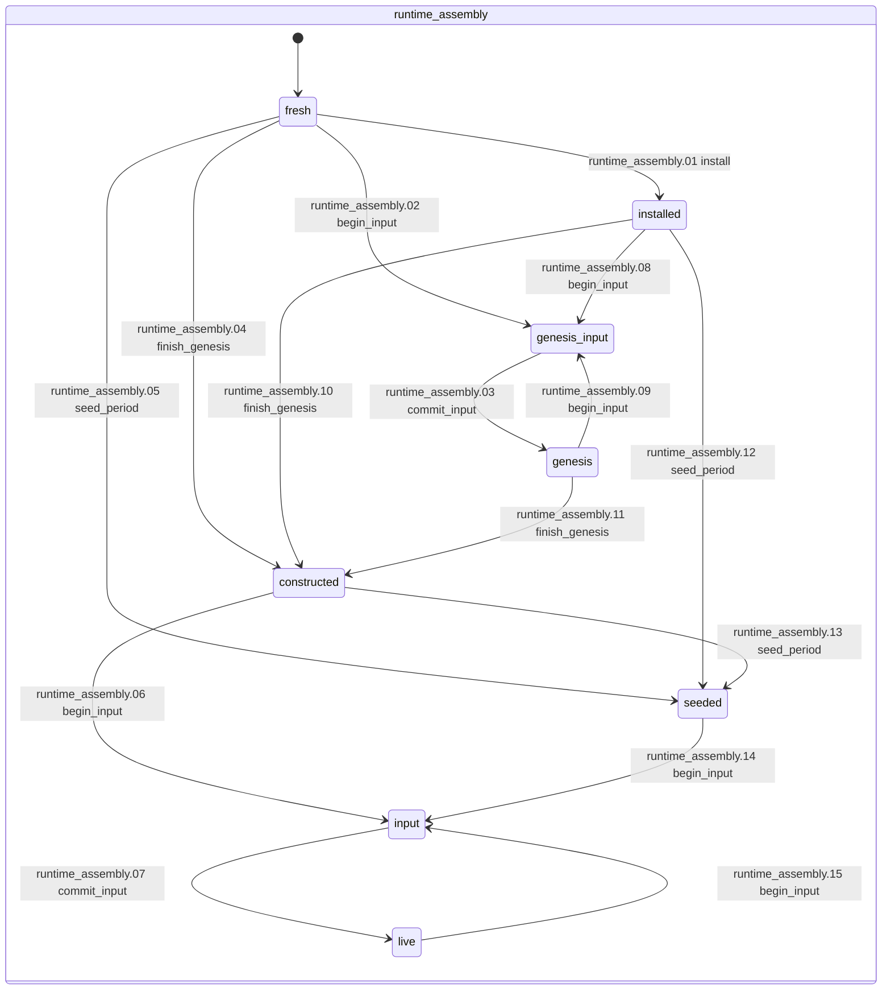

| Id | Source | Event | Guard | Action | Target | Kind | Cite |
| --- | --- | --- | --- | --- | --- | --- | --- |
| runtime_assembly.01 | fresh | install |  | Nothing is installed, committed or seeded. Carried rows land verbatim, revisions included. | installed | external | period-model ss7 |
| runtime_assembly.02 | fresh | begin_input |  | Construction is not finished. Open the genesis seed's input. | genesis_input | external | DL-87 |
| runtime_assembly.03 | genesis_input | commit_input |  | One revision per changed entity. | genesis | external | DL-87 |
| runtime_assembly.04 | fresh | finish_genesis |  | Construction ends. The genesis seed is not an input to the seed latch. | constructed | external | DL-132 |
| runtime_assembly.05 | fresh | seed_period |  | Set the period id. A period below one is the verb's own check. | seeded | external | period-model ss3.5, DL-132 |
| runtime_assembly.06 | constructed | begin_input |  | Snapshot on first touch. | input | external | DL-87, concurrency-model ss3 |
| runtime_assembly.07 | input | commit_input |  | Check capacity. One revision per changed entity. | live | external | DL-87, DL-120 |
| runtime_assembly.08 | installed | begin_input |  | As runtime_assembly.02. | genesis_input | external | DL-87 |
| runtime_assembly.09 | genesis | begin_input |  | As runtime_assembly.02. | genesis_input | external | DL-87 |
| runtime_assembly.10 | installed | finish_genesis |  | As runtime_assembly.04. | constructed | external | DL-132 |
| runtime_assembly.11 | genesis | finish_genesis |  | As runtime_assembly.04. | constructed | external | DL-132 |
| runtime_assembly.12 | installed | seed_period |  | As runtime_assembly.05. | seeded | external | period-model ss3.5, DL-132 |
| runtime_assembly.13 | constructed | seed_period |  | As runtime_assembly.05. | seeded | external | period-model ss3.5, DL-132 |
| runtime_assembly.14 | seeded | begin_input |  | As runtime_assembly.06. | input | external | DL-87, concurrency-model ss3 |
| runtime_assembly.15 | live | begin_input |  | As runtime_assembly.06. | input | external | DL-87, concurrency-model ss3 |
| runtime_assembly.16 | installed | install |  | Carried rows are assembly's first act: only a fresh state installs them. |  | refusal install_on_used_state | period-model ss7 |
| runtime_assembly.17 | genesis_input | install |  | Carried rows are assembly's first act: only a fresh state installs them. |  | refusal install_on_used_state | period-model ss7 |
| runtime_assembly.18 | genesis | install |  | Carried rows are assembly's first act: only a fresh state installs them. |  | refusal install_on_used_state | period-model ss7 |
| runtime_assembly.19 | constructed | install |  | Carried rows are assembly's first act: only a fresh state installs them. |  | refusal install_on_used_state | period-model ss7 |
| runtime_assembly.20 | seeded | install |  | Carried rows are assembly's first act: only a fresh state installs them. |  | refusal install_on_used_state | period-model ss7 |
| runtime_assembly.21 | input | install |  | Carried rows are assembly's first act: only a fresh state installs them. |  | refusal install_on_used_state | period-model ss7 |
| runtime_assembly.22 | live | install |  | Carried rows are assembly's first act: only a fresh state installs them. |  | refusal install_on_used_state | period-model ss7 |
| runtime_assembly.23 | fresh | commit_input |  | A commit needs an input open. |  | refusal no_input_open | DL-87, DL-293 |
| runtime_assembly.24 | installed | commit_input |  | A commit needs an input open. |  | refusal no_input_open | DL-87, DL-293 |
| runtime_assembly.25 | genesis | commit_input |  | A commit needs an input open. |  | refusal no_input_open | DL-87, DL-293 |
| runtime_assembly.26 | constructed | commit_input |  | A commit needs an input open. |  | refusal no_input_open | DL-87, DL-293 |
| runtime_assembly.27 | seeded | commit_input |  | A commit needs an input open. |  | refusal no_input_open | DL-87, DL-293 |
| runtime_assembly.28 | live | commit_input |  | A commit needs an input open. |  | refusal no_input_open | DL-87, DL-293 |
| runtime_assembly.29 | genesis_input | begin_input |  | Inputs do not nest. |  | refusal input_already_open | DL-87 |
| runtime_assembly.30 | input | begin_input |  | Inputs do not nest. |  | refusal input_already_open | DL-87 |
| runtime_assembly.31 | constructed | finish_genesis |  | Construction ends once: a second call would launder a used state back to fresh. |  | refusal construction_finished | DL-132 |
| runtime_assembly.32 | seeded | finish_genesis |  | Construction comes before the seed. |  | refusal construction_after_seed | DL-132 |
| runtime_assembly.33 | genesis_input | finish_genesis |  | Construction ends after the genesis input commits. |  | refusal inside_genesis_input | DL-87, DL-293 |
| runtime_assembly.34 | input | finish_genesis |  | Construction ends once: a second call would launder a used state back to fresh. |  | refusal construction_finished | DL-132 |
| runtime_assembly.35 | live | finish_genesis |  | Construction ends once: a second call would launder a used state back to fresh. |  | refusal construction_finished | DL-132 |
| runtime_assembly.36 | genesis_input | seed_period |  | Assembly precedes inputs. |  | refusal seed_inside_input | DL-132 |
| runtime_assembly.37 | genesis | seed_period |  | Seeding is assembly's first act: a live state never moves its period. |  | refusal seed_on_used_state | period-model ss3.5, DL-132 |
| runtime_assembly.38 | seeded | seed_period |  | Seeding is assembly's first act: a live state never moves its period. |  | refusal seed_on_used_state | period-model ss3.5, DL-132 |
| runtime_assembly.39 | input | seed_period |  | Assembly precedes inputs. |  | refusal seed_inside_input | DL-132 |
| runtime_assembly.40 | live | seed_period |  | Seeding is assembly's first act: a live state never moves its period. |  | refusal seed_on_used_state | period-model ss3.5, DL-132 |

| State | In | Entry | Exit | Defers | Waits |
| --- | --- | --- | --- | --- | --- |
| runtime_assembly |  |  |  |  |  |
| fresh | runtime_assembly/phase |  |  |  |  |
| installed | runtime_assembly/phase |  |  |  |  |
| genesis_input | runtime_assembly/phase |  |  |  |  |
| genesis | runtime_assembly/phase |  |  |  |  |
| constructed | runtime_assembly/phase |  |  |  |  |
| seeded | runtime_assembly/phase |  |  |  |  |
| input | runtime_assembly/phase |  |  |  |  |
| live | runtime_assembly/phase |  |  |  |  |

## anchor_head

Clock: logical.

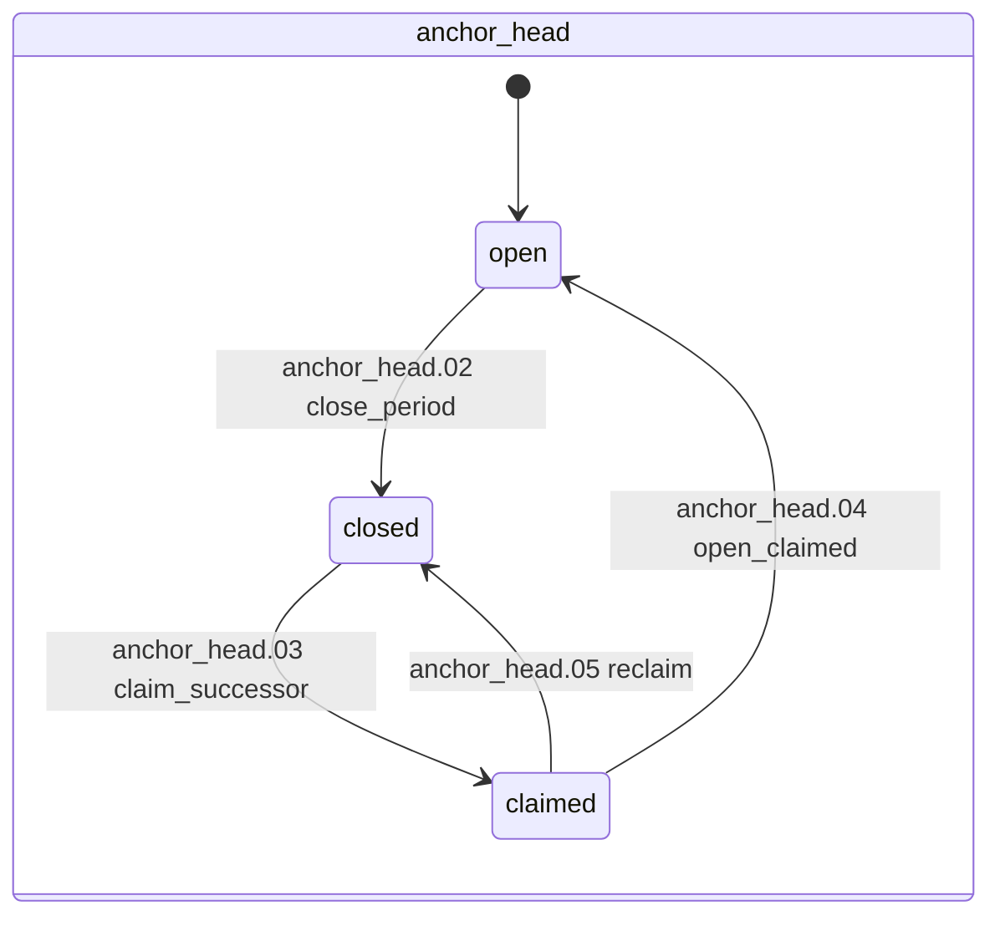

| Id | Source | Event | Guard | Action | Target | Kind | Cite |
| --- | --- | --- | --- | --- | --- | --- | --- |
| anchor_head.02 | open | close_period |  | The head is open at this period (the method's check). Write it closed at the seal digest, with the period's row in the same write. | closed | external | period-model ss1.3, ss3 |
| anchor_head.03 | closed | claim_successor |  | The head is closed at this seal digest (the method's check). Write the claim file first, then the head. | claimed | external | period-model ss1.3 |
| anchor_head.04 | claimed | open_claimed |  | The head names this claim (the method's check). Write the successor's durable registry row in the same write. | open | external | period-model ss1.3, PR-02c |
| anchor_head.05 | claimed | reclaim |  | The claim file binds its body, the estate and the head, and the registry holds the previous seal as committed (the method's checks). Append a Reclaimed entry and return the head to the previous seal. | closed | external | period-model ss1.3 |
| anchor_head.06 | claimed | claim_successor |  | The head names this claim and the claim file is gone (the method's checks). Write the claim file again, the head is written unchanged. DL-290 leaves open whether this is reachable: `reclaim` and the resume step refuse the same state as unreachable. |  | internal | period-model ss1.3, DL-290 |
| anchor_head.07 | anchor_head | create_open |  | The method answers its own interrupted genesis before any post. |  | refusal anchor_exists | period-model ss1.1, PR-01b |
| anchor_head.08 | anchor_head | close_period |  | The method answers a repeat at this period's closed head before any post. |  | refusal head_not_open | period-model ss1.3 |
| anchor_head.09 | anchor_head | claim_successor |  |  |  | refusal head_not_closed | period-model ss1.3 |
| anchor_head.10 | anchor_head | open_claimed |  | The method answers a repeat at this period's open head before any post. |  | refusal head_not_claimed | period-model ss1.3 |
| anchor_head.11 | anchor_head | reclaim |  |  |  | refusal head_not_claimed | period-model ss1.3 |

| State | In | Entry | Exit | Defers | Waits |
| --- | --- | --- | --- | --- | --- |
| anchor_head |  |  |  |  |  |
| open | anchor_head/head |  |  |  |  |
| closed | anchor_head/head |  |  |  |  |
| claimed | anchor_head/head |  |  |  |  |

## period_row

Clock: logical.

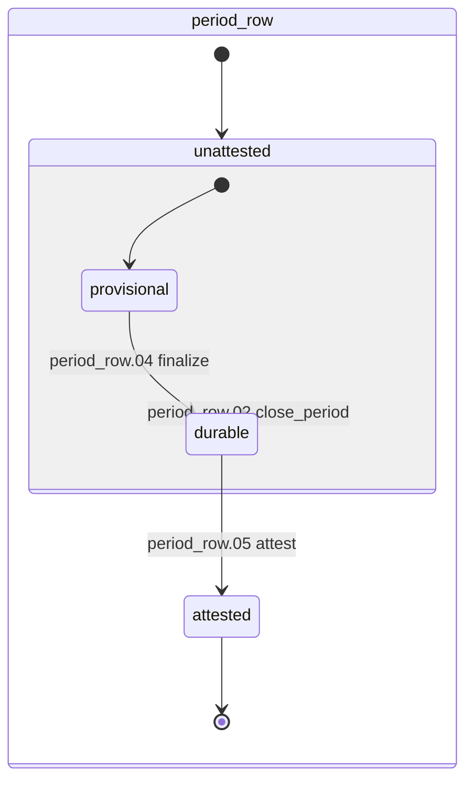

| Id | Source | Event | Guard | Action | Target | Kind | Cite |
| --- | --- | --- | --- | --- | --- | --- | --- |
| period_row.02 | unattested | close_period |  | The head closes this period. Record the seal digest and mark the segment durable. `provisional` is a tolerated source, not reachable after a crash: the row is present and finalized before any run. With no row the close writes one, durable, and no instance existed to move. | durable | external | period-model ss1.3, ss3 |
| period_row.04 | provisional | finalize |  | The segment has landed. Mark it durable. | durable | external | period-model ss1.3 |
| period_row.05 | durable | attest |  | The row's seal digest and root match the audit (the method's checks). Mark the row attested. | attested | external | period-model ss1.3, ss11 |
| period_row.06 | period_row | create_open |  | The head refuses first: genesis meets an existing anchor. |  | refusal row_exists | period-model ss1.3, PR-02c |
| period_row.07 | period_row | open_claimed |  | A successor's row is written only in the write that opens it. |  | refusal row_exists | period-model ss1.3, PR-02c |
| period_row.08 | period_row | close_period |  | Only `attested` reaches this row. |  | refusal row_attested | period-model ss1.3 |
| period_row.09 | durable | finalize |  | The method answers this repeat before any post. |  | refusal row_durable | period-model ss1.3 |
| period_row.10 | period_row | finalize |  | Only `attested` reaches this row. The method answers a durable row before any post. It meets a forged row only: attested without its durable flag. |  | refusal row_attested | period-model ss1.3 |
| period_row.11 | provisional | attest |  |  |  | refusal row_not_durable | period-model ss1.3 |
| period_row.12 | period_row | attest |  | Only `attested` reaches this row. The method answers a repeat before any post. It meets a forged row only: attested without its durable flag. |  | refusal row_attested | period-model ss1.3 |

| State | In | Entry | Exit | Defers | Waits |
| --- | --- | --- | --- | --- | --- |
| period_row |  |  |  |  |  |
| unattested | period_row/row |  |  |  |  |
| provisional | unattested/segment |  |  |  |  |
| durable | unattested/segment |  |  |  |  |
| attested (final) | period_row/row |  |  |  |  |

## supervisor_process

Clock: monotonic. Time events: deadman.

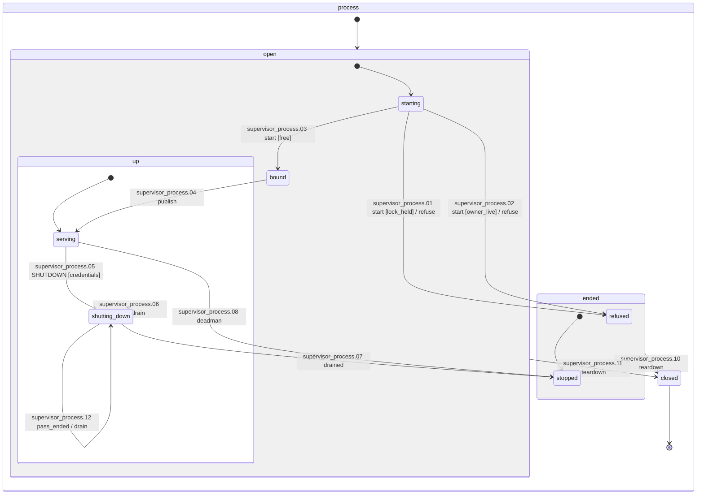

| Id | Source | Event | Guard | Action | Target | Kind | Cite |
| --- | --- | --- | --- | --- | --- | --- | --- |
| supervisor_process.01 | starting | start | lock_held | refuse | refused | external | supervisor-protocol ss5, DL-210 |
| supervisor_process.02 | starting | start | owner_live | refuse | refused | external | supervisor-protocol ss5, DL-210 |
| supervisor_process.03 | starting | start | free |  | bound | external | supervisor-protocol ss5, DL-210 |
| supervisor_process.04 | bound | publish |  | The private socket listens with mode 0600, supervisor.pid is written, and the socket is renamed to supervisor.sock. | serving | external | supervisor-protocol ss5, DL-210, DL-275 |
| supervisor_process.05 | serving | SHUTDOWN | credentials |  | shutting_down | external | supervisor-protocol ss5 SHUTDOWN, DL-80 |
| supervisor_process.06 | up | term |  | drain | shutting_down | external | supervisor-protocol ss5 SHUTDOWN, DL-275, DL-300 |
| supervisor_process.07 | shutting_down | drained |  | The shutdown's wait ended: every wrapper reaped, or the last-resort bound passed and every survivor's group was killed. | stopped | external | supervisor-protocol ss5 SHUTDOWN, DL-48, DL-150 |
| supervisor_process.08 | serving | deadman |  | A deadman is set and no live leaseholder for that many seconds, the supervisor logs the reason first. | stopped | external | supervisor-protocol ss5 The deadman, DL-95 |
| supervisor_process.09 | stopped | term |  | A signal latched during a shutdown that already ran in this loop pass. Nothing runs. |  | internal | supervisor-protocol ss5 SHUTDOWN |
| supervisor_process.10 | ended | teardown |  | Flush replies for up to 2 s, drop every connection, unlink what this incarnation published, close the open lifelines and the lock. | closed | external | supervisor-protocol ss5, DL-210 |
| supervisor_process.11 | open | teardown |  | An error ended startup or the loop: the cleanup of .10, and main exits 1. | closed | external | supervisor-protocol ss5, DL-210 |
| supervisor_process.12 | shutting_down | pass_ended |  | drain | shutting_down | external | supervisor-protocol ss5 SHUTDOWN, DL-300 |
| supervisor_process.13 | serving | SPAWN | credentials |  |  | internal | supervisor-protocol ss5 mutating verbs, DL-80 |
| supervisor_process.14 | serving | SIGNAL | credentials |  |  | internal | supervisor-protocol ss5 mutating verbs, DL-80 |
| supervisor_process.15 | serving | SPAWN | foreign |  |  | refusal wrong_incarnation | supervisor-protocol ss5 mutating verbs, DL-80, DL-229 |
| supervisor_process.16 | serving | SPAWN | stale |  |  | refusal stale_token | supervisor-protocol ss5 mutating verbs, DL-80, DL-229 |
| supervisor_process.17 | serving | SIGNAL | foreign |  |  | refusal wrong_incarnation | supervisor-protocol ss5 mutating verbs, DL-80, DL-229 |
| supervisor_process.18 | serving | SIGNAL | stale |  |  | refusal stale_token | supervisor-protocol ss5 mutating verbs, DL-80, DL-229 |
| supervisor_process.19 | serving | SHUTDOWN | foreign |  |  | refusal wrong_incarnation | supervisor-protocol ss5 mutating verbs, DL-80, DL-229 |
| supervisor_process.20 | serving | SHUTDOWN | stale |  |  | refusal stale_token | supervisor-protocol ss5 mutating verbs, DL-80, DL-229 |
| supervisor_process.21 | process | start | closed |  |  | ignored | statechart-engine ss10 |
| supervisor_process.22 | process | publish | closed |  |  | ignored | statechart-engine ss10 |
| supervisor_process.23 | process | term | closed |  |  | ignored | statechart-engine ss10 |
| supervisor_process.24 | process | drained | closed |  |  | ignored | statechart-engine ss10 |
| supervisor_process.25 | process | pass_ended | closed |  |  | ignored | statechart-engine ss10 |
| supervisor_process.26 | process | deadman | closed |  |  | ignored | statechart-engine ss10 |
| supervisor_process.27 | process | teardown | closed |  |  | ignored | statechart-engine ss10 |
| supervisor_process.28 | process | SPAWN | closed |  |  | ignored | statechart-engine ss10 |
| supervisor_process.29 | process | SIGNAL | closed |  |  | ignored | statechart-engine ss10 |
| supervisor_process.30 | process | SHUTDOWN | closed |  |  | ignored | statechart-engine ss10 |

| State | In | Entry | Exit | Defers | Waits |
| --- | --- | --- | --- | --- | --- |
| process |  |  |  |  |  |
| open | process/phase |  |  |  |  |
| starting | open/phase |  |  |  |  |
| bound | open/phase |  |  |  |  |
| up | open/phase |  |  |  |  |
| serving | up/phase |  |  |  |  |
| shutting_down | up/phase |  |  |  |  |
| ended | process/phase |  |  |  |  |
| stopped | ended/phase |  |  |  |  |
| refused | ended/phase |  |  |  |  |
| closed (final) | process/phase |  |  |  |  |

| Name | Kind | Prose |
| --- | --- | --- |
| lock_held | guard | supervisor.lock is held: another supervisor owns this root (DL-210). |
| owner_live | guard | The lock is taken, and the published socket answers PING within one of three attempts across a second or the pid record does not prove its owner absent (DL-210). |
| free | guard | The lock is taken and no other owner is proven present: private sockets are swept, the published path is reclaimed and the private socket is bound (DL-210). |
| credentials | guard | This incarnation and the current token of an unexpired lease, an integer on the wire (DL-151). Any connection may present them. The one fence of RENEW, RELEASE, SPAWN, SIGNAL and SHUTDOWN (ss5). |
| foreign | guard | The request names no incarnation or another one: the supervisor it knew is gone, so it must re-acquire and reconcile (DL-80). |
| stale | guard | This incarnation without credentials: the token is stale or the lease is not held, so the request is refused stale_token (ss5). With `foreign` and `credentials` this partitions every request. |
| closed | guard | The process is closed. Nothing posts then, elsewhere an out-of-order fact finds no row and raises `UnhandledEvent`. |
| refuse | action | Exit 1: another supervisor owns this root, teardown releases only what this process took. |
| drain | action | Run the shutdown's wait: up to 5 s for missing spawn records, TERM each live command group, KILL each after its grace, and KILL every survivor after the longest grace plus 2 s. Lifelines stay open until each wrapper exits (DL-48, DL-150). |

## supervisor_lease

Clock: monotonic. Time events: expire.

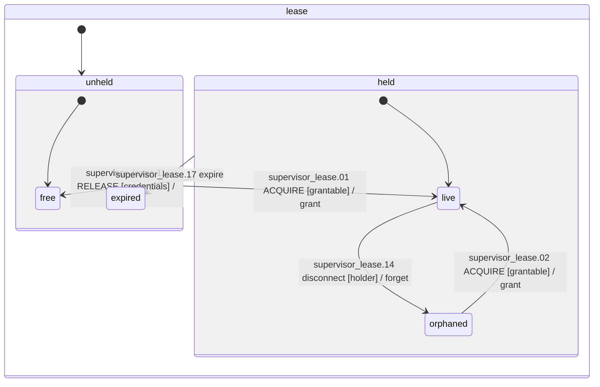

| Id | Source | Event | Guard | Action | Target | Kind | Cite |
| --- | --- | --- | --- | --- | --- | --- | --- |
| supervisor_lease.01 | unheld | ACQUIRE | grantable | grant | live | external | supervisor-protocol ss5 lease verbs, DL-79, DL-150 |
| supervisor_lease.02 | orphaned | ACQUIRE | grantable | grant | live | external | supervisor-protocol ss5 lease verbs, DL-79, DL-150 |
| supervisor_lease.03 | live | ACQUIRE | incumbent | grant |  | internal | supervisor-protocol ss5 lease verbs, DL-79, DL-80 |
| supervisor_lease.04 | live | ACQUIRE | challenger |  |  | refusal lease_held | supervisor-protocol ss5 lease verbs, DL-79 |
| supervisor_lease.05 | lease | ACQUIRE | unnamed |  |  | refusal bad_controller_id | supervisor-protocol ss5 lease verbs, DL-150 |
| supervisor_lease.06 | lease | ACQUIRE | untimed |  |  | refusal internal | supervisor-protocol ss5 lease verbs, DL-300 |
| supervisor_lease.07 | held | RENEW | renewable | extend |  | internal | supervisor-protocol ss5 lease verbs, DL-150 |
| supervisor_lease.08 | held | RENEW | renewal_untimed |  |  | refusal internal | supervisor-protocol ss5 lease verbs, DL-300 |
| supervisor_lease.09 | lease | RENEW | foreign |  |  | refusal wrong_incarnation | supervisor-protocol ss5 incarnation, DL-80, DL-150 |
| supervisor_lease.10 | lease | RENEW | this_incarnation |  |  | refusal stale_token | supervisor-protocol ss5 incarnation, DL-150 |
| supervisor_lease.11 | held | RELEASE | credentials | release | free | external | supervisor-protocol ss5 lease verbs, DL-150 |
| supervisor_lease.12 | lease | RELEASE | foreign |  |  | refusal wrong_incarnation | supervisor-protocol ss5 incarnation, DL-80, DL-150 |
| supervisor_lease.13 | lease | RELEASE | this_incarnation |  |  | refusal stale_token | supervisor-protocol ss5 incarnation, DL-150 |
| supervisor_lease.14 | live | disconnect | holder | forget | orphaned | external | supervisor-protocol ss5 lease verbs, DL-150 |
| supervisor_lease.15 | expired | disconnect | holder | forget |  | internal | supervisor-protocol ss5 lease verbs |
| supervisor_lease.16 | lease | disconnect |  |  |  | ignored | supervisor-protocol ss5 lease verbs |
| supervisor_lease.17 | held | expire |  |  | expired | external | supervisor-protocol ss5 lease verbs |
| supervisor_lease.18 | lease | expire |  |  |  | ignored | supervisor-protocol ss5 lease verbs |

| State | In | Entry | Exit | Defers | Waits |
| --- | --- | --- | --- | --- | --- |
| lease |  |  |  |  |  |
| unheld | lease/phase |  |  |  |  |
| free | unheld/phase |  |  |  |  |
| expired | unheld/phase |  |  |  |  |
| held | lease/phase |  |  |  | expire |
| live | held/phase |  |  |  |  |
| orphaned | held/phase |  |  |  |  |

| Name | Kind | Prose |
| --- | --- | --- |
| grantable | guard | controller_id is a non-empty string and ttl_s gives a representable expiry. A zero or negative ttl_s is grantable: the lease is due at once and the next sample expires it (ss5). |
| incumbent | guard | Grantable, with this incarnation and the current token: the incumbent re-keys and its old token dies (DL-79, DL-80). controller_id is a label and the token proves incumbency, not authenticity, the same-uid peer-cred gate on accept authenticates (supervisor-protocol ss5). |
| challenger | guard | controller_id is a non-empty string and ttl_s is a number, without the current token: a live lease yields only to its incumbent (DL-79). The expiry is not computed. |
| unnamed | guard | controller_id is not a non-empty string, checked before ttl_s and any lease state (DL-150). |
| untimed | guard | controller_id is a non-empty string and ttl_s gives no representable expiry (not a number, inf, nan, 1e20). Nothing changes, not even the token counter (DL-300). |
| renewable | guard | This incarnation and the current token, and ttl_s gives a representable expiry (DL-150, DL-300). |
| renewal_untimed | guard | This incarnation and the current token, and ttl_s gives no representable expiry, nothing changes (DL-300). |
| foreign | guard | The request names no incarnation or another one: the supervisor it knew is gone, so it must re-acquire and reconcile (DL-80). |
| this_incarnation | guard | The request names this incarnation (DL-80). |
| credentials | guard | This incarnation and the current token of an unexpired lease, an integer on the wire (DL-151). Any connection may present them. The one fence of RENEW, RELEASE, SPAWN, SIGNAL and SHUTDOWN (ss5). |
| holder | guard | The dropped connection is the one that holds the lease. |
| grant | action | Mint the next token and write a new record held on the claimant's connection with the request's deadline. A re-grant to the same controller_id keeps the dropped-push notice (DL-210). Answer the token, expiry and incarnation (DL-80). |
| extend | action | Move the deadline and expires_at to the request's. The connection is not adopted, so an orphaned lease stays orphaned and its pushes keep dropping until an ACQUIRE. |
| release | action | Drop the record and answer ok. |
| forget | action | Forget the holder's connection: pushes drop until the holder re-ACQUIREs, and any controller may ACQUIRE an orphaned lease, so a crashed engine's resume need not wait out the TTL. This is sound because the kernel closes the AF_UNIX fd only when the holder is gone or closes it, a non-local transport would break that (ss5). |

## supervisor_client

Clock: logical.

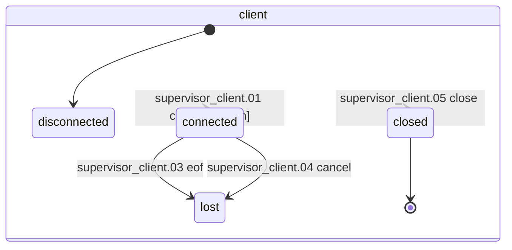

| Id | Source | Event | Guard | Action | Target | Kind | Cite |
| --- | --- | --- | --- | --- | --- | --- | --- |
| supervisor_client.01 | client | connect | down | A new epoch: the tier closes a writer the lost connection kept and cancels a reader still running, installs the new writer, a fresh lost event and its reader, then PINGs. A reconnect re-ACQUIREs when a token is held. | connected | external | supervisor-protocol ss5, DL-48, DL-79 |
| supervisor_client.02 | connected | connect |  | Supersede: the tier closes the live writer and cancels its reader, then installs the new epoch as for row .01. |  | internal | DL-48 |
| supervisor_client.03 | connected | eof |  | The tier has set the epoch's lost event and failed the pending request, the next request reconnects. | lost | external | supervisor-protocol ss5, runner-design ss7, DL-48 |
| supervisor_client.04 | connected | cancel |  | Poisoned: the tier has failed the pending request and closed the writer, since the stream has no correlation ids and the reply in flight could reach the next request. | lost | external | DL-48 |
| supervisor_client.05 | client | close | open |  | closed | external | DL-48 |
| supervisor_client.06 | lost | cancel |  | Poisoned after the loss: EOF failed the pending request before the cancelled request resumed. The tier closes the writer the loss kept, so nothing more is written to that stream. |  | internal | DL-48 |
| supervisor_client.07 | lost | eof |  | The reader of a poisoned epoch meets the EOF its own poison caused: the epoch is already lost. |  | ignored | statechart-engine ss10 |
| supervisor_client.08 | client | connect | over |  |  | ignored | statechart-engine ss10 |
| supervisor_client.09 | client | eof | over |  |  | ignored | statechart-engine ss10 |
| supervisor_client.10 | client | cancel | over |  |  | ignored | statechart-engine ss10 |
| supervisor_client.11 | client | close | over |  |  | ignored | statechart-engine ss10 |

| State | In | Entry | Exit | Defers | Waits |
| --- | --- | --- | --- | --- | --- |
| client |  |  |  |  |  |
| disconnected | client/phase |  |  |  |  |
| connected | client/phase |  |  |  |  |
| lost | client/phase |  |  |  |  |
| closed (final) | client/phase |  |  |  |  |

| Name | Kind | Prose |
| --- | --- | --- |
| down | guard | No connection is live: the client is disconnected, before its first connect, or lost. A connected client takes `supervisor_client.02`, and a closed one posts nothing. |
| open | guard | The client is not closed yet: from disconnected, connected or lost, close cancels the renewal, reader and LIST tasks, then closes the writer. |
| over | guard | The client is closed. Nothing posts to it: a second close posts nothing, a connection that completes after the close is closed unposted, and the EOF and cancel the close itself causes do their transport work with no post. Before the first connect, an EOF or a cancel finds no row and raises `UnhandledEvent`. |

## host

Clock: logical.

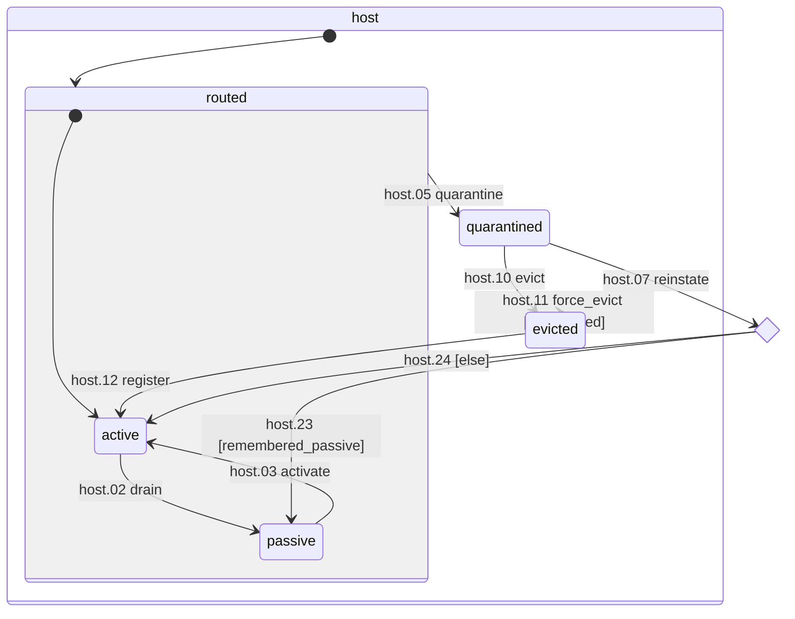

| Id | Source | Event | Guard | Action | Target | Kind | Cite |
| --- | --- | --- | --- | --- | --- | --- | --- |
| host.01 | active | activate |  | none: the row does not move and no revision moves |  | internal | concurrency-model ss8 |
| host.02 | active | drain |  | new effects are held, running work continues | passive | external | concurrency-model ss8, CM-13 |
| host.03 | passive | activate |  | held starts dispatch again | active | external | concurrency-model ss8 |
| host.04 | passive | drain |  | none: the row does not move and no revision moves |  | internal | concurrency-model ss8 |
| host.05 | routed | quarantine |  | The leader's renewal failed five times in a row. The row remembers the state it interrupts. | quarantined | external | concurrency-model ss7, ss8, DL-97, DL-291 |
| host.06 | quarantined | quarantine |  | none: repeated unreachability is one fact |  | internal | DL-97 |
| host.07 | quarantined | reinstate |  | The host answered again: put back the state quarantine interrupted, and forget it. | remembered | external | concurrency-model ss8, DL-97 |
| host.08 | active | reinstate |  | none: nothing to put back |  | internal | concurrency-model ss8, DL-111 |
| host.09 | passive | reinstate |  | none: nothing to put back |  | internal | concurrency-model ss8, DL-111 |
| host.10 | quarantined | evict |  | The gate has proved the bound: a deadman, a contact, and silence past deadman + kill + skew. generation += 1, forced_by = none, forget the interrupted state. | evicted | external | concurrency-model ss8 preconditions 1-3, DL-151 |
| host.11 | host | force_evict | not_evicted | The gate has the attribution: claimed_actor names who asks. generation += 1, forced_by = the actor, forget the interrupted state. | evicted | external | concurrency-model ss8, DL-111, DL-151 |
| host.12 | evicted | register |  | The relay presents the current generation and has self-fenced. Its held jobs run as new runs with new effect ids. No code posts it. | active | external (spec-only) | concurrency-model ss8 (eviction is fenced on return), period-model ss3.3 |
| host.13 | quarantined | activate |  |  |  | refusal host_quarantined | concurrency-model ss8, concurrency-model ss7 |
| host.14 | quarantined | drain |  |  |  | refusal host_quarantined | concurrency-model ss8, concurrency-model ss7 |
| host.15 | routed | evict |  |  |  | refusal host_not_quarantined | concurrency-model ss8 precondition 1, DL-94 |
| host.16 | evicted | activate |  |  |  | refusal host_evicted | concurrency-model ss8 |
| host.17 | evicted | drain |  |  |  | refusal host_evicted | concurrency-model ss8 |
| host.18 | evicted | quarantine |  |  |  | refusal host_evicted | concurrency-model ss8, CM-12 |
| host.19 | evicted | reinstate |  |  |  | refusal host_evicted | concurrency-model ss8, CM-12 |
| host.20 | evicted | evict |  |  |  | refusal host_already_evicted | concurrency-model ss8 |
| host.21 | evicted | force_evict |  |  |  | refusal host_already_evicted | concurrency-model ss8 |
| host.22 | host | register |  | Re-registration refreshes identity and keeps the state. No tier path posts it: `register_host` on an existing row starts nothing. |  | ignored | concurrency-model ss8, DL-94 |

| Id | Choice | Guard | Action | Target |
| --- | --- | --- | --- | --- |
| host.23 | remembered | remembered_passive |  | passive |
| host.24 | remembered | else |  | active |

| State | In | Entry | Exit | Defers | Waits |
| --- | --- | --- | --- | --- | --- |
| host |  |  |  |  |  |
| routed | host/routing |  |  |  |  |
| active | routed/routing |  |  |  |  |
| passive | routed/routing |  |  |  |  |
| quarantined | host/routing |  |  |  |  |
| evicted | host/routing |  |  |  |  |

| Name | Kind | Prose |
| --- | --- | --- |
| not_evicted | guard | The host is not evicted (ss8: force skips the proof, not the state). |
| remembered_passive | guard | Quarantine interrupted `passive`: a drained host that answers again stays drained (DL-97). |

## admission

Clock: logical.

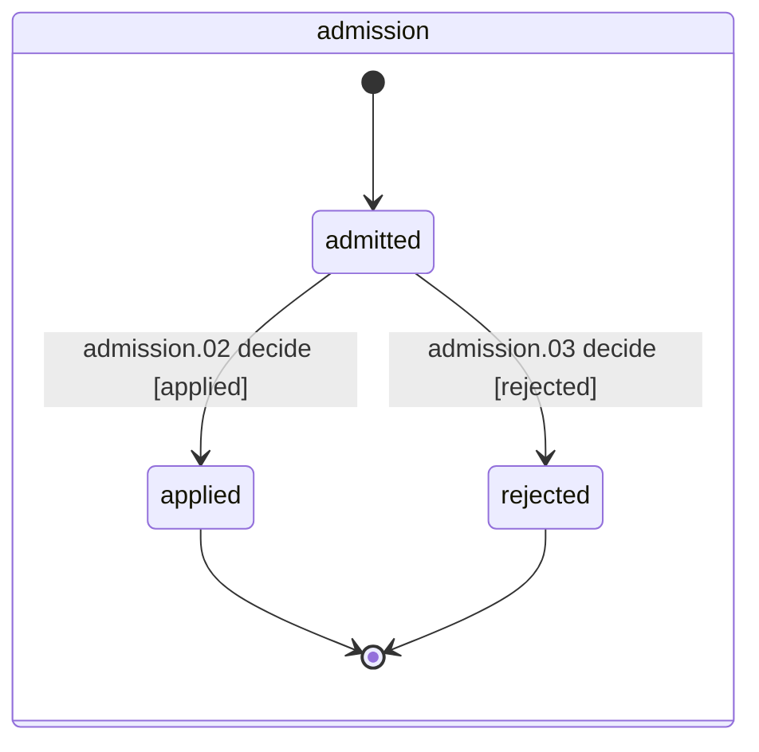

| Id | Source | Event | Guard | Action | Target | Kind | Cite |
| --- | --- | --- | --- | --- | --- | --- | --- |
| admission.02 | admitted | decide | applied | The decision line, with the outbox entries it implies. | applied | external | concurrency-model ss4 steps 5-7, DL-118 |
| admission.03 | admitted | decide | rejected | The decision line, with its stored code. | rejected | external | concurrency-model ss4, DL-235, DL-272, DL-320 |
| admission.09 | admitted | input | other | Refuse request_id_reused, with no decision to carry. |  | refusal request_id_reused | concurrency-model ss4 step 2, DL-217 |
| admission.10 | admitted | input | same | The index raises an EngineError: a second writer is applying inputs, or steps 5-7 yielded. The engine stops. |  | internal | concurrency-model ss4 step 2 |
| admission.11 | admission | decide | decided | A decision is final: the index answers an exact retry from the stored decision, and refuses a reused id with request_id_reused carrying it, before any post (DL-217, CM-05). It forgets the instance in the call that made it final. No tier path posts this row. |  | ignored | statechart-engine ss10 |
| admission.12 | admission | input | decided | A decision is final: the index answers an exact retry from the stored decision, and refuses a reused id with request_id_reused carrying it, before any post (DL-217, CM-05). It forgets the instance in the call that made it final. No tier path posts this row. |  | ignored | statechart-engine ss10 |

| State | In | Entry | Exit | Defers | Waits |
| --- | --- | --- | --- | --- | --- |
| admission |  |  |  |  |  |
| admitted | admission/window |  |  |  |  |
| applied (final) | admission/window |  |  |  |  |
| rejected (final) | admission/window |  |  |  |  |

| Name | Kind | Prose |
| --- | --- | --- |
| applied | guard | The decision is `applied`: the gate passed, or a replayed durable decision says applied. |
| rejected | guard | The decision is `rejected`: a precondition, the stale-completion gate or a host guard rejected the input, the input was quarantined, or a replayed durable decision says rejected. |
| same | guard | The input carries the fingerprint the attempt was admitted under. |
| other | guard | The input carries another fingerprint than the attempt's. |
| decided | guard | The instance rests in a final state. Nothing posts to it then: the index forgets the instance in the call that made it final, and answers an input for a decided id from the stored decision before any post (DL-217, CM-05). |

## effect

Clock: logical.

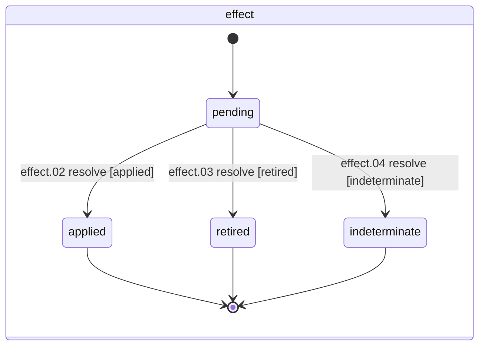

| Id | Source | Event | Guard | Action | Target | Kind | Cite |
| --- | --- | --- | --- | --- | --- | --- | --- |
| effect.02 | pending | resolve | applied | Dispatched, or resume found the run on the host, or a kill landed, or a replayed effect_result, or a carried execution. | applied | external | concurrency-model ss5, DL-96, period-model ss3.5 |
| effect.03 | pending | resolve | retired | Superseded at dispatch, or resume finds that the run it would kill has exited. | retired | external | concurrency-model ss5, DL-111, DL-232 |
| effect.04 | pending | resolve | indeterminate | Resume finds no status and no live wrapper for a kill. An exact retry answers outcome_unavailable. | indeterminate | external | concurrency-model ss5, CM-06, DL-111 |
| effect.05 | effect | resolve | over | An outcome is final: the outbox refuses a second one with an EngineError before any post, and forgets the instance in the call that made it final (DL-295). No tier path posts this row. |  | ignored | statechart-engine ss10 |

| State | In | Entry | Exit | Defers | Waits |
| --- | --- | --- | --- | --- | --- |
| effect |  |  |  |  |  |
| pending | effect/outcome |  |  |  |  |
| applied (final) | effect/outcome |  |  |  |  |
| retired (final) | effect/outcome |  |  |  |  |
| indeterminate (final) | effect/outcome |  |  |  |  |

| Name | Kind | Prose |
| --- | --- | --- |
| applied | guard | The outcome's state is `applied`. |
| retired | guard | The outcome's state is `retired`. |
| indeterminate | guard | The outcome's state is `indeterminate`. |
| over | guard | The effect rests in a final state. The outbox forgets the instance in the call that made it final and refuses a second outcome before any post (DL-295). In `pending` an outcome that no row's guard takes raises `UnhandledEvent`. |

## subscription

Clock: logical.

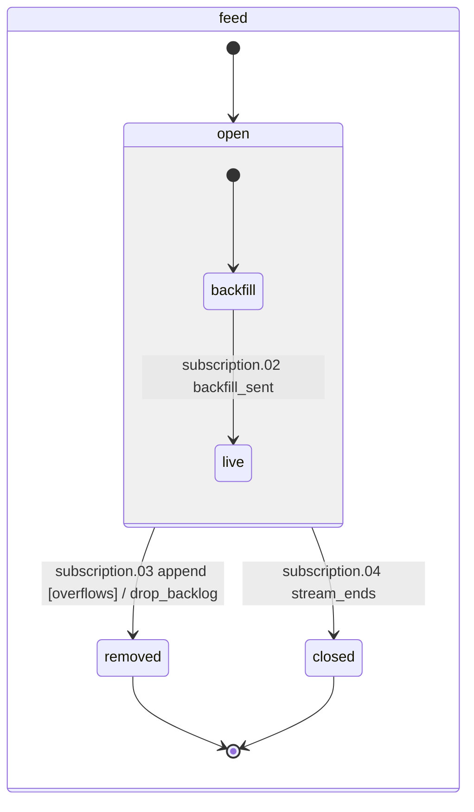

| Id | Source | Event | Guard | Action | Target | Kind | Cite |
| --- | --- | --- | --- | --- | --- | --- | --- |
| subscription.02 | backfill | backfill_sent |  | The handler posts it once the backfill went out without a refusal, with no `since` there is nothing to send. The handler then sends the queued live records past the seam. | live | external | control-protocol ss5, DL-45, DL-135 |
| subscription.03 | open | append | overflows | drop_backlog | removed | external | control-protocol ss5, DL-267 |
| subscription.04 | open | stream_ends |  | The client is gone, a refusal went on the stream, the lineage was lost, or the handler was cancelled. The journal has already taken the feed out of its fan-out. | closed | external | control-protocol ss5, PR-03, period-model ss11 |
| subscription.05 | open | append | fits | enqueue |  | internal | control-protocol ss5, DL-267 |
| subscription.06 | feed | append | over |  |  | ignored | statechart-engine ss10 |
| subscription.07 | feed | backfill_sent | over |  |  | ignored | statechart-engine ss10 |
| subscription.08 | feed | stream_ends | over |  |  | ignored | statechart-engine ss10 |

| State | In | Entry | Exit | Defers | Waits |
| --- | --- | --- | --- | --- | --- |
| feed |  |  |  |  |  |
| open | feed/phase |  |  |  |  |
| backfill | open/phase |  |  |  |  |
| live | open/phase |  |  |  |  |
| removed (final) | feed/phase |  |  |  |  |
| closed (final) | feed/phase |  |  |  |  |

| Name | Kind | Prose |
| --- | --- | --- |
| fits | guard | The record fits: the backlog is empty, or the backlog plus the record stays within the budget. An empty backlog takes one record of any size, so one record larger than the budget delays the feed and does not remove it (DL-267). |
| overflows | guard | The record does not fit: the backlog holds a record, and the backlog plus this one would pass the budget (DL-267). |
| over | guard | The feed rests in `removed` or `closed`. Nothing posts to it then: the journal forgets the instance in the call that made it final. In `live`, a second `backfill_sent` finds no row and raises `UnhandledEvent`. |
| enqueue | action | Queue the record and count its bytes against the budget. Memory only: the queue has no count limit, so this never blocks. |
| drop_backlog | action | Record why, and drop the backlog. The journal then takes the feed out of its fan-out and, once every other feed has the record, tells the owner, which ends the stream (DL-267). |

## seal_boundary

Clock: logical.

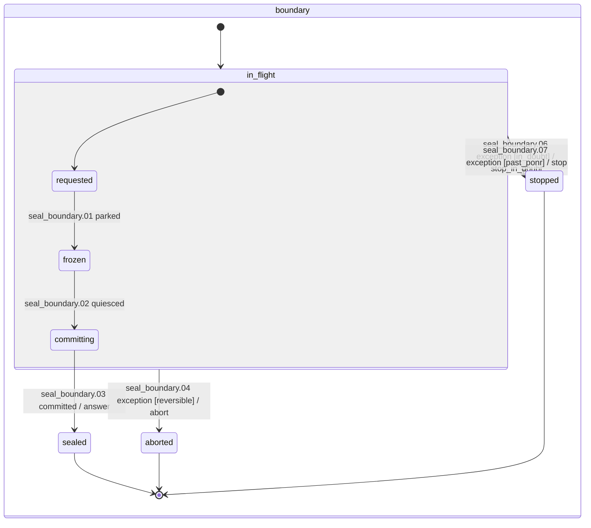

| Id | Source | Event | Guard | Action | Target | Kind | Cite |
| --- | --- | --- | --- | --- | --- | --- | --- |
| seal_boundary.01 | requested | parked |  | The barrier parked: admission is frozen and FW polls are parked (ss6 step 2). | frozen | external | period-model ss6 step 2, ss8, PR-28c |
| seal_boundary.02 | frozen | quiesced |  | The cutoff is chosen, drained and quiescent, and the supervisor proof holds (ss6 steps 3-7, ss8). `commit_boundary` runs next (step 8). | committing | external | period-model ss6 steps 3-8, PR-27 |
| seal_boundary.03 | committing | committed |  | answer | sealed | external | period-model ss7 |
| seal_boundary.04 | in_flight | exception | reversible | abort | aborted | external | period-model ss7, PR-28b |
| seal_boundary.05 | in_flight | exception | fence_lost | stop | stopped | external | period-model ss7, DL-101, PR-28b |
| seal_boundary.06 | in_flight | exception | in_doubt | stop_in_doubt | stopped | external | DL-274 |
| seal_boundary.07 | in_flight | exception | past_ponr | stop | stopped | external | period-model ss7 |
| seal_boundary.09 | boundary | parked | over |  |  | ignored | statechart-engine ss10 |
| seal_boundary.10 | boundary | quiesced | over |  |  | ignored | statechart-engine ss10 |
| seal_boundary.11 | boundary | committed | over |  |  | ignored | statechart-engine ss10 |
| seal_boundary.12 | boundary | exception | over |  |  | ignored | statechart-engine ss10 |

| State | In | Entry | Exit | Defers | Waits |
| --- | --- | --- | --- | --- | --- |
| boundary |  |  |  |  |  |
| in_flight | boundary/phase |  |  |  |  |
| requested | in_flight/phase |  |  |  |  |
| frozen | in_flight/phase |  |  |  |  |
| committing | in_flight/phase |  |  |  |  |
| sealed (final) | boundary/phase |  |  |  |  |
| aborted (final) | boundary/phase |  |  |  |  |
| stopped (final) | boundary/phase |  |  |  |  |

| Name | Kind | Prose |
| --- | --- | --- |
| past_ponr | guard | The exception is `BoundaryFailStop`: the `seal` append may have begun, so the outcome is unknown and recovery decides (PR-28d). The engine exits 4. Checked first. |
| fence_lost | guard | Not `BoundaryFailStop`, and the fence is lost: a leader that cannot prove it leads does not reopen admission (DL-101, PR-28b). It takes precedence over DL-274's flags. |
| in_doubt | guard | Not `BoundaryFailStop`, the fence intact, and memory or the WAL in doubt: an attempt admitted during the seal is not fully applied, an engine-made input the drain could not admit would be lost, or a WAL append is unfinished (DL-274). |
| reversible | guard | Not `BoundaryFailStop`, the fence intact, and nothing in doubt: every other exception before the `seal` append. A refusal before the freeze, a phase-2 refusal, the drain's timeout, a late input (`seal_input_after_cutoff`) and a failed sidecar write are among them (PR-28b). |
| over | guard | The boundary rests in a final state. Nothing posts to it then: an aborted boundary is forgotten at once, a sealed one once the answer has had its turns, and a stop ends the engine. In flight, an event out of order finds no row and raises `UnhandledEvent`. |
| answer | action | Answer the request with the committed boundary, then raise `PeriodSealed`: the engine exits 3 (PR-30b). |
| abort | action | Run `abort_boundary` and fail the request with the exception. The abort clears the sealing flag, reopens control admission, restarts scheduler admission and unparks FW polls. It touches no row, and C1 carries on (PR-28b). |
| stop | action | Re-raise without an abort. The request is not answered. |
| stop_in_doubt | action | Note which fact stopped the seal, then re-raise without an abort. Neither the request nor an attempt whose answer was owed is answered. Resume repairs the WAL tail and rebuilds from the WAL (DL-274). |
