# State machines

This file is generated from `dsl41.machines`; regenerate it with `uv run python scripts/render_state_machines.py`.

## job_status

```mermaid
stateDiagram-v2
    state "FAILURE" as s0
    state "INACTIVE" as s1
    state "QUE_WAIT" as s2
    state "RUNNING" as s3
    state "STARTING" as s4
    state "SUCCESS" as s5
    state "TERMINATED" as s6
    state c18 <<choice>>
    [*] --> s1
    s0 --> s5 : job_status.01 start [not a box, the job, or a box above it, is ON_NOEXEC] / start_run, no capacity is taken
    s1 --> s5 : job_status.01 start [not a box, the job, or a box above it, is ON_NOEXEC] / start_run, no capacity is taken
    s5 --> s5 : job_status.01 start [not a box, the job, or a box above it, is ON_NOEXEC] / start_run, no capacity is taken
    s6 --> s5 : job_status.01 start [not a box, the job, or a box above it, is ON_NOEXEC] / start_run, no capacity is taken
    s0 --> s4 : job_status.02 start [not a box, the gates hold, inside the run window, admissible] / arm term_run_time, start_run, reserve, or take over held units
    s1 --> s4 : job_status.02 start [not a box, the gates hold, inside the run window, admissible] / arm term_run_time, start_run, reserve, or take over held units
    s5 --> s4 : job_status.02 start [not a box, the gates hold, inside the run window, admissible] / arm term_run_time, start_run, reserve, or take over held units
    s6 --> s4 : job_status.02 start [not a box, the gates hold, inside the run window, admissible] / arm term_run_time, start_run, reserve, or take over held units
    s0 --> s2 : job_status.03 start [the gates hold, inside the run window, not admissible] / enqueue_waiter allocates the rank
    s1 --> s2 : job_status.03 start [the gates hold, inside the run window, not admissible] / enqueue_waiter allocates the rank
    s5 --> s2 : job_status.03 start [the gates hold, inside the run window, not admissible] / enqueue_waiter allocates the rank
    s6 --> s2 : job_status.03 start [the gates hold, inside the run window, not admissible] / enqueue_waiter allocates the rank
    s0 --> s4 : job_status.04 FORCE_STARTJOB [the job holds units from an earlier run] / start on the held units and the machine load, no admission test
    s6 --> s4 : job_status.04 FORCE_STARTJOB [the job holds units from an earlier run] / start on the held units and the machine load, no admission test
    s4 --> s3 : job_status.05 started [not a box, still STARTING at this run]
    s0 --> s1 : job_status.06 start [standalone, outside run_window, closer to the previous close]
    s5 --> s1 : job_status.06 start [standalone, outside run_window, closer to the previous close]
    s6 --> s1 : job_status.06 start [standalone, outside run_window, closer to the previous close]
    s0 --> s1 : job_status.07 start [its box is RUNNING and it has not run there, outside run_window, closer to the previous close] / record_resolution, the box's completion door runs
    s5 --> s1 : job_status.07 start [its box is RUNNING and it has not run there, outside run_window, closer to the previous close] / record_resolution, the box's completion door runs
    s6 --> s1 : job_status.07 start [its box is RUNNING and it has not run there, outside run_window, closer to the previous close] / record_resolution, the box's completion door runs
    s2 --> s4 : job_status.08 readmit [its box is RUNNING, not held, admissible, queued-recheck passes] / dequeue_waiter, reserve, start_run
    s2 --> s1 : job_status.09 readmit [its box is not RUNNING, a full scan] / dequeue_waiter
    s2 --> s1 : job_status.10 readmit [queued-recheck fails] / disarm, dequeue_waiter, void_resolution, then defer or skip
    s2 --> s6 : job_status.11 KILLJOB / dequeue_waiter, disarm
    s2 --> s1 : job_status.12 ON_ICE / set ON_ICE, dequeue_waiter
    s2 --> s1 : job_status.13 ON_NOEXEC [not a box, not ignored] / set ON_NOEXEC, dequeue_waiter, clear the exit code, retry the start
    s3 --> s6 : job_status.14 KILLJOB / a box kills its job_terminator members
    s4 --> s6 : job_status.14 KILLJOB / a box kills its job_terminator members
    s3 --> s6 : job_status.15 TIMER term_run_time [the timer's run is the row's run] / a box kills its job_terminator members
    s3 --> s6 : job_status.16 box ends FAILURE or TERMINATED [a member with job_terminator] / a box kills its own job_terminator members
    s4 --> s6 : job_status.16 box ends FAILURE or TERMINATED [a member with job_terminator] / a box kills its own job_terminator members
    s0 --> s5 : job_status.17 STATUS exit_code [exit_is_success] / release the run's units on leaving STARTING or RUNNING
    s1 --> s5 : job_status.17 STATUS exit_code [exit_is_success] / release the run's units on leaving STARTING or RUNNING
    s2 --> s5 : job_status.17 STATUS exit_code [exit_is_success] / release the run's units on leaving STARTING or RUNNING
    s3 --> s5 : job_status.17 STATUS exit_code [exit_is_success] / release the run's units on leaving STARTING or RUNNING
    s4 --> s5 : job_status.17 STATUS exit_code [exit_is_success] / release the run's units on leaving STARTING or RUNNING
    s5 --> s5 : job_status.17 STATUS exit_code [exit_is_success] / release the run's units on leaving STARTING or RUNNING
    s6 --> s5 : job_status.17 STATUS exit_code [exit_is_success] / release the run's units on leaving STARTING or RUNNING
    s0 --> s0 : job_status.18 STATUS exit_code [not exit_is_success] / release the run's units on leaving STARTING or RUNNING
    s1 --> s0 : job_status.18 STATUS exit_code [not exit_is_success] / release the run's units on leaving STARTING or RUNNING
    s2 --> s0 : job_status.18 STATUS exit_code [not exit_is_success] / release the run's units on leaving STARTING or RUNNING
    s3 --> s0 : job_status.18 STATUS exit_code [not exit_is_success] / release the run's units on leaving STARTING or RUNNING
    s4 --> s0 : job_status.18 STATUS exit_code [not exit_is_success] / release the run's units on leaving STARTING or RUNNING
    s5 --> s0 : job_status.18 STATUS exit_code [not exit_is_success] / release the run's units on leaving STARTING or RUNNING
    s6 --> s0 : job_status.18 STATUS exit_code [not exit_is_success] / release the run's units on leaving STARTING or RUNNING
    s0 --> c18 : job_status.19 STATUS status [the status is not INACTIVE, or the job has no catalog entry] / release the run's units on leaving STARTING or RUNNING
    s1 --> c18 : job_status.19 STATUS status [the status is not INACTIVE, or the job has no catalog entry] / release the run's units on leaving STARTING or RUNNING
    s2 --> c18 : job_status.19 STATUS status [the status is not INACTIVE, or the job has no catalog entry] / release the run's units on leaving STARTING or RUNNING
    s3 --> c18 : job_status.19 STATUS status [the status is not INACTIVE, or the job has no catalog entry] / release the run's units on leaving STARTING or RUNNING
    s4 --> c18 : job_status.19 STATUS status [the status is not INACTIVE, or the job has no catalog entry] / release the run's units on leaving STARTING or RUNNING
    s5 --> c18 : job_status.19 STATUS status [the status is not INACTIVE, or the job has no catalog entry] / release the run's units on leaving STARTING or RUNNING
    s6 --> c18 : job_status.19 STATUS status [the status is not INACTIVE, or the job has no catalog entry] / release the run's units on leaving STARTING or RUNNING
    c18 --> s0
    c18 --> s1
    c18 --> s3
    c18 --> s4
    c18 --> s5
    c18 --> s6
    s0 --> s1 : job_status.20 STATUS INACTIVE [a catalog job, not a box] / record_resolution when its box is RUNNING, SEM-15 on an idle box
    s1 --> s1 : job_status.20 STATUS INACTIVE [a catalog job, not a box] / record_resolution when its box is RUNNING, SEM-15 on an idle box
    s2 --> s1 : job_status.20 STATUS INACTIVE [a catalog job, not a box] / record_resolution when its box is RUNNING, SEM-15 on an idle box
    s3 --> s1 : job_status.20 STATUS INACTIVE [a catalog job, not a box] / record_resolution when its box is RUNNING, SEM-15 on an idle box
    s4 --> s1 : job_status.20 STATUS INACTIVE [a catalog job, not a box] / record_resolution when its box is RUNNING, SEM-15 on an idle box
    s5 --> s1 : job_status.20 STATUS INACTIVE [a catalog job, not a box] / record_resolution when its box is RUNNING, SEM-15 on an idle box
    s6 --> s1 : job_status.20 STATUS INACTIVE [a catalog job, not a box] / record_resolution when its box is RUNNING, SEM-15 on an idle box
    s0 --> s1 : job_status.21 ON_NOEXEC [not a box, not ignored] / set ON_NOEXEC, clear the exit code
    s6 --> s1 : job_status.21 ON_NOEXEC [not a box, not ignored] / set ON_NOEXEC, clear the exit code
    s0 --> s1 : job_status.22 box start [contained, not live or queued] / one batch around the box's STARTING, clear the exit code
    s5 --> s1 : job_status.22 box start [contained, not live or queued] / one batch around the box's STARTING, clear the exit code
    s6 --> s1 : job_status.22 box start [contained, not live or queued] / one batch around the box's STARTING, clear the exit code
    s0 --> s1 : job_status.23 box set INACTIVE [contained] / one batch with the box's own row, the box runs inside lose their arms
    s2 --> s1 : job_status.23 box set INACTIVE [contained] / one batch with the box's own row, the box runs inside lose their arms
    s3 --> s1 : job_status.23 box set INACTIVE [contained] / one batch with the box's own row, the box runs inside lose their arms
    s4 --> s1 : job_status.23 box set INACTIVE [contained] / one batch with the box's own row, the box runs inside lose their arms
    s5 --> s1 : job_status.23 box set INACTIVE [contained] / one batch with the box's own row, the box runs inside lose their arms
    s6 --> s1 : job_status.23 box set INACTIVE [contained] / one batch with the box's own row, the box runs inside lose their arms
    s0 --> s4 : job_status.24 start [a box, the gates hold, inside the run window, admissible] / start_run, reset the contained jobs around this write
    s1 --> s4 : job_status.24 start [a box, the gates hold, inside the run window, admissible] / start_run, reset the contained jobs around this write
    s5 --> s4 : job_status.24 start [a box, the gates hold, inside the run window, admissible] / start_run, reset the contained jobs around this write
    s6 --> s4 : job_status.24 start [a box, the gates hold, inside the run window, admissible] / start_run, reset the contained jobs around this write
    s4 --> s3 : job_status.25 started [a box, still STARTING at this run] / auto_hold members, attempt every member, decide the run windows
    s3 --> s5 : job_status.26 member moves [box_success holds]
    s3 --> s0 : job_status.27 member moves [box_failure holds] / kill the job_terminator members
    s3 --> s5 : job_status.28 completion moment [every member done, no failed vote, no box_success]
    s3 --> s0 : job_status.29 completion moment [every member done, a failed vote, no box_failure] / kill the job_terminator members
    s3 --> s6 : job_status.30 member ends FAILURE or TERMINATED [the member has box_terminator, a TERMINATED end only under box-terminator-on-terminated=true] / kill the job_terminator members
    s0 --> s5 : job_status.31 member ends, or a member set INACTIVE [under idle-box-iced-member=ignore, every member that is neither INACTIVE nor out on ice is terminal, and one votes or the changed member is not out on ice, under vote, every member not INACTIVE is terminal, box_success holds]
    s1 --> s5 : job_status.31 member ends, or a member set INACTIVE [under idle-box-iced-member=ignore, every member that is neither INACTIVE nor out on ice is terminal, and one votes or the changed member is not out on ice, under vote, every member not INACTIVE is terminal, box_success holds]
    s2 --> s5 : job_status.31 member ends, or a member set INACTIVE [under idle-box-iced-member=ignore, every member that is neither INACTIVE nor out on ice is terminal, and one votes or the changed member is not out on ice, under vote, every member not INACTIVE is terminal, box_success holds]
    s1 --> s0 : job_status.32 member ends, or a member set INACTIVE [under idle-box-iced-member=ignore, every member that is neither INACTIVE nor out on ice is terminal, and one votes or the changed member is not out on ice, under vote, every member not INACTIVE is terminal, box_failure holds]
    s2 --> s0 : job_status.32 member ends, or a member set INACTIVE [under idle-box-iced-member=ignore, every member that is neither INACTIVE nor out on ice is terminal, and one votes or the changed member is not out on ice, under vote, every member not INACTIVE is terminal, box_failure holds]
    s5 --> s0 : job_status.32 member ends, or a member set INACTIVE [under idle-box-iced-member=ignore, every member that is neither INACTIVE nor out on ice is terminal, and one votes or the changed member is not out on ice, under vote, every member not INACTIVE is terminal, box_failure holds]
    s0 --> s5 : job_status.33 member ends, or a member set INACTIVE [under idle-box-iced-member=ignore, every member that is neither INACTIVE nor out on ice is terminal, and one votes or the changed member is not out on ice, under vote, every member not INACTIVE is terminal, no override holds, no member failed, no box_success]
    s1 --> s5 : job_status.33 member ends, or a member set INACTIVE [under idle-box-iced-member=ignore, every member that is neither INACTIVE nor out on ice is terminal, and one votes or the changed member is not out on ice, under vote, every member not INACTIVE is terminal, no override holds, no member failed, no box_success]
    s2 --> s5 : job_status.33 member ends, or a member set INACTIVE [under idle-box-iced-member=ignore, every member that is neither INACTIVE nor out on ice is terminal, and one votes or the changed member is not out on ice, under vote, every member not INACTIVE is terminal, no override holds, no member failed, no box_success]
    s1 --> s0 : job_status.34 member ends, or a member set INACTIVE [under idle-box-iced-member=ignore, every member that is neither INACTIVE nor out on ice is terminal, and one votes or the changed member is not out on ice, under vote, every member not INACTIVE is terminal, no override holds, a member failed, no box_failure]
    s2 --> s0 : job_status.34 member ends, or a member set INACTIVE [under idle-box-iced-member=ignore, every member that is neither INACTIVE nor out on ice is terminal, and one votes or the changed member is not out on ice, under vote, every member not INACTIVE is terminal, no override holds, a member failed, no box_failure]
    s5 --> s0 : job_status.34 member ends, or a member set INACTIVE [under idle-box-iced-member=ignore, every member that is neither INACTIVE nor out on ice is terminal, and one votes or the changed member is not out on ice, under vote, every member not INACTIVE is terminal, no override holds, a member failed, no box_failure]
    s0 --> s1 : job_status.35 STATUS INACTIVE [a box] / the SEM-18 cascade, one batch
    s1 --> s1 : job_status.35 STATUS INACTIVE [a box] / the SEM-18 cascade, one batch
    s2 --> s1 : job_status.35 STATUS INACTIVE [a box] / the SEM-18 cascade, one batch
    s3 --> s1 : job_status.35 STATUS INACTIVE [a box] / the SEM-18 cascade, one batch
    s4 --> s1 : job_status.35 STATUS INACTIVE [a box] / the SEM-18 cascade, one batch
    s5 --> s1 : job_status.35 STATUS INACTIVE [a box] / the SEM-18 cascade, one batch
    s6 --> s1 : job_status.35 STATUS INACTIVE [a box] / the SEM-18 cascade, one batch
    s0 --> s1 : job_status.36 ON_NOEXEC [a box, not ignored, a job in its tree is not INACTIVE, or its parent is RUNNING] / flag the tree, the SEM-18 cascade, one batch
    s1 --> s1 : job_status.36 ON_NOEXEC [a box, not ignored, a job in its tree is not INACTIVE, or its parent is RUNNING] / flag the tree, the SEM-18 cascade, one batch
    s2 --> s1 : job_status.36 ON_NOEXEC [a box, not ignored, a job in its tree is not INACTIVE, or its parent is RUNNING] / flag the tree, the SEM-18 cascade, one batch
    s4 --> s1 : job_status.36 ON_NOEXEC [a box, not ignored, a job in its tree is not INACTIVE, or its parent is RUNNING] / flag the tree, the SEM-18 cascade, one batch
    s5 --> s1 : job_status.36 ON_NOEXEC [a box, not ignored, a job in its tree is not INACTIVE, or its parent is RUNNING] / flag the tree, the SEM-18 cascade, one batch
    s6 --> s1 : job_status.36 ON_NOEXEC [a box, not ignored, a job in its tree is not INACTIVE, or its parent is RUNNING] / flag the tree, the SEM-18 cascade, one batch
    s1 --> s1 : job_status.37 KILLJOB [not running or queued] / an EVENT_IGNORED trace line
    s5 --> s5 : job_status.38 KILLJOB [not running or queued] / an EVENT_IGNORED trace line
    s0 --> s0 : job_status.39 KILLJOB [not running or queued] / an EVENT_IGNORED trace line
    s6 --> s6 : job_status.40 KILLJOB [not running or queued] / an EVENT_IGNORED trace line
    s1 --> s1 : job_status.41 start refused [already live or queued, a member whose box is not RUNNING, or that ran in this box execution, or was taken off ice in it, a stale deferred start or scan, a start nested inside two starts of the same job (a re-trigger loop)] / a START_REFUSED trace line
    s2 --> s2 : job_status.42 start refused [already live or queued, a member whose box is not RUNNING, or that ran in this box execution, or was taken off ice in it, a stale deferred start or scan, a start nested inside two starts of the same job (a re-trigger loop)] / a START_REFUSED trace line
    s4 --> s4 : job_status.43 start refused [already live or queued, a member whose box is not RUNNING, or that ran in this box execution, or was taken off ice in it, a stale deferred start or scan, a start nested inside two starts of the same job (a re-trigger loop)] / a START_REFUSED trace line
    s3 --> s3 : job_status.44 start refused [already live or queued, a member whose box is not RUNNING, or that ran in this box execution, or was taken off ice in it, a stale deferred start or scan, a start nested inside two starts of the same job (a re-trigger loop)] / a START_REFUSED trace line
    s5 --> s5 : job_status.45 start refused [already live or queued, a member whose box is not RUNNING, or that ran in this box execution, or was taken off ice in it, a stale deferred start or scan, a start nested inside two starts of the same job (a re-trigger loop)] / a START_REFUSED trace line
    s0 --> s0 : job_status.46 start refused [already live or queued, a member whose box is not RUNNING, or that ran in this box execution, or was taken off ice in it, a stale deferred start or scan, a start nested inside two starts of the same job (a re-trigger loop)] / a START_REFUSED trace line
    s6 --> s6 : job_status.47 start refused [already live or queued, a member whose box is not RUNNING, or that ran in this box execution, or was taken off ice in it, a stale deferred start or scan, a start nested inside two starts of the same job (a re-trigger loop)] / a START_REFUSED trace line
    s4 --> s4 : job_status.48 ON_ICE [the vendor ignores it for a live job] / an EVENT_IGNORED trace line
    s3 --> s3 : job_status.49 ON_ICE [the vendor ignores it for a live job] / an EVENT_IGNORED trace line
    s4 --> s4 : job_status.50 ON_HOLD [the vendor ignores it for a live job] / an EVENT_IGNORED trace line
    s3 --> s3 : job_status.51 ON_HOLD [the vendor ignores it for a live job] / an EVENT_IGNORED trace line
    s1 --> s1 : job_status.52 ON_NOEXEC [the job is ON_ICE, a job STARTING or RUNNING, a box RUNNING, or with a job inside that is ON_ICE, live or queued (a queued box only so)] / an EVENT_IGNORED trace line
    s4 --> s4 : job_status.53 ON_NOEXEC [the job is ON_ICE, a job STARTING or RUNNING, a box RUNNING, or with a job inside that is ON_ICE, live or queued (a queued box only so)] / an EVENT_IGNORED trace line
    s3 --> s3 : job_status.54 ON_NOEXEC [the job is ON_ICE, a job STARTING or RUNNING, a box RUNNING, or with a job inside that is ON_ICE, live or queued (a queued box only so)] / an EVENT_IGNORED trace line
    s5 --> s5 : job_status.55 ON_NOEXEC [the job is ON_ICE, a job STARTING or RUNNING, a box RUNNING, or with a job inside that is ON_ICE, live or queued (a queued box only so)] / an EVENT_IGNORED trace line
    s0 --> s0 : job_status.56 ON_NOEXEC [the job is ON_ICE, a job STARTING or RUNNING, a box RUNNING, or with a job inside that is ON_ICE, live or queued (a queued box only so)] / an EVENT_IGNORED trace line
    s6 --> s6 : job_status.57 ON_NOEXEC [the job is ON_ICE, a job STARTING or RUNNING, a box RUNNING, or with a job inside that is ON_ICE, live or queued (a queued box only so)] / an EVENT_IGNORED trace line
    s2 --> s2 : job_status.58 ON_NOEXEC [the job is ON_ICE, a job STARTING or RUNNING, a box RUNNING, or with a job inside that is ON_ICE, live or queued (a queued box only so)] / an EVENT_IGNORED trace line
```

| Id | Source | Trigger | Guard | Effect | Target | Cite | Mark |
| --- | --- | --- | --- | --- | --- | --- | --- |
| job_status.01 | FAILURE, INACTIVE, SUCCESS, TERMINATED | start | not a box, the job, or a box above it, is ON_NOEXEC | start_run, no capacity is taken | SUCCESS | SEM-22, DL-54 |  |
| job_status.02 | FAILURE, INACTIVE, SUCCESS, TERMINATED | start | not a box, the gates hold, inside the run window, admissible | arm term_run_time, start_run, reserve, or take over held units | STARTING | SEM-10, DL-50, DL-120 |  |
| job_status.03 | FAILURE, INACTIVE, SUCCESS, TERMINATED | start | the gates hold, inside the run window, not admissible | enqueue_waiter allocates the rank | QUE_WAIT | DL-50, DL-247, DL-255 |  |
| job_status.04 | FAILURE, TERMINATED | FORCE_STARTJOB | the job holds units from an earlier run | start on the held units and the machine load, no admission test | STARTING | DL-256 |  |
| job_status.05 | STARTING | started | not a box, still STARTING at this run |  | RUNNING | SEM-10 |  |
| job_status.06 | FAILURE, SUCCESS, TERMINATED | start | standalone, outside run_window, closer to the previous close |  | INACTIVE | SEM-33, DL-246 |  |
| job_status.07 | FAILURE, SUCCESS, TERMINATED | start | its box is RUNNING and it has not run there, outside run_window, closer to the previous close | record_resolution, the box's completion door runs | INACTIVE | SEM-33, DL-154 |  |
| job_status.08 | QUE_WAIT | readmit | its box is RUNNING, not held, admissible, queued-recheck passes | dequeue_waiter, reserve, start_run | STARTING | DL-50, DL-257 |  |
| job_status.09 | QUE_WAIT | readmit | its box is not RUNNING, a full scan | dequeue_waiter | INACTIVE | DL-50, DL-247 |  |
| job_status.10 | QUE_WAIT | readmit | queued-recheck fails | disarm, dequeue_waiter, void_resolution, then defer or skip | INACTIVE | DL-257 |  |
| job_status.11 | QUE_WAIT | KILLJOB |  | dequeue_waiter, disarm | TERMINATED | DL-50, DL-54 |  |
| job_status.12 | QUE_WAIT | ON_ICE |  | set ON_ICE, dequeue_waiter | INACTIVE | DL-50, DL-285 |  |
| job_status.13 | QUE_WAIT | ON_NOEXEC | not a box, not ignored | set ON_NOEXEC, dequeue_waiter, clear the exit code, retry the start | INACTIVE | DL-254 |  |
| job_status.14 | RUNNING, STARTING | KILLJOB |  | a box kills its job_terminator members | TERMINATED | SEM-14 |  |
| job_status.15 | RUNNING | TIMER term_run_time | the timer's run is the row's run | a box kills its job_terminator members | TERMINATED | autosys-semantics ss5 |  |
| job_status.16 | RUNNING, STARTING | box ends FAILURE or TERMINATED | a member with job_terminator | a box kills its own job_terminator members | TERMINATED | SEM-14 |  |
| job_status.17 | FAILURE, INACTIVE, QUE_WAIT, RUNNING, STARTING, SUCCESS, TERMINATED | STATUS exit_code | exit_is_success | release the run's units on leaving STARTING or RUNNING | SUCCESS | SEM-09 |  |
| job_status.18 | FAILURE, INACTIVE, QUE_WAIT, RUNNING, STARTING, SUCCESS, TERMINATED | STATUS exit_code | not exit_is_success | release the run's units on leaving STARTING or RUNNING | FAILURE | SEM-09 |  |
| job_status.19 | FAILURE, INACTIVE, QUE_WAIT, RUNNING, STARTING, SUCCESS, TERMINATED | STATUS status | the status is not INACTIVE, or the job has no catalog entry | release the run's units on leaving STARTING or RUNNING | FAILURE, INACTIVE, RUNNING, STARTING, SUCCESS, TERMINATED | DL-13, DL-264 |  |
| job_status.20 | FAILURE, INACTIVE, QUE_WAIT, RUNNING, STARTING, SUCCESS, TERMINATED | STATUS INACTIVE | a catalog job, not a box | record_resolution when its box is RUNNING, SEM-15 on an idle box | INACTIVE | DL-242, DL-235 |  |
| job_status.21 | FAILURE, TERMINATED | ON_NOEXEC | not a box, not ignored | set ON_NOEXEC, clear the exit code | INACTIVE | SEM-22, DL-243 |  |
| job_status.22 | FAILURE, SUCCESS, TERMINATED | box start | contained, not live or queued | one batch around the box's STARTING, clear the exit code | INACTIVE | SEM-10, DL-242 |  |
| job_status.23 | FAILURE, QUE_WAIT, RUNNING, STARTING, SUCCESS, TERMINATED | box set INACTIVE | contained | one batch with the box's own row, the box runs inside lose their arms | INACTIVE | SEM-18, DL-242 |  |
| job_status.24 | FAILURE, INACTIVE, SUCCESS, TERMINATED | start | a box, the gates hold, inside the run window, admissible | start_run, reset the contained jobs around this write | STARTING | SEM-10, DL-242 |  |
| job_status.25 | STARTING | started | a box, still STARTING at this run | auto_hold members, attempt every member, decide the run windows | RUNNING | SEM-10, SEM-33, DL-246 |  |
| job_status.26 | RUNNING | member moves | box_success holds |  | SUCCESS | SEM-12 |  |
| job_status.27 | RUNNING | member moves | box_failure holds | kill the job_terminator members | FAILURE | SEM-12, SEM-14 |  |
| job_status.28 | RUNNING | completion moment | every member done, no failed vote, no box_success |  | SUCCESS | SEM-11 |  |
| job_status.29 | RUNNING | completion moment | every member done, a failed vote, no box_failure | kill the job_terminator members | FAILURE | SEM-11, SEM-14 |  |
| job_status.30 | RUNNING | member ends FAILURE or TERMINATED | the member has box_terminator, a TERMINATED end only under box-terminator-on-terminated=true | kill the job_terminator members | TERMINATED | SEM-14 |  |
| job_status.31 | FAILURE, INACTIVE, QUE_WAIT | member ends, or a member set INACTIVE | under idle-box-iced-member=ignore, every member that is neither INACTIVE nor out on ice is terminal, and one votes or the changed member is not out on ice, under vote, every member not INACTIVE is terminal, box_success holds |  | SUCCESS | SEM-15 |  |
| job_status.32 | INACTIVE, QUE_WAIT, SUCCESS | member ends, or a member set INACTIVE | under idle-box-iced-member=ignore, every member that is neither INACTIVE nor out on ice is terminal, and one votes or the changed member is not out on ice, under vote, every member not INACTIVE is terminal, box_failure holds |  | FAILURE | SEM-15 |  |
| job_status.33 | FAILURE, INACTIVE, QUE_WAIT | member ends, or a member set INACTIVE | under idle-box-iced-member=ignore, every member that is neither INACTIVE nor out on ice is terminal, and one votes or the changed member is not out on ice, under vote, every member not INACTIVE is terminal, no override holds, no member failed, no box_success |  | SUCCESS | SEM-15, DL-242 |  |
| job_status.34 | INACTIVE, QUE_WAIT, SUCCESS | member ends, or a member set INACTIVE | under idle-box-iced-member=ignore, every member that is neither INACTIVE nor out on ice is terminal, and one votes or the changed member is not out on ice, under vote, every member not INACTIVE is terminal, no override holds, a member failed, no box_failure |  | FAILURE | SEM-15, DL-242 |  |
| job_status.35 | FAILURE, INACTIVE, QUE_WAIT, RUNNING, STARTING, SUCCESS, TERMINATED | STATUS INACTIVE | a box | the SEM-18 cascade, one batch | INACTIVE | SEM-18, DL-242 |  |
| job_status.36 | FAILURE, INACTIVE, QUE_WAIT, STARTING, SUCCESS, TERMINATED | ON_NOEXEC | a box, not ignored, a job in its tree is not INACTIVE, or its parent is RUNNING | flag the tree, the SEM-18 cascade, one batch | INACTIVE | DL-254 |  |
| job_status.37 | INACTIVE | KILLJOB | not running or queued | an EVENT_IGNORED trace line | INACTIVE | DL-64, DL-81 |  |
| job_status.38 | SUCCESS | KILLJOB | not running or queued | an EVENT_IGNORED trace line | SUCCESS | DL-64, DL-81 |  |
| job_status.39 | FAILURE | KILLJOB | not running or queued | an EVENT_IGNORED trace line | FAILURE | DL-64, DL-81 |  |
| job_status.40 | TERMINATED | KILLJOB | not running or queued | an EVENT_IGNORED trace line | TERMINATED | DL-64, DL-81 |  |
| job_status.41 | INACTIVE | start refused | already live or queued, a member whose box is not RUNNING, or that ran in this box execution, or was taken off ice in it, a stale deferred start or scan, a start nested inside two starts of the same job (a re-trigger loop) | a START_REFUSED trace line | INACTIVE | DL-64, DL-81, DL-246, DL-257, SEM-20, DL-304 |  |
| job_status.42 | QUE_WAIT | start refused | already live or queued, a member whose box is not RUNNING, or that ran in this box execution, or was taken off ice in it, a stale deferred start or scan, a start nested inside two starts of the same job (a re-trigger loop) | a START_REFUSED trace line | QUE_WAIT | DL-64, DL-81, DL-246, DL-257, SEM-20, DL-304 |  |
| job_status.43 | STARTING | start refused | already live or queued, a member whose box is not RUNNING, or that ran in this box execution, or was taken off ice in it, a stale deferred start or scan, a start nested inside two starts of the same job (a re-trigger loop) | a START_REFUSED trace line | STARTING | DL-64, DL-81, DL-246, DL-257, SEM-20, DL-304 |  |
| job_status.44 | RUNNING | start refused | already live or queued, a member whose box is not RUNNING, or that ran in this box execution, or was taken off ice in it, a stale deferred start or scan, a start nested inside two starts of the same job (a re-trigger loop) | a START_REFUSED trace line | RUNNING | DL-64, DL-81, DL-246, DL-257, SEM-20, DL-304 |  |
| job_status.45 | SUCCESS | start refused | already live or queued, a member whose box is not RUNNING, or that ran in this box execution, or was taken off ice in it, a stale deferred start or scan, a start nested inside two starts of the same job (a re-trigger loop) | a START_REFUSED trace line | SUCCESS | DL-64, DL-81, DL-246, DL-257, SEM-20, DL-304 |  |
| job_status.46 | FAILURE | start refused | already live or queued, a member whose box is not RUNNING, or that ran in this box execution, or was taken off ice in it, a stale deferred start or scan, a start nested inside two starts of the same job (a re-trigger loop) | a START_REFUSED trace line | FAILURE | DL-64, DL-81, DL-246, DL-257, SEM-20, DL-304 |  |
| job_status.47 | TERMINATED | start refused | already live or queued, a member whose box is not RUNNING, or that ran in this box execution, or was taken off ice in it, a stale deferred start or scan, a start nested inside two starts of the same job (a re-trigger loop) | a START_REFUSED trace line | TERMINATED | DL-64, DL-81, DL-246, DL-257, SEM-20, DL-304 |  |
| job_status.48 | STARTING | ON_ICE | the vendor ignores it for a live job | an EVENT_IGNORED trace line | STARTING | DL-254 |  |
| job_status.49 | RUNNING | ON_ICE | the vendor ignores it for a live job | an EVENT_IGNORED trace line | RUNNING | DL-254 |  |
| job_status.50 | STARTING | ON_HOLD | the vendor ignores it for a live job | an EVENT_IGNORED trace line | STARTING | DL-254 |  |
| job_status.51 | RUNNING | ON_HOLD | the vendor ignores it for a live job | an EVENT_IGNORED trace line | RUNNING | DL-254 |  |
| job_status.52 | INACTIVE | ON_NOEXEC | the job is ON_ICE, a job STARTING or RUNNING, a box RUNNING, or with a job inside that is ON_ICE, live or queued (a queued box only so) | an EVENT_IGNORED trace line | INACTIVE | DL-254 |  |
| job_status.53 | STARTING | ON_NOEXEC | the job is ON_ICE, a job STARTING or RUNNING, a box RUNNING, or with a job inside that is ON_ICE, live or queued (a queued box only so) | an EVENT_IGNORED trace line | STARTING | DL-254 |  |
| job_status.54 | RUNNING | ON_NOEXEC | the job is ON_ICE, a job STARTING or RUNNING, a box RUNNING, or with a job inside that is ON_ICE, live or queued (a queued box only so) | an EVENT_IGNORED trace line | RUNNING | DL-254 |  |
| job_status.55 | SUCCESS | ON_NOEXEC | the job is ON_ICE, a job STARTING or RUNNING, a box RUNNING, or with a job inside that is ON_ICE, live or queued (a queued box only so) | an EVENT_IGNORED trace line | SUCCESS | DL-254 |  |
| job_status.56 | FAILURE | ON_NOEXEC | the job is ON_ICE, a job STARTING or RUNNING, a box RUNNING, or with a job inside that is ON_ICE, live or queued (a queued box only so) | an EVENT_IGNORED trace line | FAILURE | DL-254 |  |
| job_status.57 | TERMINATED | ON_NOEXEC | the job is ON_ICE, a job STARTING or RUNNING, a box RUNNING, or with a job inside that is ON_ICE, live or queued (a queued box only so) | an EVENT_IGNORED trace line | TERMINATED | DL-254 |  |
| job_status.58 | QUE_WAIT | ON_NOEXEC | the job is ON_ICE, a job STARTING or RUNNING, a box RUNNING, or with a job inside that is ON_ICE, live or queued (a queued box only so) | an EVENT_IGNORED trace line | QUE_WAIT | DL-254 |  |

## job_flags

```mermaid
stateDiagram-v2
    state "arm_off" as s0
    state "arm_on" as s1
    state "hold_off" as s2
    state "hold_on" as s3
    state "ice_off" as s4
    state "ice_on" as s5
    state "noexec_off" as s6
    state "noexec_on" as s7
    s4 --> s5 : job_flags.01 ON_ICE [not STARTING or RUNNING (else ignored), a second ice changes nothing] / a queued job leaves the queue, a first ice on a member is a completion moment
    s5 --> s5 : job_flags.01 ON_ICE [not STARTING or RUNNING (else ignored), a second ice changes nothing] / a queued job leaves the queue, a first ice on a member is a completion moment
    s4 --> s4 : job_flags.02 OFF_ICE / no re-evaluation: conditions must reoccur. From ice_on only, under off-ice-in-running-box=next-run: a member of a RUNNING box that has not run there sits that run out
    s5 --> s4 : job_flags.02 OFF_ICE / no re-evaluation: conditions must reoccur. From ice_on only, under off-ice-in-running-box=next-run: a member of a RUNNING box that has not run there sits that run out
    s5 --> s4 : job_flags.03 FORCE_STARTJOB [not live] / the start goes on
    s2 --> s3 : job_flags.04 ON_HOLD [not STARTING or RUNNING (else ignored)] / a held waiter blocks no one
    s3 --> s3 : job_flags.04 ON_HOLD [not STARTING or RUNNING (else ignored)] / a held waiter blocks no one
    s2 --> s2 : job_flags.05 OFF_HOLD / attempt the start, or wake the queue for a queued job
    s3 --> s2 : job_flags.05 OFF_HOLD / attempt the start, or wake the queue for a queued job
    s3 --> s2 : job_flags.06 FORCE_STARTJOB [not live] / the start goes on
    s3 --> s2 : job_flags.07 ON_NOEXEC [not ignored] / ON_NOEXEC supersedes ON_HOLD, the start is retried
    s2 --> s3 : job_flags.08 box start [a member with auto_hold]
    s6 --> s7 : job_flags.09 ON_NOEXEC [not ignored, the job, or every job in a box's tree]
    s7 --> s7 : job_flags.09 ON_NOEXEC [not ignored, the job, or every job in a box's tree]
    s6 --> s6 : job_flags.10 OFF_NOEXEC
    s7 --> s6 : job_flags.10 OFF_NOEXEC
    s7 --> s6 : job_flags.11 OFF_NOEXEC on its box [contained in the box]
    s0 --> s1 : job_flags.12 scheduled tick blocked [held or its condition false, a schedule, a member's box is RUNNING] / a SCHED_ARM trace line
    s0 --> s0 : job_flags.13 actual start / start_run
    s1 --> s0 : job_flags.13 actual start / start_run
    s0 --> s0 : job_flags.14 DISARM / a DISARM trace line
    s1 --> s0 : job_flags.14 DISARM / a DISARM trace line
    s1 --> s0 : job_flags.15 box run ends [a member, its box reaches a terminal status or is set INACTIVE] / a SCHED_DISARM trace line
    s1 --> s0 : job_flags.16 leave QUE_WAIT unstarted / a SCHED_DISARM trace line
    s0 --> s0 : job_flags.17 KILLJOB on QUE_WAIT
    s1 --> s0 : job_flags.17 KILLJOB on QUE_WAIT
```

| Id | Source | Trigger | Guard | Effect | Target | Cite | Mark |
| --- | --- | --- | --- | --- | --- | --- | --- |
| job_flags.01 | ice_off, ice_on | ON_ICE | not STARTING or RUNNING (else ignored), a second ice changes nothing | a queued job leaves the queue, a first ice on a member is a completion moment | ice_on | SEM-20, DL-254, DL-285 |  |
| job_flags.02 | ice_off, ice_on | OFF_ICE |  | no re-evaluation: conditions must reoccur. From ice_on only, under off-ice-in-running-box=next-run: a member of a RUNNING box that has not run there sits that run out | ice_off | SEM-20 |  |
| job_flags.03 | ice_on | FORCE_STARTJOB | not live | the start goes on | ice_off | SEM-23, DL-243 |  |
| job_flags.04 | hold_off, hold_on | ON_HOLD | not STARTING or RUNNING (else ignored) | a held waiter blocks no one | hold_on | SEM-21, DL-254, DL-247 |  |
| job_flags.05 | hold_off, hold_on | OFF_HOLD |  | attempt the start, or wake the queue for a queued job | hold_off | SEM-21, DL-50 |  |
| job_flags.06 | hold_on | FORCE_STARTJOB | not live | the start goes on | hold_off | SEM-23, DL-243 |  |
| job_flags.07 | hold_on | ON_NOEXEC | not ignored | ON_NOEXEC supersedes ON_HOLD, the start is retried | hold_off | DL-254 |  |
| job_flags.08 | hold_off | box start | a member with auto_hold |  | hold_on | autosys-semantics ss5 |  |
| job_flags.09 | noexec_off, noexec_on | ON_NOEXEC | not ignored, the job, or every job in a box's tree |  | noexec_on | SEM-22, DL-254 |  |
| job_flags.10 | noexec_off, noexec_on | OFF_NOEXEC |  |  | noexec_off | DL-243 |  |
| job_flags.11 | noexec_on | OFF_NOEXEC on its box | contained in the box |  | noexec_off | DL-254 |  |
| job_flags.12 | arm_off | scheduled tick blocked | held or its condition false, a schedule, a member's box is RUNNING | a SCHED_ARM trace line | arm_on | SEM-32, DL-54 |  |
| job_flags.13 | arm_off, arm_on | actual start |  | start_run | arm_off | DL-54 |  |
| job_flags.14 | arm_off, arm_on | DISARM |  | a DISARM trace line | arm_off | DL-158 |  |
| job_flags.15 | arm_on | box run ends | a member, its box reaches a terminal status or is set INACTIVE | a SCHED_DISARM trace line | arm_off | DL-54 |  |
| job_flags.16 | arm_on | leave QUE_WAIT unstarted |  | a SCHED_DISARM trace line | arm_off | DL-257 |  |
| job_flags.17 | arm_off, arm_on | KILLJOB on QUE_WAIT |  |  | arm_off | DL-54 |  |

## job_holding

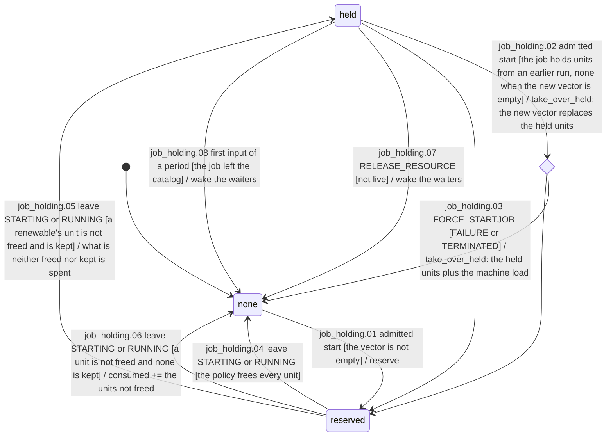

| Id | Source | Trigger | Guard | Effect | Target | Cite | Mark |
| --- | --- | --- | --- | --- | --- | --- | --- |
| job_holding.01 | none | admitted start | the vector is not empty | reserve | reserved | DL-120 |  |
| job_holding.02 | held | admitted start | the job holds units from an earlier run, none when the new vector is empty | take_over_held: the new vector replaces the held units | none, reserved | DL-256 |  |
| job_holding.03 | held | FORCE_STARTJOB | FAILURE or TERMINATED | take_over_held: the held units plus the machine load | reserved | DL-256 |  |
| job_holding.04 | reserved | leave STARTING or RUNNING | the policy frees every unit |  | none | DL-50, DL-120 |  |
| job_holding.05 | reserved | leave STARTING or RUNNING | a renewable's unit is not freed and is kept | what is neither freed nor kept is spent | held | DL-256 |  |
| job_holding.06 | reserved | leave STARTING or RUNNING | a unit is not freed and none is kept | consumed += the units not freed | none | SEM-16, DL-120 |  |
| job_holding.07 | held | RELEASE_RESOURCE | not live | wake the waiters | none | DL-256 |  |
| job_holding.08 | held | first input of a period | the job left the catalog | wake the waiters | none | DL-256 |  |

## runtime_assembly

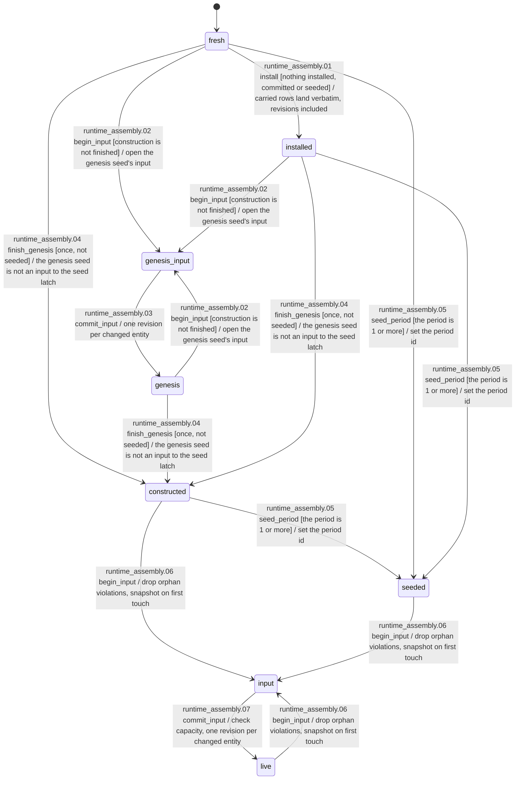

| Id | Source | Trigger | Guard | Effect | Target | Cite | Mark |
| --- | --- | --- | --- | --- | --- | --- | --- |
| runtime_assembly.01 | fresh | install | nothing installed, committed or seeded | carried rows land verbatim, revisions included | installed | period-model ss7 |  |
| runtime_assembly.02 | fresh, genesis, installed | begin_input | construction is not finished | open the genesis seed's input | genesis_input | DL-87 |  |
| runtime_assembly.03 | genesis_input | commit_input |  | one revision per changed entity | genesis | DL-87 |  |
| runtime_assembly.04 | fresh, genesis, installed | finish_genesis | once, not seeded | the genesis seed is not an input to the seed latch | constructed | DL-132 |  |
| runtime_assembly.05 | constructed, fresh, installed | seed_period | the period is 1 or more | set the period id | seeded | period-model ss3.5, DL-132 |  |
| runtime_assembly.06 | constructed, live, seeded | begin_input |  | drop orphan violations, snapshot on first touch | input | DL-87, concurrency-model ss3 |  |
| runtime_assembly.07 | input | commit_input |  | check capacity, one revision per changed entity | live | DL-87, DL-120 |  |

## anchor_head

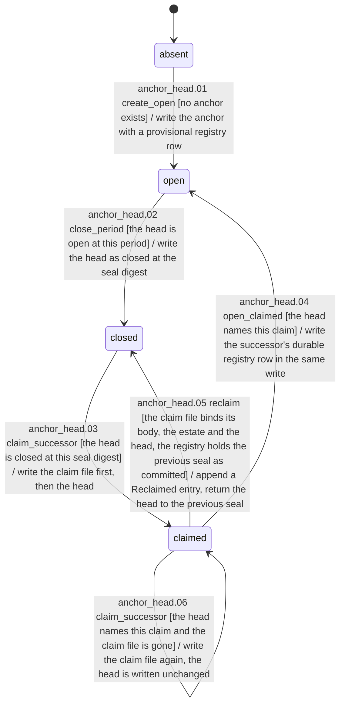

| Id | Source | Trigger | Guard | Effect | Target | Cite | Mark |
| --- | --- | --- | --- | --- | --- | --- | --- |
| anchor_head.01 | absent | create_open | no anchor exists | write the anchor with a provisional registry row | open | period-model ss1.1, ss1.3 |  |
| anchor_head.02 | open | close_period | the head is open at this period | write the head as closed at the seal digest | closed | period-model ss1.3, ss3 |  |
| anchor_head.03 | closed | claim_successor | the head is closed at this seal digest | write the claim file first, then the head | claimed | period-model ss1.3 |  |
| anchor_head.04 | claimed | open_claimed | the head names this claim | write the successor's durable registry row in the same write | open | period-model ss1.3, PR-02c |  |
| anchor_head.05 | claimed | reclaim | the claim file binds its body, the estate and the head, the registry holds the previous seal as committed | append a Reclaimed entry, return the head to the previous seal | closed | period-model ss1.3 |  |
| anchor_head.06 | claimed | claim_successor | the head names this claim and the claim file is gone | write the claim file again, the head is written unchanged | claimed | period-model ss1.3 |  |

## period_row

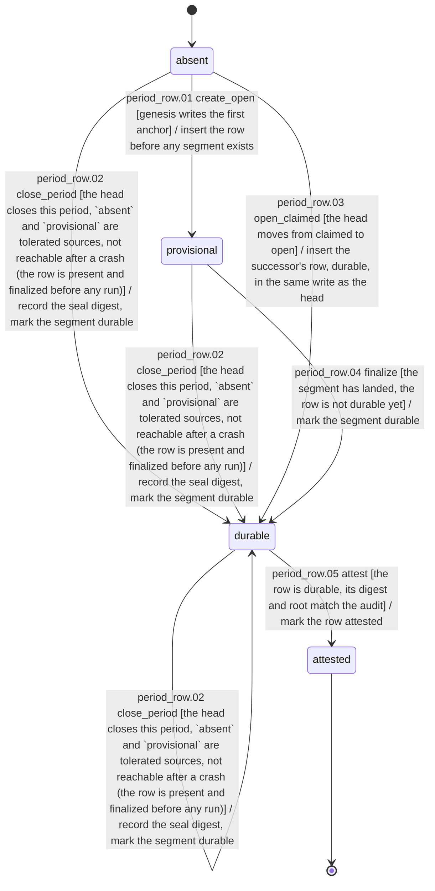

| Id | Source | Trigger | Guard | Effect | Target | Cite | Mark |
| --- | --- | --- | --- | --- | --- | --- | --- |
| period_row.01 | absent | create_open | genesis writes the first anchor | insert the row before any segment exists | provisional | period-model ss1.3, PR-02c |  |
| period_row.02 | absent, durable, provisional | close_period | the head closes this period, `absent` and `provisional` are tolerated sources, not reachable after a crash (the row is present and finalized before any run) | record the seal digest, mark the segment durable | durable | period-model ss1.3, ss3 |  |
| period_row.03 | absent | open_claimed | the head moves from claimed to open | insert the successor's row, durable, in the same write as the head | durable | period-model ss1.3, PR-02c |  |
| period_row.04 | provisional | finalize | the segment has landed, the row is not durable yet | mark the segment durable | durable | period-model ss1.3 |  |
| period_row.05 | durable | attest | the row is durable, its digest and root match the audit | mark the row attested | attested | period-model ss1.3, ss11 |  |

## supervisor_process

Clock: monotonic. Time events: deadman.

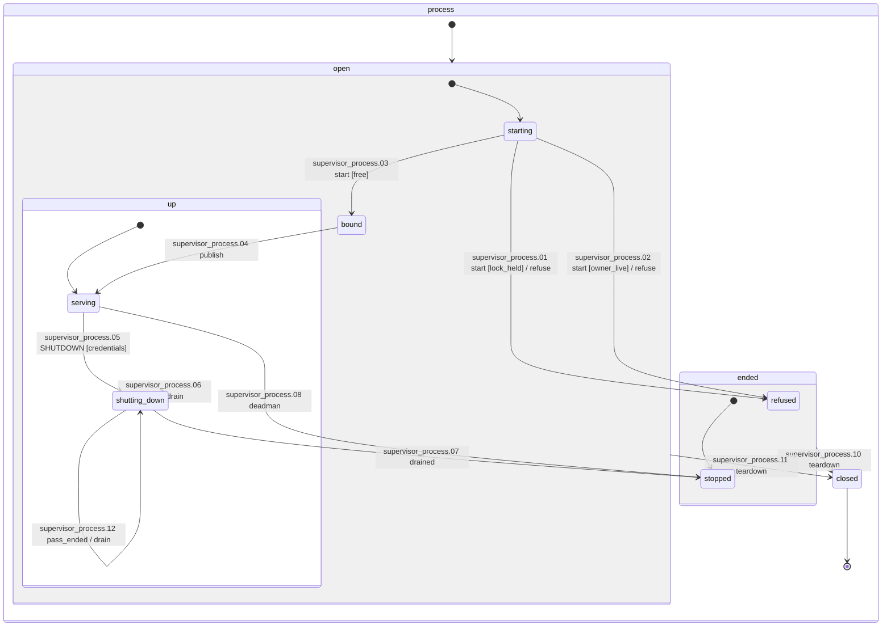

| Id | Source | Event | Guard | Action | Target | Kind | Cite |
| --- | --- | --- | --- | --- | --- | --- | --- |
| supervisor_process.01 | starting | start | lock_held | refuse | refused | external | supervisor-protocol ss5, DL-210 |
| supervisor_process.02 | starting | start | owner_live | refuse | refused | external | supervisor-protocol ss5, DL-210 |
| supervisor_process.03 | starting | start | free |  | bound | external | supervisor-protocol ss5, DL-210 |
| supervisor_process.04 | bound | publish |  | The private socket listens with mode 0600, supervisor.pid is written, and the socket is renamed to supervisor.sock. | serving | external | supervisor-protocol ss5, DL-210, DL-275 |
| supervisor_process.05 | serving | SHUTDOWN | credentials |  | shutting_down | external | supervisor-protocol ss5 SHUTDOWN, DL-80 |
| supervisor_process.06 | up | term |  | drain | shutting_down | external | supervisor-protocol ss5 SHUTDOWN, DL-275, DL-300 |
| supervisor_process.07 | shutting_down | drained |  | The shutdown's wait ended: every wrapper reaped, or the last-resort bound passed and every survivor's group was killed. | stopped | external | supervisor-protocol ss5 SHUTDOWN, DL-48, DL-150 |
| supervisor_process.08 | serving | deadman |  | A deadman is set and no live leaseholder for that many seconds, the supervisor logs the reason first. | stopped | external | supervisor-protocol ss5 The deadman, DL-95 |
| supervisor_process.09 | stopped | term |  | A signal latched during a shutdown that already ran in this loop pass. Nothing runs. |  | internal | supervisor-protocol ss5 SHUTDOWN |
| supervisor_process.10 | ended | teardown |  | Flush replies for up to 2 s, drop every connection, unlink what this incarnation published, close the open lifelines and the lock. | closed | external | supervisor-protocol ss5, DL-210 |
| supervisor_process.11 | open | teardown |  | An error ended startup or the loop: the cleanup of .10, and main exits 1. | closed | external | supervisor-protocol ss5, DL-210 |
| supervisor_process.12 | shutting_down | pass_ended |  | drain | shutting_down | external | supervisor-protocol ss5 SHUTDOWN, DL-300 |
| supervisor_process.13 | serving | SPAWN | credentials |  |  | internal | supervisor-protocol ss5 mutating verbs, DL-80 |
| supervisor_process.14 | serving | SIGNAL | credentials |  |  | internal | supervisor-protocol ss5 mutating verbs, DL-80 |
| supervisor_process.15 | serving | SPAWN | foreign |  |  | refusal wrong_incarnation | supervisor-protocol ss5 mutating verbs, DL-80, DL-229 |
| supervisor_process.16 | serving | SPAWN | stale |  |  | refusal stale_token | supervisor-protocol ss5 mutating verbs, DL-80, DL-229 |
| supervisor_process.17 | serving | SIGNAL | foreign |  |  | refusal wrong_incarnation | supervisor-protocol ss5 mutating verbs, DL-80, DL-229 |
| supervisor_process.18 | serving | SIGNAL | stale |  |  | refusal stale_token | supervisor-protocol ss5 mutating verbs, DL-80, DL-229 |
| supervisor_process.19 | serving | SHUTDOWN | foreign |  |  | refusal wrong_incarnation | supervisor-protocol ss5 mutating verbs, DL-80, DL-229 |
| supervisor_process.20 | serving | SHUTDOWN | stale |  |  | refusal stale_token | supervisor-protocol ss5 mutating verbs, DL-80, DL-229 |
| supervisor_process.21 | process | start | closed |  |  | ignored | statechart-engine ss10 |
| supervisor_process.22 | process | publish | closed |  |  | ignored | statechart-engine ss10 |
| supervisor_process.23 | process | term | closed |  |  | ignored | statechart-engine ss10 |
| supervisor_process.24 | process | drained | closed |  |  | ignored | statechart-engine ss10 |
| supervisor_process.25 | process | pass_ended | closed |  |  | ignored | statechart-engine ss10 |
| supervisor_process.26 | process | deadman | closed |  |  | ignored | statechart-engine ss10 |
| supervisor_process.27 | process | teardown | closed |  |  | ignored | statechart-engine ss10 |
| supervisor_process.28 | process | SPAWN | closed |  |  | ignored | statechart-engine ss10 |
| supervisor_process.29 | process | SIGNAL | closed |  |  | ignored | statechart-engine ss10 |
| supervisor_process.30 | process | SHUTDOWN | closed |  |  | ignored | statechart-engine ss10 |

| State | In | Entry | Exit | Defers | Waits |
| --- | --- | --- | --- | --- | --- |
| process |  |  |  |  |  |
| open | process/phase |  |  |  |  |
| starting | open/phase |  |  |  |  |
| bound | open/phase |  |  |  |  |
| up | open/phase |  |  |  |  |
| serving | up/phase |  |  |  |  |
| shutting_down | up/phase |  |  |  |  |
| ended | process/phase |  |  |  |  |
| stopped | ended/phase |  |  |  |  |
| refused | ended/phase |  |  |  |  |
| closed (final) | process/phase |  |  |  |  |

| Name | Kind | Prose |
| --- | --- | --- |
| lock_held | guard | supervisor.lock is held: another supervisor owns this root (DL-210). |
| owner_live | guard | The lock is taken, but the published socket answers PING within one of three attempts across a second, or the pid record does not prove its owner absent (DL-210). |
| free | guard | The lock is taken and no other owner is proven present: private sockets are swept, the published path is reclaimed, and the private socket is bound (DL-210). |
| credentials | guard | This incarnation, then the current token of an unexpired lease, an integer on the wire (DL-151). ss5 checks nothing else: any connection may present them. The one fence of RENEW, RELEASE, SPAWN, SIGNAL and SHUTDOWN. |
| foreign | guard | The request names no incarnation, or another one: the supervisor it knew is gone, so it must re-acquire and reconcile (DL-80). |
| stale | guard | This incarnation without credentials: the token is not the current one, or the lease is not held. The request is refused stale_token (ss5). With `foreign` and `credentials` this partitions every request. |
| closed | guard | The process is closed. Nothing posts to it then: `_teardown` returns at once and a dropped connection posts nothing. In any other state a fact posted out of order finds no row and raises `UnhandledEvent`. |
| refuse | action | Exit 1: another supervisor owns this root. Teardown then releases only what this process took. |
| drain | action | Run the shutdown's wait: up to 5 s for missing spawn records, TERM each live command group, KILL each after its grace, and KILL every survivor once the longest grace plus 2 s has passed. Lifelines stay open until each wrapper exits (DL-48, DL-150). |

## supervisor_lease

Clock: monotonic. Time events: expire.

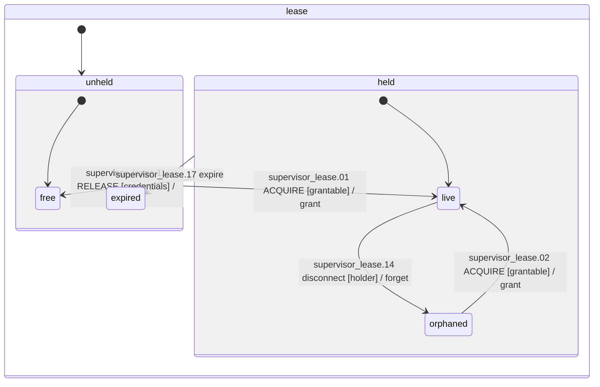

| Id | Source | Event | Guard | Action | Target | Kind | Cite |
| --- | --- | --- | --- | --- | --- | --- | --- |
| supervisor_lease.01 | unheld | ACQUIRE | grantable | grant | live | external | supervisor-protocol ss5 lease verbs, DL-79, DL-150 |
| supervisor_lease.02 | orphaned | ACQUIRE | grantable | grant | live | external | supervisor-protocol ss5 lease verbs, DL-79, DL-150 |
| supervisor_lease.03 | live | ACQUIRE | incumbent | grant |  | internal | supervisor-protocol ss5 lease verbs, DL-79, DL-80 |
| supervisor_lease.04 | live | ACQUIRE | challenger |  |  | refusal lease_held | supervisor-protocol ss5 lease verbs, DL-79 |
| supervisor_lease.05 | lease | ACQUIRE | unnamed |  |  | refusal bad_controller_id | supervisor-protocol ss5 lease verbs, DL-150 |
| supervisor_lease.06 | lease | ACQUIRE | untimed |  |  | refusal internal | supervisor-protocol ss5 lease verbs, DL-300 |
| supervisor_lease.07 | held | RENEW | renewable | extend |  | internal | supervisor-protocol ss5 lease verbs, DL-150 |
| supervisor_lease.08 | held | RENEW | renewal_untimed |  |  | refusal internal | supervisor-protocol ss5 lease verbs, DL-300 |
| supervisor_lease.09 | lease | RENEW | foreign |  |  | refusal wrong_incarnation | supervisor-protocol ss5 incarnation, DL-80, DL-150 |
| supervisor_lease.10 | lease | RENEW | this_incarnation |  |  | refusal stale_token | supervisor-protocol ss5 incarnation, DL-150 |
| supervisor_lease.11 | held | RELEASE | credentials | release | free | external | supervisor-protocol ss5 lease verbs, DL-150 |
| supervisor_lease.12 | lease | RELEASE | foreign |  |  | refusal wrong_incarnation | supervisor-protocol ss5 incarnation, DL-80, DL-150 |
| supervisor_lease.13 | lease | RELEASE | this_incarnation |  |  | refusal stale_token | supervisor-protocol ss5 incarnation, DL-150 |
| supervisor_lease.14 | live | disconnect | holder | forget | orphaned | external | supervisor-protocol ss5 lease verbs, DL-150 |
| supervisor_lease.15 | expired | disconnect | holder | forget |  | internal | supervisor-protocol ss5 lease verbs |
| supervisor_lease.16 | lease | disconnect |  |  |  | ignored | supervisor-protocol ss5 lease verbs |
| supervisor_lease.17 | held | expire |  |  | expired | external | supervisor-protocol ss5 lease verbs |
| supervisor_lease.18 | lease | expire |  |  |  | ignored | supervisor-protocol ss5 lease verbs |

| State | In | Entry | Exit | Defers | Waits |
| --- | --- | --- | --- | --- | --- |
| lease |  |  |  |  |  |
| unheld | lease/phase |  |  |  |  |
| free | unheld/phase |  |  |  |  |
| expired | unheld/phase |  |  |  |  |
| held | lease/phase |  |  |  | expire |
| live | held/phase |  |  |  |  |
| orphaned | held/phase |  |  |  |  |

| Name | Kind | Prose |
| --- | --- | --- |
| grantable | guard | controller_id is a non-empty string, and ttl_s gives a representable expiry. A zero or negative ttl_s gives one too: the lease it grants is due at once, and the next sample expires it (ss5). |
| incumbent | guard | Grantable, with this incarnation and the current token: the incumbent re-keys, and its old token dies (DL-79, DL-80). controller_id is a label, not a credential. The token proves incumbency, not authenticity. Authentication is the same-uid peer-cred gate on accept (ss1). |
| challenger | guard | controller_id is a non-empty string and ttl_s is a number, without this incarnation and the current token: a live lease yields only to its incumbent (DL-79). The expiry is not computed. |
| unnamed | guard | controller_id is not a non-empty string, checked before ttl_s and before any lease state (DL-150). |
| untimed | guard | controller_id is a non-empty string, and ttl_s gives no representable expiry (not a number, inf, nan, 1e20). Nothing changes, not even the token counter (DL-300). |
| renewable | guard | This incarnation and the current token, and ttl_s gives a representable expiry (DL-150, DL-300). |
| renewal_untimed | guard | This incarnation and the current token, and ttl_s gives no representable expiry. Nothing changes (DL-300). |
| foreign | guard | The request names no incarnation, or another one: the supervisor it knew is gone, so it must re-acquire and reconcile (DL-80). |
| this_incarnation | guard | The request names this incarnation (DL-80). |
| credentials | guard | This incarnation, then the current token of an unexpired lease, an integer on the wire (DL-151). ss5 checks nothing else: any connection may present them. The one fence of RENEW, RELEASE, SPAWN, SIGNAL and SHUTDOWN. |
| holder | guard | The dropped connection is the one that holds the lease. |
| grant | action | Mint the next token and write a new record, held on the claimant's connection, with the request's deadline. A re-grant to the same controller_id keeps the dropped-push notice (DL-210). Answer the token, the expiry and the incarnation (DL-80). |
| extend | action | Move the deadline and expires_at to the request's. The connection is not adopted, so an orphaned lease stays orphaned and its pushes keep dropping until an ACQUIRE. Answer the expiry. |
| release | action | Drop the record, and answer ok. |
| forget | action | Forget the holder's connection: pushes drop until the holder re-ACQUIREs, and any controller may ACQUIRE an orphaned lease. That lets a crashed engine's resume re-acquire without waiting out the TTL. It is sound because the kernel closes this AF_UNIX fd only when the holder process is gone, kill -9 included, or when the holder closes it itself. A non-local transport would break that (ss5). |

## supervisor_client

Clock: logical.

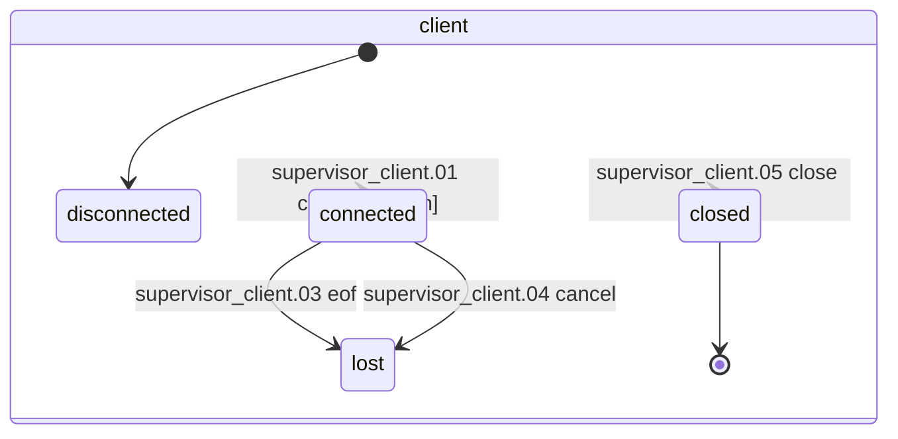

| Id | Source | Event | Guard | Action | Target | Kind | Cite |
| --- | --- | --- | --- | --- | --- | --- | --- |
| supervisor_client.01 | client | connect | down | A new epoch: the tier closes a writer the lost connection kept and cancels a reader still running, installs the new writer, a fresh lost event and its reader, then PINGs. A reconnect re-ACQUIREs when a token is held. | connected | external | supervisor-protocol ss5, DL-48, DL-79 |
| supervisor_client.02 | connected | connect |  | Supersede: the tier closes the live writer and cancels its reader, then installs the new epoch as for row .01. |  | internal | DL-48 |
| supervisor_client.03 | connected | eof |  | The tier has set the epoch's lost event and failed the pending request, the next request reconnects. | lost | external | supervisor-protocol ss5, runner-design ss7, DL-48 |
| supervisor_client.04 | connected | cancel |  | Poisoned: the tier has failed the pending request and closed the writer, since the stream has no correlation ids and the reply in flight could reach the next request. | lost | external | DL-48 |
| supervisor_client.05 | client | close | open |  | closed | external | DL-48 |
| supervisor_client.06 | lost | cancel |  | Poisoned after the loss: EOF failed the pending request before the cancelled request resumed. The tier closes the writer the loss kept, so nothing more is written to that stream. |  | internal | DL-48 |
| supervisor_client.07 | lost | eof |  | The reader of a poisoned epoch meets the EOF its own poison caused: the epoch is already lost. |  | ignored | statechart-engine ss10 |
| supervisor_client.08 | client | connect | over |  |  | ignored | statechart-engine ss10 |
| supervisor_client.09 | client | eof | over |  |  | ignored | statechart-engine ss10 |
| supervisor_client.10 | client | cancel | over |  |  | ignored | statechart-engine ss10 |
| supervisor_client.11 | client | close | over |  |  | ignored | statechart-engine ss10 |

| State | In | Entry | Exit | Defers | Waits |
| --- | --- | --- | --- | --- | --- |
| client |  |  |  |  |  |
| disconnected | client/phase |  |  |  |  |
| connected | client/phase |  |  |  |  |
| lost | client/phase |  |  |  |  |
| closed (final) | client/phase |  |  |  |  |

| Name | Kind | Prose |
| --- | --- | --- |
| down | guard | No connection is live: the client is disconnected, before its first connect, or lost. A connected client takes `supervisor_client.02` instead, and a closed one posts nothing. |
| open | guard | The client is not closed yet: from disconnected, connected or lost, close cancels the renewal, reader and LIST tasks, then closes the writer. |
| over | guard | The client is closed. Nothing posts to it then: a second close posts nothing, a connection that completes after the close is closed unposted, and the EOF and the cancel that the close itself causes do their transport work with no post. Before the first connect, an EOF or a cancel finds no row and raises `UnhandledEvent`. |

## host

Clock: logical.

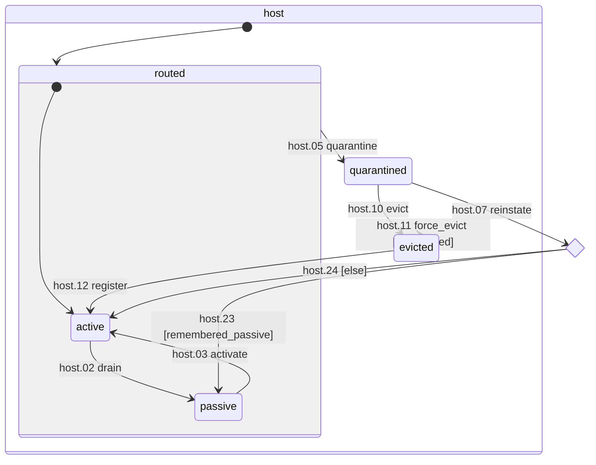

| Id | Source | Event | Guard | Action | Target | Kind | Cite |
| --- | --- | --- | --- | --- | --- | --- | --- |
| host.01 | active | activate |  | none: the row does not move and no revision moves |  | internal | concurrency-model ss8 |
| host.02 | active | drain |  | new effects are held, running work continues | passive | external | concurrency-model ss8, CM-13 |
| host.03 | passive | activate |  | held starts dispatch again | active | external | concurrency-model ss8 |
| host.04 | passive | drain |  | none: the row does not move and no revision moves |  | internal | concurrency-model ss8 |
| host.05 | routed | quarantine |  | The leader's renewal failed five times in a row. The row remembers the state it interrupts. | quarantined | external | concurrency-model ss7, ss8, DL-97, DL-291 |
| host.06 | quarantined | quarantine |  | none: repeated unreachability is one fact |  | internal | DL-97 |
| host.07 | quarantined | reinstate |  | The host answered again: put back the state quarantine interrupted, and forget it. | remembered | external | concurrency-model ss8, DL-97 |
| host.08 | active | reinstate |  | none: nothing to put back |  | internal | concurrency-model ss8, DL-111 |
| host.09 | passive | reinstate |  | none: nothing to put back |  | internal | concurrency-model ss8, DL-111 |
| host.10 | quarantined | evict |  | The gate has proved the bound: a deadman, a contact, and silence past deadman + kill + skew. generation += 1, forced_by = none, forget the interrupted state. | evicted | external | concurrency-model ss8 preconditions 1-3, DL-151 |
| host.11 | host | force_evict | not_evicted | The gate has the attribution: claimed_actor names who asks. generation += 1, forced_by = the actor, forget the interrupted state. | evicted | external | concurrency-model ss8, DL-111, DL-151 |
| host.12 | evicted | register |  | The relay presents the current generation and has self-fenced. Its held jobs run as new runs with new effect ids. No code posts it. | active | external (spec-only) | concurrency-model ss8 (eviction is fenced on return), period-model ss3.3 |
| host.13 | quarantined | activate |  |  |  | refusal host_quarantined | concurrency-model ss8, concurrency-model ss7 |
| host.14 | quarantined | drain |  |  |  | refusal host_quarantined | concurrency-model ss8, concurrency-model ss7 |
| host.15 | routed | evict |  |  |  | refusal host_not_quarantined | concurrency-model ss8 precondition 1, DL-94 |
| host.16 | evicted | activate |  |  |  | refusal host_evicted | concurrency-model ss8 |
| host.17 | evicted | drain |  |  |  | refusal host_evicted | concurrency-model ss8 |
| host.18 | evicted | quarantine |  |  |  | refusal host_evicted | concurrency-model ss8, CM-12 |
| host.19 | evicted | reinstate |  |  |  | refusal host_evicted | concurrency-model ss8, CM-12 |
| host.20 | evicted | evict |  |  |  | refusal host_already_evicted | concurrency-model ss8 |
| host.21 | evicted | force_evict |  |  |  | refusal host_already_evicted | concurrency-model ss8 |
| host.22 | host | register |  | Re-registration refreshes identity and keeps the state. No tier path posts it: `register_host` on an existing row starts nothing. |  | ignored | concurrency-model ss8, DL-94 |

| Id | Choice | Guard | Action | Target |
| --- | --- | --- | --- | --- |
| host.23 | remembered | remembered_passive |  | passive |
| host.24 | remembered | else |  | active |

| State | In | Entry | Exit | Defers | Waits |
| --- | --- | --- | --- | --- | --- |
| host |  |  |  |  |  |
| routed | host/routing |  |  |  |  |
| active | routed/routing |  |  |  |  |
| passive | routed/routing |  |  |  |  |
| quarantined | host/routing |  |  |  |  |
| evicted | host/routing |  |  |  |  |

| Name | Kind | Prose |
| --- | --- | --- |
| not_evicted | guard | The host is not evicted. `evicted` refuses a forced eviction with its own row, so the walk reaches the root only from a routed or a quarantined host (ss8: force skips the proof, not the state). |
| remembered_passive | guard | Quarantine interrupted `passive`: the row remembers it, and a drained host that answers again stays drained (DL-97). |

## admission

Clock: logical.

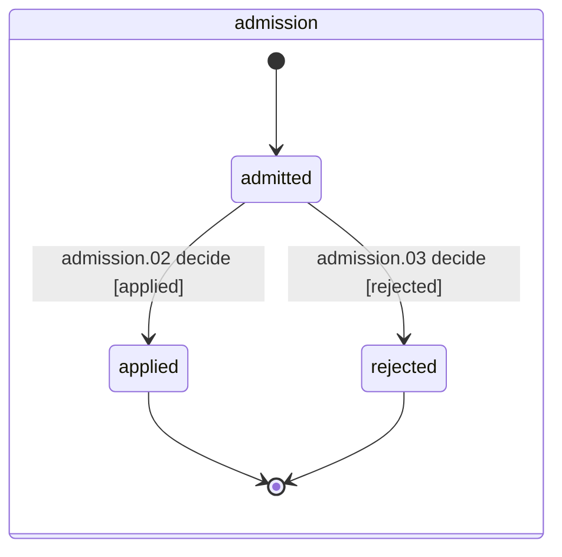

| Id | Source | Event | Guard | Action | Target | Kind | Cite |
| --- | --- | --- | --- | --- | --- | --- | --- |
| admission.02 | admitted | decide | applied | The decision line, with the outbox entries it implies. | applied | external | concurrency-model ss4 steps 5-7, DL-118 |
| admission.03 | admitted | decide | rejected | The decision line, with its stored code. | rejected | external | concurrency-model ss4, DL-235, DL-272, DL-320 |
| admission.09 | admitted | input | other | Refuse request_id_reused, with no decision to carry. |  | refusal request_id_reused | concurrency-model ss4 step 2, DL-217 |
| admission.10 | admitted | input | same | The index raises an EngineError: a second writer is applying inputs, or steps 5-7 yielded. The engine stops. |  | internal | concurrency-model ss4 step 2 |
| admission.11 | admission | decide | decided | A decision is final: the index answers an exact retry from the stored decision, and refuses a reused id with request_id_reused carrying it, before any post (DL-217, CM-05). It forgets the instance in the call that made it final. No tier path posts this row. |  | ignored | statechart-engine ss10 |
| admission.12 | admission | input | decided | A decision is final: the index answers an exact retry from the stored decision, and refuses a reused id with request_id_reused carrying it, before any post (DL-217, CM-05). It forgets the instance in the call that made it final. No tier path posts this row. |  | ignored | statechart-engine ss10 |

| State | In | Entry | Exit | Defers | Waits |
| --- | --- | --- | --- | --- | --- |
| admission |  |  |  |  |  |
| admitted | admission/window |  |  |  |  |
| applied (final) | admission/window |  |  |  |  |
| rejected (final) | admission/window |  |  |  |  |

| Name | Kind | Prose |
| --- | --- | --- |
| applied | guard | The decision is `applied`: the gate passed, or a replayed durable decision says applied. |
| rejected | guard | The decision is `rejected`: a precondition, the stale-completion gate or a host guard rejected the input, the input was quarantined, or a replayed durable decision says rejected. |
| same | guard | The input carries the fingerprint the attempt was admitted under. |
| other | guard | The input carries another fingerprint than the attempt's. |
| decided | guard | The instance rests in a final state. Nothing posts to it then: the index forgets the instance in the call that made it final, and answers an input for a decided id from the stored decision before any post (DL-217, CM-05). |

## effect

Clock: logical.

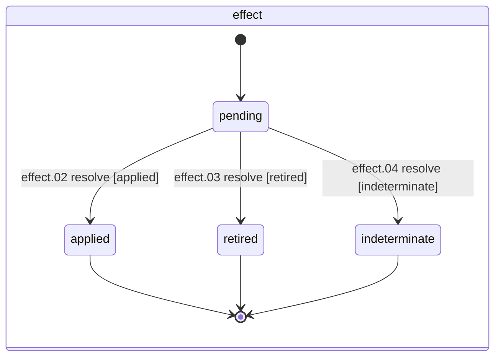

| Id | Source | Event | Guard | Action | Target | Kind | Cite |
| --- | --- | --- | --- | --- | --- | --- | --- |
| effect.02 | pending | resolve | applied | Dispatched, or resume found the run on the host, or a kill landed, or a replayed effect_result, or a carried execution. | applied | external | concurrency-model ss5, DL-96, period-model ss3.5 |
| effect.03 | pending | resolve | retired | Superseded at dispatch, or resume finds that the run it would kill has exited. | retired | external | concurrency-model ss5, DL-111, DL-232 |
| effect.04 | pending | resolve | indeterminate | Resume finds no status and no live wrapper for a kill. An exact retry answers outcome_unavailable. | indeterminate | external | concurrency-model ss5, CM-06, DL-111 |
| effect.05 | effect | resolve | over | An outcome is final: the outbox refuses a second one with an EngineError before any post, and forgets the instance in the call that made it final (DL-295). No tier path posts this row. |  | ignored | statechart-engine ss10 |

| State | In | Entry | Exit | Defers | Waits |
| --- | --- | --- | --- | --- | --- |
| effect |  |  |  |  |  |
| pending | effect/outcome |  |  |  |  |
| applied (final) | effect/outcome |  |  |  |  |
| retired (final) | effect/outcome |  |  |  |  |
| indeterminate (final) | effect/outcome |  |  |  |  |

| Name | Kind | Prose |
| --- | --- | --- |
| applied | guard | The outcome's state is `applied`. |
| retired | guard | The outcome's state is `retired`. |
| indeterminate | guard | The outcome's state is `indeterminate`. |
| over | guard | The effect rests in a final state. Nothing posts to it then: the outbox forgets the instance in the call that made it final, and refuses a second outcome before any post (DL-295). In `pending` an outcome that no row's guard takes raises `UnhandledEvent`. |

## subscription

Clock: logical.

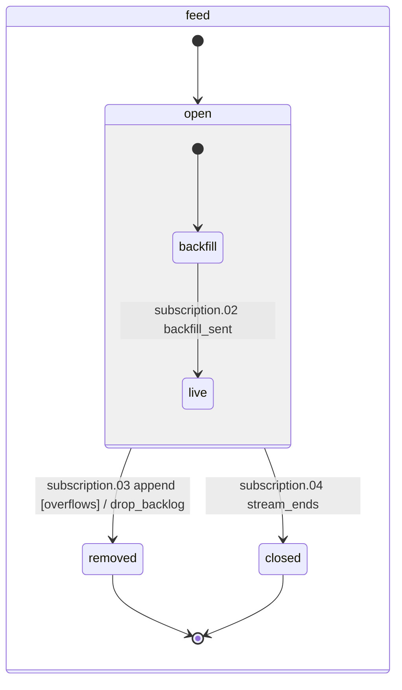

| Id | Source | Event | Guard | Action | Target | Kind | Cite |
| --- | --- | --- | --- | --- | --- | --- | --- |
| subscription.02 | backfill | backfill_sent |  | The handler posts it once the backfill went out without a refusal, with no `since` there is nothing to send. The handler then sends the queued live records past the seam. | live | external | control-protocol ss5, DL-45, DL-135 |
| subscription.03 | open | append | overflows | drop_backlog | removed | external | control-protocol ss5, DL-267 |
| subscription.04 | open | stream_ends |  | The client is gone, a refusal went on the stream, the lineage was lost, or the handler was cancelled. The journal has already taken the feed out of its fan-out. | closed | external | control-protocol ss5, PR-03, period-model ss11 |
| subscription.05 | open | append | fits | enqueue |  | internal | control-protocol ss5, DL-267 |
| subscription.06 | feed | append | over |  |  | ignored | statechart-engine ss10 |
| subscription.07 | feed | backfill_sent | over |  |  | ignored | statechart-engine ss10 |
| subscription.08 | feed | stream_ends | over |  |  | ignored | statechart-engine ss10 |

| State | In | Entry | Exit | Defers | Waits |
| --- | --- | --- | --- | --- | --- |
| feed |  |  |  |  |  |
| open | feed/phase |  |  |  |  |
| backfill | open/phase |  |  |  |  |
| live | open/phase |  |  |  |  |
| removed (final) | feed/phase |  |  |  |  |
| closed (final) | feed/phase |  |  |  |  |

| Name | Kind | Prose |
| --- | --- | --- |
| fits | guard | The record fits: the backlog is empty, or the backlog plus the record stays within the budget. An empty backlog takes one record of any size, so one record larger than the budget delays the feed and does not remove it (DL-267). |
| overflows | guard | The record does not fit: the backlog holds a record, and the backlog plus this one would pass the budget (DL-267). |
| over | guard | The feed rests in `removed` or `closed`. Nothing posts to it then: the journal forgets the instance in the call that made it final. In `live`, a second `backfill_sent` finds no row and raises `UnhandledEvent`. |
| enqueue | action | Queue the record and count its bytes against the budget. Memory only: the queue has no count limit, so this never blocks. |
| drop_backlog | action | Record why, and drop the backlog. The journal then takes the feed out of its fan-out and, once every other feed has the record, tells the owner, which ends the stream (DL-267). |

## seal_boundary

Clock: logical.

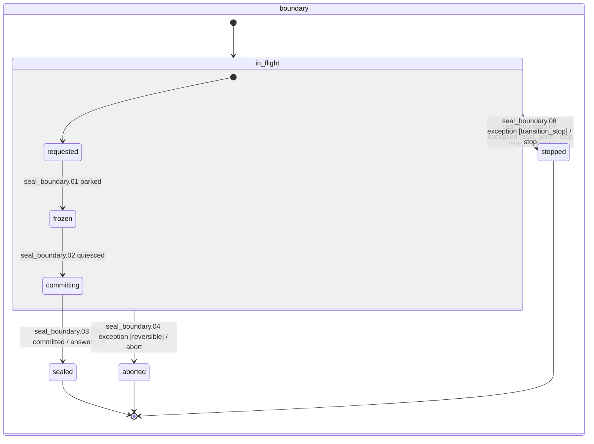

| Id | Source | Event | Guard | Action | Target | Kind | Cite |
| --- | --- | --- | --- | --- | --- | --- | --- |
| seal_boundary.01 | requested | parked |  | The barrier parked: admission is frozen and FW polls are parked (ss6 step 2). | frozen | external | period-model ss6 step 2, ss8, PR-28c |
| seal_boundary.02 | frozen | quiesced |  | The cutoff is chosen, drained and quiescent, and the supervisor proof holds (ss6 steps 3-7, ss8). `commit_boundary` runs next (step 8). | committing | external | period-model ss6 steps 3-8, PR-27 |
| seal_boundary.03 | committing | committed |  | answer | sealed | external | period-model ss7 |
| seal_boundary.04 | in_flight | exception | reversible | abort | aborted | external | period-model ss7, PR-28b |
| seal_boundary.05 | in_flight | exception | fence_lost | stop | stopped | external | period-model ss7, DL-101, PR-28b |
| seal_boundary.06 | in_flight | exception | in_doubt | stop_in_doubt | stopped | external | DL-274 |
| seal_boundary.07 | in_flight | exception | past_ponr | stop | stopped | external | period-model ss7 |
| seal_boundary.08 | in_flight | exception | transition_stop | stop | stopped | external | concurrency-model ss4, DL-292 |
| seal_boundary.09 | boundary | parked | over |  |  | ignored | statechart-engine ss10 |
| seal_boundary.10 | boundary | quiesced | over |  |  | ignored | statechart-engine ss10 |
| seal_boundary.11 | boundary | committed | over |  |  | ignored | statechart-engine ss10 |
| seal_boundary.12 | boundary | exception | over |  |  | ignored | statechart-engine ss10 |

| State | In | Entry | Exit | Defers | Waits |
| --- | --- | --- | --- | --- | --- |
| boundary |  |  |  |  |  |
| in_flight | boundary/phase |  |  |  |  |
| requested | in_flight/phase |  |  |  |  |
| frozen | in_flight/phase |  |  |  |  |
| committing | in_flight/phase |  |  |  |  |
| sealed (final) | boundary/phase |  |  |  |  |
| aborted (final) | boundary/phase |  |  |  |  |
| stopped (final) | boundary/phase |  |  |  |  |

| Name | Kind | Prose |
| --- | --- | --- |
| past_ponr | guard | The exception is `BoundaryFailStop`: the `seal` append may have begun, so the outcome is unknown and recovery decides (PR-28d). The engine exits 4. Checked first. |
| transition_stop | guard | The exception is `TransitionStop`: under `--on-transition-violation stop`, an input committed inside the interval recorded a violation, and its decision is durable. That stop is the operator's chosen halt. The engine exits 5 (DL-292, DL-295). |
| fence_lost | guard | Neither stop type, and the fence is lost: a leader that cannot prove it leads does not reopen admission (DL-101, PR-28b). Checked before DL-274's flags. |
| in_doubt | guard | Neither stop type, the fence intact, and memory or the WAL in doubt: an attempt admitted during the seal is not fully applied, an engine-made input the drain could not admit would be lost, or a WAL append is unfinished (DL-274). |
| reversible | guard | Neither stop type, the fence intact, and nothing in doubt: every other exception before the `seal` append. A refusal before the freeze, a phase-2 refusal, the drain's timeout, a late input (`seal_input_after_cutoff`) and a failed sidecar write are among them (PR-28b). |
| over | guard | The boundary rests in a final state. Nothing posts to it then: an aborted boundary is forgotten at once, a sealed one once the answer has had its turns, and a stop ends the engine. In flight, an event out of order finds no row and raises `UnhandledEvent`. |
| answer | action | Answer the request with the committed boundary, then raise `PeriodSealed`: the engine exits 3 (PR-30b). |
| abort | action | Run `abort_boundary` and fail the request with the exception. The abort clears the sealing flag, reopens control admission, restarts scheduler admission and unparks FW polls. It touches no row, and C1 carries on (PR-28b). |
| stop | action | Re-raise without an abort. The request is not answered. |
| stop_in_doubt | action | Note which fact stopped the seal, then re-raise without an abort. Neither the request nor an attempt whose answer was owed is answered. Resume repairs the WAL tail and rebuilds from the WAL (DL-274). |
